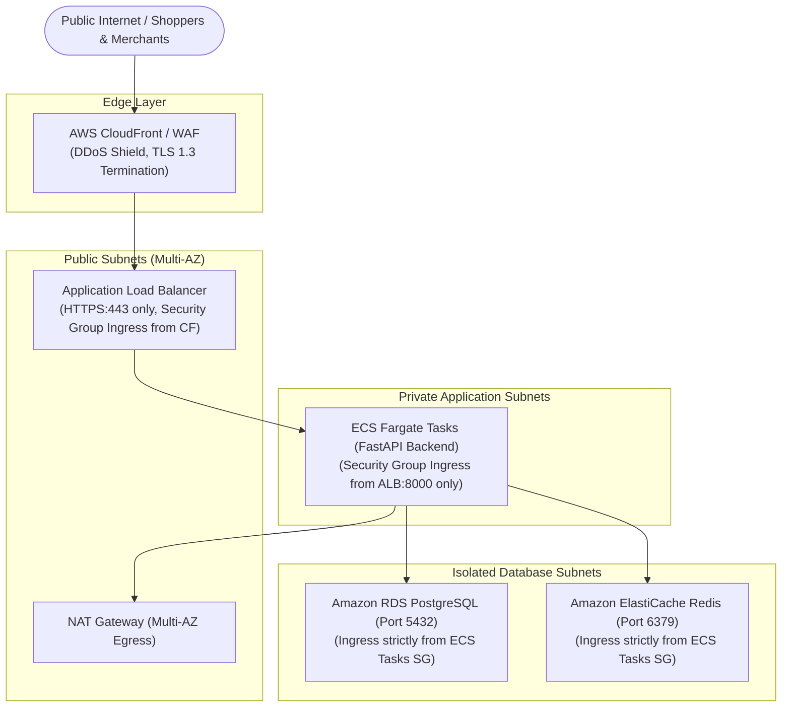

# Network Topology and Egress Security Architecture

## 1. Network Perimeter & Ingress Architecture

All hosted FashXStudio components operate within a dedicated Amazon VPC. No database or container compute instance is ever assigned a public IPv4 address.



### Ingress Invariants:
1. **CloudFront to ALB**: ALB security groups permit inbound HTTP/HTTPS traffic strictly from AWS CloudFront IP prefix lists using a custom verified header (`X-Origin-Verify`). Direct connections bypassing CloudFront are dropped.
2. **ALB to ECS**: ECS tasks accept incoming connections on port 8000 exclusively from the ALB security group.
3. **Database Subnets**: RDS and Redis subnets have no internet gateway routes. Inbound traffic is accepted solely from the ECS application security group on ports 5432 and 6379 respectively.

---

## 2. Egress Allowlist and Firewall Rules

To protect against command-and-control exfiltration, unauthorized scraping, and supply-chain attacks, backend tasks operate under an egress firewall with an explicit allowlist:

| Destination | Destination Port | Protocol | Purpose |
| :--- | :--- | :--- | :--- |
| **AWS S3 Gateway Endpoint** | 443 | HTTPS | Private object storage read/write |
| **AWS Secrets Manager Endpoint** | 443 | HTTPS | Secret fetching during container boot |
| **Supabase Auth API** | 443 | HTTPS | JWKS key rotation & token validation |
| **FASHN Inference API** (`api.fashn.ai`) | 443 | HTTPS | Virtual try-on inference dispatch |
| **Sentry Ingest Host** | 443 | HTTPS | Exception tracking & telemetry |
| **Allowed Retailer Hosts** | 443 | HTTPS | Catalog ingestion & product verification |

All other outbound destination ports and arbitrary IP ranges are dropped at the NAT gateway / network firewall level.

---

## 3. Server-Side Request Forgery (SSRF) Prevention

The visual shopping and catalog ingestion modules allow merchants and shoppers to submit product URLs and images. To prevent SSRF attacks against internal cloud infrastructure:

1. **Host Whitelist Validation**: The application strictly validates outbound HTTP targets against `FASHX_RETAILER_ALLOWED_HOSTS` (`backend/fashx/core/settings.py`). Unlisted domains are rejected before initiating DNS lookups.
2. **Private IP Address Filtering**: Before initiating an outbound HTTP fetch, the target IP address is resolved and validated. Outbound connections to private or non-routable IP blocks are blocked:
   - `10.0.0.0/8` (RFC 1918 Private)
   - `172.16.0.0/12` (RFC 1918 Private)
   - `192.168.0.0/16` (RFC 1918 Private)
   - `127.0.0.0/8` (Loopback)
   - `169.254.169.254/32` (AWS Instance Metadata Service - IMDS)
3. **IMDSv2 Enforced**: ECS container instances enforce AWS IMDSv2 with token hops restricted to 1 (`HttpTokens=required`, `HttpPutResponseHopLimit=1`), preventing containers from reading underlying EC2/host metadata.

---

## 4. Declarative Egress Policy (Staging / Production Reference)

```yaml
environment: staging

inbound:
  public_api:
    protocols:
      - HTTPS
    ports:
      - 443

  database:
    public_access: false

  redis:
    public_access: false

outbound:
  allowed_services:
    - name: postgres
      destination: staging-private-database
      port: 5432

    - name: redis
      destination: staging-private-redis
      port: 6379

    - name: object-storage
      destination: staging-object-storage-endpoint
      port: 443

  external_providers:
    - name: fashn
      enabled: false
      reason: "Staging provider approval pending"

    - name: error-monitoring
      enabled: true
      destination: approved-monitoring-endpoint
      port: 443

  default_action: deny
```

---

## 5. Network Acceptance Verification Checklist

- [ ] Public API responds over HTTPS.
- [ ] Database port is not publicly reachable.
- [ ] Redis port is not publicly reachable.
- [ ] API cannot reach another environment's private database.
- [ ] Worker can reach only approved external providers.
- [ ] Unapproved image URLs are rejected.
- [ ] Redirects to private IPs are rejected.
- [ ] Mobile application has no direct database or Redis access.
