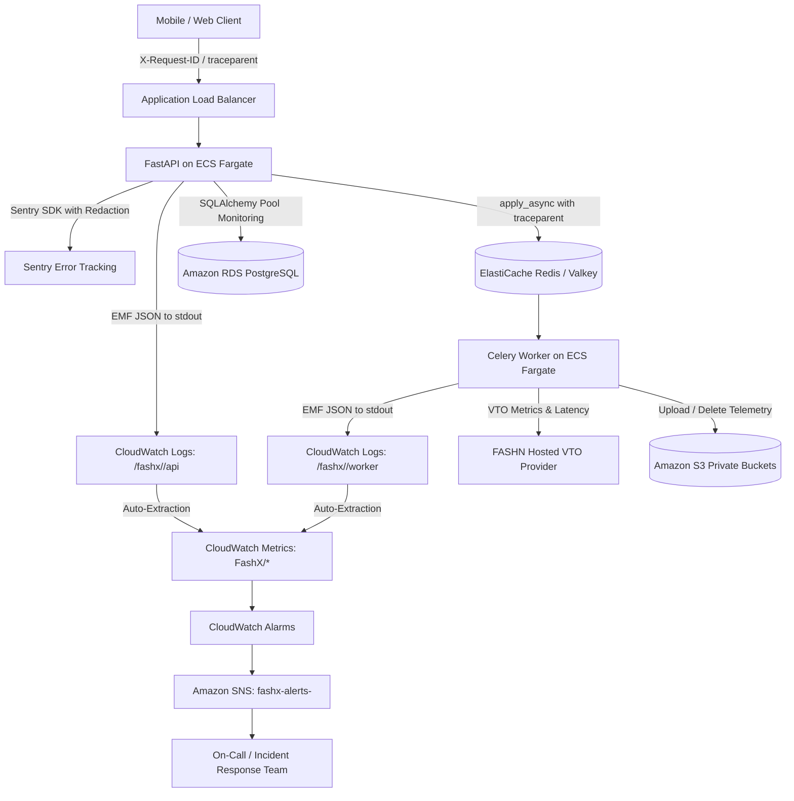

# Observability Architecture Specification

## 1. Executive Summary

FashXStudio implements an AWS-native observability foundation with OpenTelemetry and CloudWatch Embedded Metric Format (EMF) instrumentation in the AWS Mumbai region (`ap-south-1`).

Rather than managing self-hosted Prometheus, Grafana, Loki, or Jaeger infrastructure during early releases, the platform uses:
- **Amazon CloudWatch Logs**: Centralized JSON structured log aggregation across ECS Fargate tasks.
- **CloudWatch Embedded Metric Format (EMF)**: Synchronous metric emission to stdout parsed automatically by CloudWatch without an external daemon.
- **Sentry**: Distributed application exception aggregation, release health, and stack traces.
- **W3C Trace Context**: Cross-service request correlation between API, Celery message broker, and background workers.
- **Amazon CloudWatch Alarms & SNS**: Incident notification channels segregated by environment.

## 2. Core Architectural Components

| Component | Technology | Target Service / Destination | Purpose |
| :--- | :--- | :--- | :--- |
| **Application Logs** | `backend/fashx/core/logging.py` | Amazon CloudWatch Logs | Single-line structured JSON logs with centralized context and redaction. |
| **Operational Metrics** | `backend/fashx/core/metrics.py` | CloudWatch EMF (`FashX/*`) | High-resolution metric emission without running a separate metrics agent. |
| **Distributed Tracing** | `backend/fashx/core/tracing.py` | W3C `traceparent` headers | Trace propagation from inbound HTTP requests into Celery background tasks. |
| **Error Tracking** | Sentry SDK (`observability.py`) | Sentry SaaS / AWS Secrets | Exception capture with strict `before_send` credential and PII sanitization. |
| **Database Telemetry** | RDS CloudWatch + SQLAlchemy Pool | CloudWatch (`FashX/Database`) | Connection pool checkout, query latency, CPU, and free storage tracking. |
| **Queue & Worker Telemetry**| Celery Signals + Heartbeat | CloudWatch (`FashX/Queues`, `FashX/Workers`) | Queue depth, task completion, retry rate, dead-letter count, and heartbeats. |
| **Object Storage Telemetry**| S3 Storage Adapter (`s3.py`) | CloudWatch (`FashX/Storage`) | Upload/download throughput, operation latency, and erasure failures. |
| **VTO Provider Telemetry** | FASHN API Adapter (`fashn_api.py`) | CloudWatch (`FashX/VTO`) | Inference latency, rate limits (429), auth failures (401), and estimated spend. |
| **Alerts & Operations** | CloudWatch Alarms + SNS | Email / Operations Channels | Automated paging for latency degradation, 5xx spikes, and dependency failures. |
| **Operations Dashboard** | CloudWatch Dashboards | `FashXStudio-Production-Operations` | Central operational single pane of glass. |
