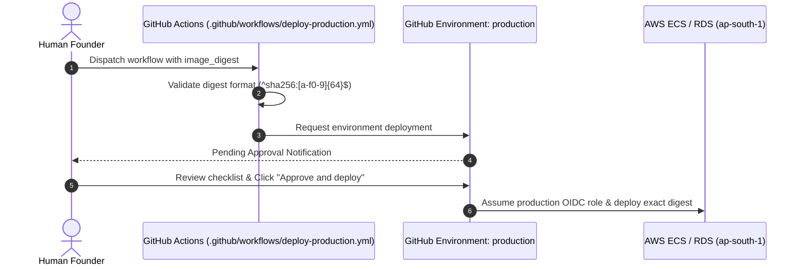

# Production Release Approval Policy

## 1. Objective and Authority

Production releases in FashXStudio directly serve merchants, consumers, and handle payment-adjacent affiliate metadata. In accordance with `AGENTS.md` Rule 12, automated pipelines and coding agents are strictly forbidden from merging or deploying to production directly.

Only the human founder / designated release authority possesses the authority to approve a production release.

## 2. Gate Requirements for Approval

Before approving a production deployment in GitHub Actions, the following criteria must be satisfied:

1. **Immutable Provenance**:
   - The candidate image must be referenced by its SHA-256 digest (`sha256:...`).
   - The digest must correspond to a commit that passed all CI quality gates on `main`.
2. **Staging Validation**:
   - The exact digest must have operated in `staging` with zero critical errors.
   - Staging smoke tests must have succeeded completely.
3. **Database Compatibility**:
   - Any database migration included in the release must follow the expand-contract pattern.
   - Destructive migrations (table drops, column renames without views) are strictly prohibited during normal rolling updates.
4. **Maintenance Windows**:
   - Releases should be timed to avoid peak Indian e-commerce traffic hours.
   - The approving founder must monitor deployment execution and initial telemetry for at least 30 minutes following release.

## 3. Approval Flow in GitHub Actions

