# Release Promotion and Artifact Flow

## 1. Build Once, Promote Everywhere

FashXStudio enforces the immutable container pattern. Container images are compiled and verified once at the time of commit validation and promoted through environments without rebuilding.

```mermaid
flowchart LR
    Commit["Git Commit (PR Approved)"]
    CI["CI: Build & Scan (Trivy)"]
    Registry["Amazon ECR Registry\nfashx:${SHA}"]
    DevDeploy["Deploy to Dev ECS"]
    StagingDeploy["Deploy to Staging ECS\n(Smoke & Migration Test)"]
    Gate["Founder Gate (PR & Approval)"]
    ProdDeploy["Deploy to Prod ECS\n(Zero Downtime Rolling)"]

    Commit --> CI
    CI --> Registry
    Registry --> DevDeploy
    DevDeploy --> StagingDeploy
    StagingDeploy --> Gate
    Gate --> ProdDeploy
```

1. **Deterministic Tagging**: Every build artifact is tagged with the full Git SHA (`fashx:${GITHUB_SHA}`). Mutable tags like `:latest` are forbidden in production deployments.
2. **Security Preflight**: Before any image is pushed to the ECR registry or scheduled for promotion, it must clear vulnerability scanning (Trivy: 0 Critical / High CVEs).

---

## 2. Expand-and-Contract Schema Migration Flow

Because production updates must execute with zero downtime and allow safe rollback without data loss, all database schema modifications follow the **Expand and Contract** paradigm:

### Phase 1: Expand (Non-breaking)
- Add new tables, nullable columns, or view definitions.
- Existing running application code remains fully compatible with the new schema.
- Alembic migration runs: `alembic upgrade head`.

### Phase 2: Application Promotion
- Deploy updated application tasks that write to both old and new schema structures (dual-writing) or read from the new structure with fallback.
- Verify health checks and smoke tests.

### Phase 3: Contract (Cleanup)
- Once the application release is stable across multiple release cycles, a follow-up migration removes deprecated columns or enforces strict `NOT NULL` constraints.

---

## 3. Stage-by-Stage Promotion Protocol

### Step 1: Promotion to Shared Development
- **Trigger**: Automatic on merge of feature branches to `main` (or recovery branch).
- **Checks**: All unit and integration tests pass; Docker build succeeds.
- **Verification**: Service stability check (`aws ecs wait services-stable`).

### Step 2: Promotion to Staging
- **Trigger**: Manual dispatch or creation of a Release Candidate tag (`v*.*.*-rc*`).
- **Pre-deployment Verification**:
  1. Alembic forward migration check.
  2. JWKS auth endpoint handshake.
  3. Private S3 bucket presigned URL generation test.
- **Post-deployment Verification**:
  1. Automated smoke suite (`scripts/release/smoke.py`).
  2. Visual shopping & try-on workflow qualification.

### Step 3: Promotion to Production
- **Trigger**: Explicit Founder Approval on GitHub (`release` gate).
- **Rule 12 Compliance**: Never push or merge to main directly. Only the human founder merges after CI is green.
- **Rollout Strategy**: ECS Rolling Update with minimum healthy percent = 100% and maximum percent = 200%. New tasks must pass `/healthz` checks before older tasks are drained and terminated.
