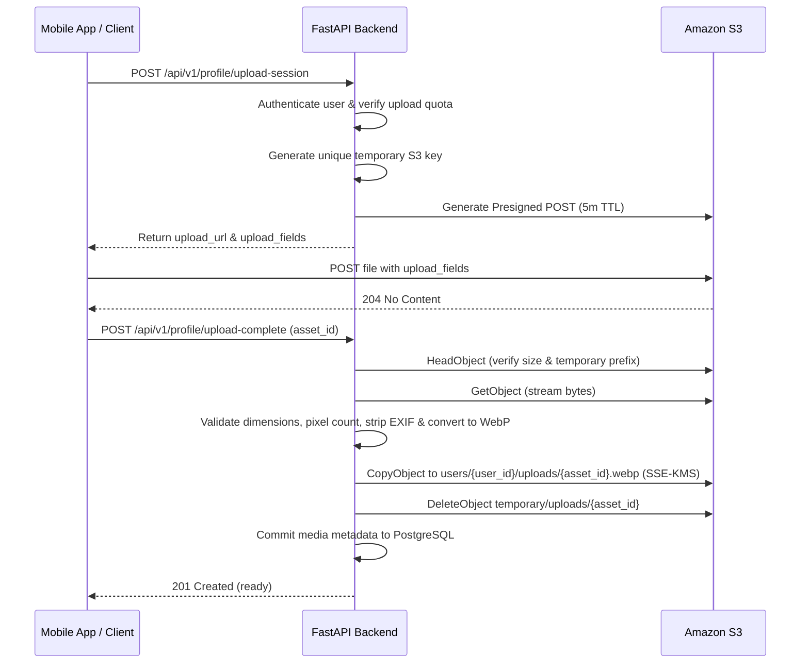

# FashXStudio — Presigned URL Policy & Lifecycle (Phase 03.4)

## 1. Principles
1. **Bearer Credentials**: Presigned URLs grant temporary access to anyone holding the URL. They must never be logged, included in analytics payloads, or stored in PostgreSQL.
2. **Short-Lived Expiration**: Presigned URLs expire in **300 seconds (5 minutes)** by default.
3. **Application Authorization First**: A presigned URL is generated only after the backend authenticates the caller and confirms PostgreSQL ownership.
4. **Unique Object Keys**: Every upload session generates a distinct server-side UUID key (`temporary/uploads/{uuid}`) to prevent upload overwriting or race conditions.

---

## 2. URL Types and Policies

| Action | URL Method | Target Prefix | Expiration | Content Restrictions |
| :--- | :--- | :--- | :--- | :--- |
| **Shopper Photo Upload** | Presigned `POST` | `temporary/uploads/{asset_id}` | 300 seconds | Max 10 MB, `image/*` |
| **Catalog Feed Upload** | Presigned `POST` | `temporary/ingest/{feed_id}` | 300 seconds | Max 15 MB, `image/*` |
| **Shopper Photo Download** | Presigned `GET` | `users/{user_id}/uploads/{id}.webp` | 300 seconds | Read-only |
| **VTO Result Download** | Presigned `GET` | `tryon/{user_id}/{job_id}/result.webp` | 300 seconds | Read-only |
| **Product Image Download** | Presigned `GET` | `products/{merchant_id}/{p_id}/{id}.webp`| 300 seconds | Read-only |

---

## 3. Presigned POST Security Conditions
Generated by `generate_presigned_post` in `backend/fashx/infrastructure/storage/s3.py`:
- `content-length-range`: Enforces minimum (1 byte) and maximum (10 MB or 15 MB).
- `starts-with $Content-Type image/`: Restricts client MIME type to images.
- `x-amz-server-side-encryption`: Enforces `aws:kms` with the environment KMS key ID.

---

## 4. Two-Step Upload Pattern

