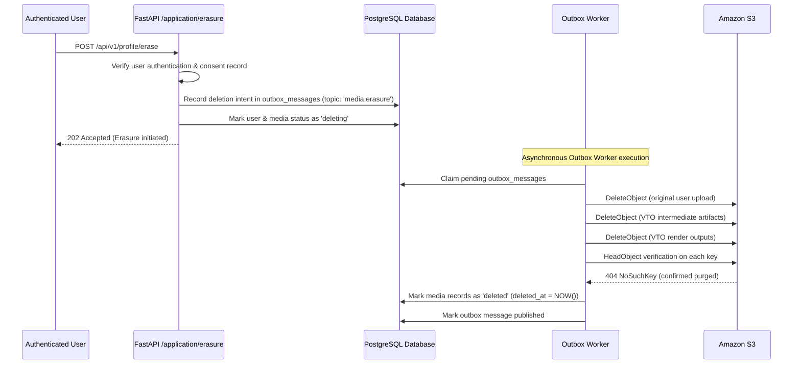

# FashXStudio — User Media Erasure Workflow (Phase 03.4)

## 1. Principles
User profile photographs, uploaded body images, and generated virtual try-on renders are sensitive personal data. When a user deletes their account or exercises privacy erasure rights:
1. Deletion must be **durable and guaranteed** against transient network or storage failures.
2. Deletion must be **idempotent** (safe to retry multiple times without error).
3. Erasure cannot be marked complete in PostgreSQL until S3 returns HTTP 404 / NoSuchKey on verification.

---

## 2. Multi-Step Erasure Sequence

---

## 3. Deletion Verification Probe
Implemented in `backend/fashx/infrastructure/storage/deletion.py`:
- `delete_object(key)` sends `DeleteObject` command to S3.
- `object_exists(key)` issues `HeadObject`. It returns `False` if `status == 404` or error code is `NoSuchKey` / `NotFound`.
- If an authorization error (`403 AccessDenied`) or server failure occurs during probe, the exception is re-raised and the outbox worker retries with exponential backoff.
