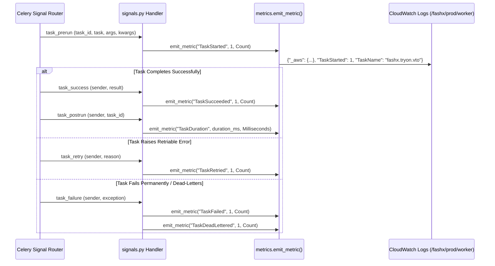

# Background Worker Monitoring Specification

## 1. Overview

FashXStudio executes asynchronous jobs (Virtual Try-On processing, catalog ingestion, vector indexing, image transformations) using Celery workers deployed on Amazon ECS Fargate.

Worker observability is driven by Celery signal hooks (`backend/fashx/workers/signals.py`) and dedicated telemetry emitters (`backend/fashx/workers/telemetry.py`). All metrics are formatted in AWS CloudWatch Embedded Metric Format (EMF) and directed to stdout.

## 2. Worker Lifecycle Telemetry

Celery signals hook into task execution phases to emit structured metrics into the CloudWatch namespace `FashX/Workers`:

## 3. Emitted Worker Metrics (`FashX/Workers`)

| Metric Name | Type | Unit | Description |
| :--- | :--- | :--- | :--- |
| `TaskStarted` | Counter | Count | A task has begun execution on a worker process. |
| `TaskSucceeded` | Counter | Count | A task completed execution without uncaught errors. |
| `TaskDuration` | Timer | Milliseconds | Execution wall-clock duration from prerun to postrun. |
| `TaskFailed` | Counter | Count | A task raised an unhandled exception or failed execution. |
| `TaskRetried` | Counter | Count | A task raised an exception and was rescheduled for retry. |
| `TaskDeadLettered` | Counter | Count | A task exhausted maximum retry attempts and routed to dead letter. |
| `WorkerHeartbeat` | Gauge | Count | Emitted every 60 seconds per worker host to indicate vitality. |

### Allowed Dimensions
- `Environment`: `dev`, `staging`, `prod`
- `TaskName`: Full module path of task (e.g. `fashx.tryon.tasks.process_vto_request`)
- `Queue`: Target queue name (`vto`, `catalog`, `default`)

### Cardinality Protection
Task IDs (`task_id`), user IDs, image URLs, and payload arguments are strictly prohibited as dimensions. These identifiers are logged as standard JSON fields for log searchability, but excluded from EMF metric dimensions.

## 4. Worker Vitality & Heartbeat Checks

Workers publish a `WorkerHeartbeat=1` metric on a 60-second periodic schedule.
- CloudWatch Alarm `Worker-Heartbeat-Missing-Production` triggers if zero heartbeats are received within 3 minutes across the worker cluster.
- This alerts operators to worker fleet crashes, task starvation, or memory deadlock.

## 5. Graceful Shutdown & Recovery

Workers are configured with `acks_late=True` and `reject_on_worker_lost=True`:
- Upon receiving `SIGTERM` from ECS Fargate during deployments or scaling events, the worker stops accepting new tasks and finishes in-flight jobs within a 120-second stop timeout.
- If a task exceeds the timeout, ECS terminates the container, and the task message remains unacknowledged in Redis for automatic redelivery to another healthy worker.

## 6. Verification & Automated Testing

Worker telemetry is tested in `tests/observability/test_worker_metrics.py`:
- `test_task_lifecycle_metrics_emitted`: Simulates Celery lifecycle signals and asserts correct EMF metric generation.
- `test_worker_heartbeat_and_queue_depth`: Verifies periodic heartbeat and Redis queue depth calculation.
