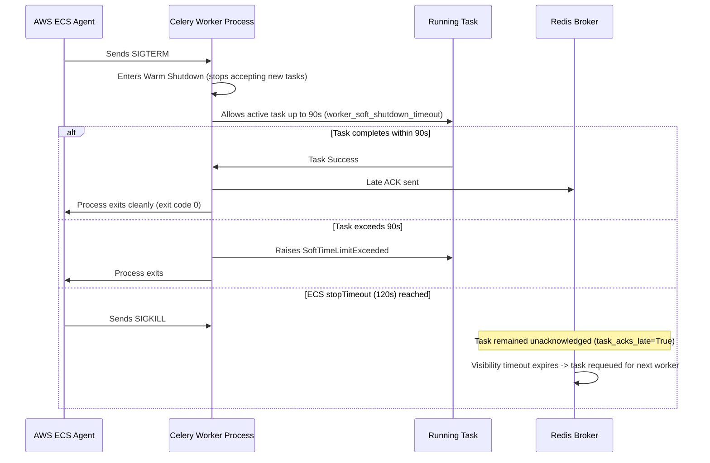

# FashXStudio — Worker Shutdown & Crash Recovery Policy (Phase 03.3)

## 1. Termination Sequence
Background worker ECS task definitions are configured to allow graceful task drainage during deployments, autoscaling events, or host retirements.

---

## 2. Timing Budget
- **Celery Soft Shutdown Timeout**: `worker_soft_shutdown_timeout = 90.0` seconds.
- **ECS Container Stop Timeout**: `stopTimeout: 120` seconds configured in ECS task definitions (`tryon.json.template`, `ingest.json.template`).
- **Safety Margin**: A 30-second window exists between Celery shutdown completion and ECS hard `SIGKILL`, preventing truncated writes.

---

## 3. Crash Recovery and Idempotency
- **Late Acknowledgment (`task_acks_late = True`)**: Tasks are acknowledged only when finished. If a container suffers a power fault, OOM kill, or network severance before completion, the message remains unacknowledged in Redis.
- **Requeue on Worker Loss (`task_reject_on_worker_lost = True`)**: When a worker process terminates abruptly, Celery automatically rejects unacknowledged messages so Redis re-queues them.
- **Task Idempotency**: Because a recovered task will be re-executed, all worker tasks are idempotent:
  - `process_tryon_job`: Checks `TryOnJob.status`. If already completed or processing with a valid provider job ID, it resumes without double-billing or redundant inference.
  - `ingest_catalog_feed`: Validates version and skips unchanged catalog rows.
  - `sweep_storage_erasure`: Uses outbox idempotent deduplication.
