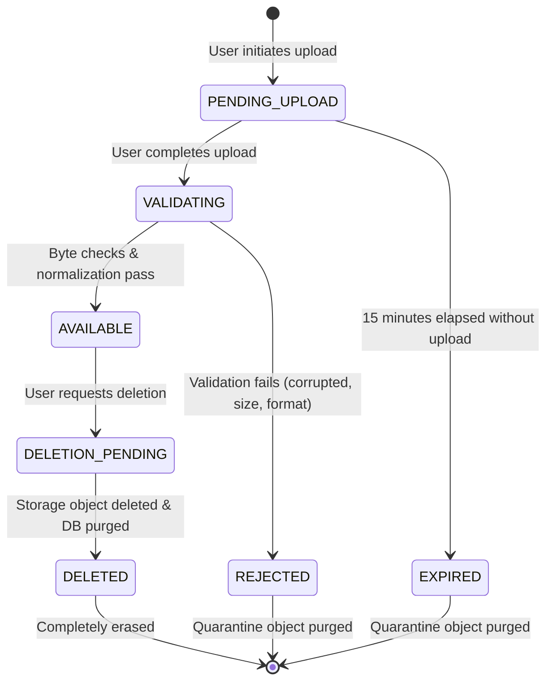

# Media Deletion and Retention Policy

## 1. Overview
FashXStudio respects shopper privacy and complies with data minimization principles (GDPR Article 17, CCPA, and Rule I06). Shoppers retain unconditional rights to delete their uploaded photos at any time.

---

## 2. Deletion Lifecycle State Machine

---

## 3. Explicit User Media Deletion
When a shopper calls `DELETE /api/v1/media/{image_id}`:
1. **Immediate Revocation**: The record status in `user_media` is atomically transitioned to `DELETION_PENDING`.
2. **Access Invalidation**: Any subsequent attempt to generate a signed download URL or query metadata immediately returns `404 Not Found`. Existing ephemeral URLs expire within at most 60 seconds.
3. **Physical Object Erasure**: The underlying storage object (`users/{user_id}/images/{image_id}/original.webp`) is deleted from Amazon S3.
4. **Terminal Status**: The record status is marked `DELETED`, with `deleted_at` set to the UTC timestamp.

---

## 4. User Account Erasure Integration
When a shopper requests total account deletion under the GDPR / CCPA erasure protocol (`fashx.application.erasure`):
1. Both `user_media` and `media_uploads` are classified as biometric-adjacent storage tables (`BIOMETRIC_TABLES`).
2. The erasure orchestrator retrieves all storage keys associated with `user_id` across both `media_uploads` (`quarantine_key`, `final_key`) and `user_media` (`storage_key`).
3. Physical objects are deleted from cloud storage.
4. All database rows belonging to `user_id` in `user_media` and `media_uploads` are permanently deleted with cascade constraints.

---

## 5. Ephemeral Quarantine Retention
- Unfinished or abandoned upload intents (`media_uploads`) expire after 15 minutes.
- S3 Bucket Lifecycle rules enforce automatic expiration of any remaining objects under `temporary/uploads/` after 24 hours as a defensive failsafe.
