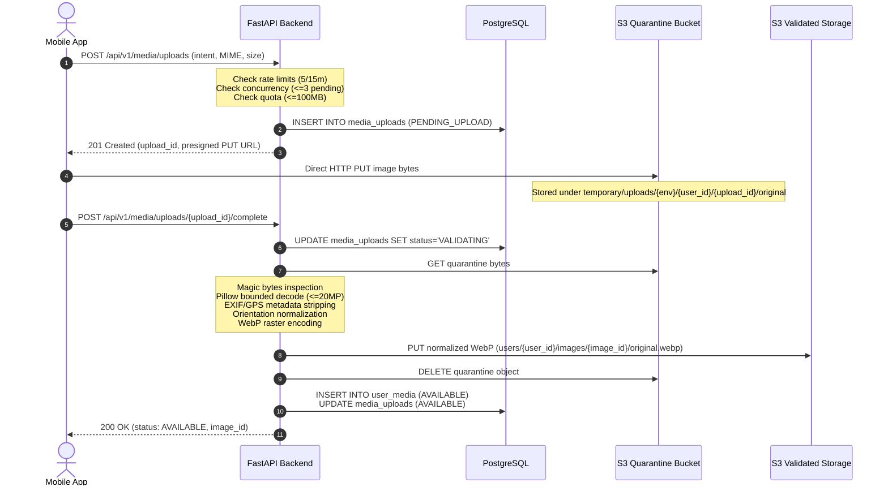

# Photo Upload Architecture

## 1. Overview
The FashXStudio personal media upload subsystem (Phase 04.5) provides an authenticated, isolated, and verified ingestion pipeline for personal shopper imagery (such as profile reference photos and virtual try-on fitting imagery).

A personal photo uploaded for fitting or try-on is classified as private user data and biometric-adjacent media under FashX architectural invariants (Rule I06). It is governed by the following core guarantees:
1. **Zero Public Storage**: No personal imagery is ever stored in public Amazon S3 buckets or served via public CDNs.
2. **Ephemeral Access**: Read access is granted exclusively through short-lived (60-second) pre-signed GET URLs authenticated against backend ownership policies.
3. **Server-Generated Keys**: Storage keys are completely generated by the server using cryptographically random UUIDs; client filenames are metadata-only and never incorporated into storage paths.
4. **Quarantine Isolation**: Ingested files land in an isolated quarantine prefix (`temporary/uploads/...`) and are strictly inaccessible to downstream services until decoded, validated, stripped of metadata, and normalized into `users/{user_id}/images/...`.
5. **Decoupled Consent**: Uploading a photo stores validated media assets in private storage but does **not** grant authorization for third-party virtual try-on processing. Third-party execution requires explicit, decoupled shopper consent (governed by Phase 04.4/04.6).

---

## 2. Pipeline Data Flow

---

## 3. Storage Hierarchy and Security

| Category | Storage Path Pattern | Access Mode | Retention Policy |
|---|---|---|---|
| **Quarantine Storage** | `temporary/uploads/{env}/{user_id}/{upload_id}/original` | Server PUT via 5-minute pre-signed URL; no public read | Auto-purged upon validation completion or rejected after 15m |
| **Validated Media** | `users/{user_id}/images/{image_id}/original.webp` | Ephemeral signed GET URL (60s TTL); authenticated user only | Retained until explicit user deletion or account erasure |

---

## 4. Rate Limiting and Quota Invariants
- **Intent Rate Limiting**: Maximum 5 upload initiation intents per user per 15-minute sliding window. Excess intents return `429 Too Many Requests` (`upload_rate_limited`).
- **Concurrent Pending Limit**: Maximum 3 simultaneous uncompleted uploads in `PENDING_UPLOAD` or `VALIDATING` state per user.
- **Active Storage Quota**: Maximum 100 MB of total validated personal media per shopper. Requests exceeding this threshold return `413 Payload Too Large` (`media_storage_quota_exceeded`).

---

## 5. Security & Privacy Invariants
- **Metadata Sanitization**: All incoming images have EXIF tags, GPS coordinate records, camera hardware fingerprints, and embedded IPTC/XMP profiles removed during normalization.
- **Decompression Bomb Protection**: Pillow decompression boundaries strictly enforce `MAX_IMAGE_PIXELS = 20_000_000` (20 megapixels) and max canvas dimensions of 4096×4096 px.
- **Cross-Tenant Isolation**: Ownership checks compare the authenticated token subject (`users.id`) against the resource owner. Unauthorized accesses return `404 Not Found` rather than `403 Forbidden` to prevent resource identifier enumeration.
