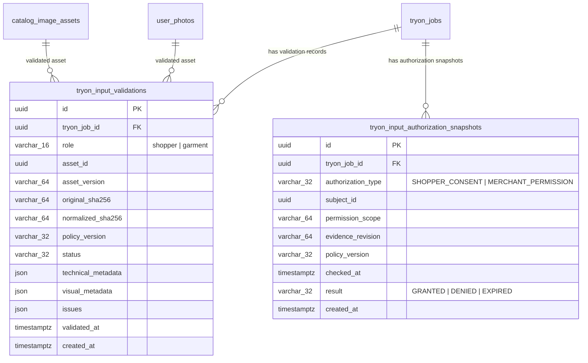

# Phase 07.3.5 — Database Schema and Data Model Specification

## 1. Overview
Input validation and authorization evidence must be durably recorded to ensure non-repudiation, auditability, and DPDP / GDPR compliance. The Phase 07.3 data model introduces two dedicated tables in PostgreSQL:
1. `tryon_input_validations`: Immutable records of technical and visual image inspection results.
2. `tryon_input_authorization_snapshots`: Point-in-time snapshots of shopper consent and merchant licensing permissions verified at job admission and time-of-use.

Migration: `database/migrations/versions/0050_add_tryon_input_validations.py`

---

## 2. Entity Relationship Diagram



---

## 3. Table Definitions

### 3.1 `tryon_input_validations`
Stores the detailed validation outcomes for each input image associated with a try-on job.

| Column | Type | Nullable | Constraints & Defaults | Description |
| :--- | :--- | :--- | :--- | :--- |
| `id` | `UUID` | No | PK, `gen_random_uuid()` | Unique record identifier |
| `tryon_job_id` | `UUID` | No | FK `tryon_jobs.id` ON DELETE CASCADE | Associated try-on job |
| `role` | `VARCHAR(16)` | No | `CHECK (role IN ('shopper', 'garment'))` | Image input role |
| `asset_id` | `UUID` | No | — | Underlying asset ID (`user_photos.id` or `catalog_image_assets.id`) |
| `asset_version` | `VARCHAR(64)` | No | — | Asset version or update revision |
| `original_sha256` | `VARCHAR(64)` | Yes | — | SHA-256 digest of original raw image bytes |
| `normalized_sha256`| `VARCHAR(64)` | Yes | — | SHA-256 digest of normalized raster submitted to provider |
| `policy_version` | `VARCHAR(32)` | No | — | Validation rule set version (e.g. `v1.0`) |
| `status` | `VARCHAR(32)` | No | — | Outcome (`PASSED`, `PASSED_WITH_WARNINGS`, `NEEDS_REVIEW`, `REJECTED`, `EXPIRED`, `ERROR`) |
| `technical_metadata`| `JSONB/JSON` | No | Default `{}` | Dimensions, format, orientation, byte count |
| `visual_metadata` | `JSONB/JSON` | No | Default `{}` | Person count, detected regions, pose, occlusion, confidence |
| `issues` | `JSONB/JSON` | No | Default `[]` | List of validation issue objects |
| `validated_at` | `TIMESTAMPTZ` | No | — | Timestamp when validation was performed |
| `created_at` | `TIMESTAMPTZ` | No | `server_default=now()` | Record creation timestamp |

#### Indexes and Constraints
- `ix_tryon_input_job`: `(tryon_job_id)` — Rapid lookup of all validation records for a job.
- `ix_tryon_input_asset`: `(asset_id, asset_version)` — Traceability of validations for specific asset versions.
- `ix_tryon_input_status`: `(status, validated_at)` — Metric aggregation and alerting queries.
- `uq_tryon_input_validations_idempotency`: Unique `(tryon_job_id, role, asset_id, asset_version, policy_version)` — Prevents duplicate validation writes for identical inputs.

---

### 3.2 `tryon_input_authorization_snapshots`
Durable evidence of permission verification at the instant of job creation and worker execution.

| Column | Type | Nullable | Constraints & Defaults | Description |
| :--- | :--- | :--- | :--- | :--- |
| `id` | `UUID` | No | PK, `gen_random_uuid()` | Unique record identifier |
| `tryon_job_id` | `UUID` | No | FK `tryon_jobs.id` ON DELETE CASCADE | Associated try-on job |
| `authorization_type`| `VARCHAR(32)` | No | — | Type (`SHOPPER_CONSENT` or `MERCHANT_PERMISSION`) |
| `subject_id` | `UUID` | No | — | Subject identifier (`user_id` or `merchant_id`) |
| `permission_scope` | `VARCHAR(64)` | No | — | Scope verified (`THIRD_PARTY_VTO_PROCESSING`, `IMAGE_AI_PROCESS`, `VTO_PROCESS`) |
| `evidence_revision`| `VARCHAR(64)` | Yes | — | Revision ID of the underlying consent event or merchant grant |
| `policy_version` | `VARCHAR(32)` | No | — | Authorization policy version |
| `checked_at` | `TIMESTAMPTZ` | No | `server_default=now()` | Instant authorization was checked |
| `result` | `VARCHAR(32)` | No | — | Result (`GRANTED`, `DENIED`, `EXPIRED`) |

#### Indexes
- `ix_tryon_auth_snapshot_job`: `(tryon_job_id)` — Retrieval of authorization evidence for a job.
- `ix_tryon_auth_snapshot_subject`: `(subject_id, authorization_type)` — Subject compliance audit trail.

---

## 4. Query Patterns

### Retrieve Job Validation Summary
```sql
SELECT
    v.role,
    v.status,
    v.original_sha256,
    v.normalized_sha256,
    v.technical_metadata->>'width' AS width,
    v.technical_metadata->>'height' AS height,
    v.issues
FROM tryon_input_validations v
WHERE v.tryon_job_id = :job_id;
```

### Audit Subject Authorization Trail
```sql
SELECT
    a.authorization_type,
    a.permission_scope,
    a.result,
    a.evidence_revision,
    a.checked_at
FROM tryon_input_authorization_snapshots a
WHERE a.subject_id = :subject_id
ORDER BY a.checked_at DESC;
```

---

## 5. Retention and Privacy Policy
- **Validation Metadata**: Retained for 90 days for operational debugging and quality metrics, then anonymized or purged.
- **Authorization Snapshots**: Retained for 7 years in accordance with regulatory non-repudiation and consent audit requirements under Indian DPDP Act 2023.
- **Zero Raw Image Storage**: The validation tables store only cryptographic SHA-256 hashes and dimensions; raw pixel buffers and base64 strings are strictly prohibited from database columns.
