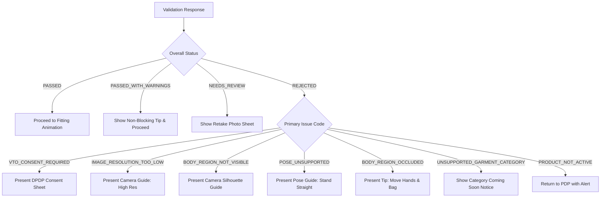

# Phase 07.3.6 — Validation Error Codes and Remediation Catalog

## 1. Overview
The Virtual Try-On validation engine provides deterministic error codes, explicit severity tiers, and clear, human-readable remediation messages. When a validation check fails or raises a warning, the shopper is given actionable instructions on how to correct the issue rather than opaque error messages.

---

## 2. Severity Classification

| Severity | Definition | Action on Provider Submission |
| :--- | :--- | :--- |
| `ERROR` | Mandatory integrity, authorization, or visual check failed. | **BLOCKED** (`REJECTED`) |
| `WARNING` | Non-fatal anomaly detected; try-on can proceed with possible quality degradation. | **ALLOWED** (`PASSED_WITH_WARNINGS`) |
| `REVIEW` | Automated assessment confidence is uncertain (`< 0.80`). | **BLOCKED** (`NEEDS_REVIEW`) |

---

## 3. Comprehensive Error Code Catalog

### 3.1 Shopper Photograph Errors

| Code | Severity | Root Cause | Shopper Remediation Message |
| :--- | :--- | :--- | :--- |
| `VTO_CONSENT_REQUIRED` | `ERROR` | Shopper has not granted consent for virtual try-on processing. | Please accept the Virtual Try-On privacy terms to enable fitting simulation. |
| `IMAGE_NOT_OWNED_OR_NOT_FOUND` | `ERROR` | Shopper photo asset was not found or does not belong to the user. | Please select a valid photo from your saved profile fitting photos. |
| `IMAGE_CORRUPTED` | `ERROR` | Image bytes cannot be decoded or container is malformed. | The uploaded file appears damaged or incomplete. Please upload the photo again. |
| `IMAGE_FORMAT_UNSUPPORTED` | `ERROR` | Image format is not JPEG, PNG, or WebP (e.g. HEIC, BMP, GIF). | Please upload an image in JPEG, PNG, or WebP format. |
| `IMAGE_RESOLUTION_TOO_LOW` | `ERROR` | Dimensions are below 512×512 px. | Please upload a photo with at least 512x512 resolution (720p or higher recommended). |
| `IMAGE_DIMENSIONS_TOO_LARGE` | `ERROR` | Dimensions exceed 4096×4096 px or 20 MP. | Please resize your photo so dimensions do not exceed 4096x4096 pixels. |
| `IMAGE_FILE_TOO_LARGE` | `ERROR` | Raw file size exceeds 10 MB. | The file size exceeds the 10 MB limit. Please compress or resize the photo. |
| `PERSON_NOT_DETECTED` | `ERROR` | Visual assessment detected no human figure in the photo. | We could not clearly detect a person in this photo. Please upload a clear photo of yourself. |
| `MULTIPLE_PEOPLE_DETECTED` | `ERROR` | Visual assessment detected more than one person. | Multiple people were detected. Please upload a photo containing only yourself. |
| `BODY_REGION_NOT_VISIBLE` | `ERROR` | Required body regions for category (e.g. shoulders for tops, legs for bottoms) are not visible. | Make sure your full upper body (or full body) is clearly framed in the photo. |
| `BODY_REGION_OCCLUDED` | `ERROR` | Target try-on region is obstructed by hands, bags, hair, or objects. | Please upload a photo where your clothes and body are not covered by bags, hands, or accessories. |
| `POSE_UNSUPPORTED` | `ERROR` | Shopper is lying down or in an extreme angle. | Please stand upright facing the camera for the best virtual try-on results. |

### 3.2 Garment and Product Errors

| Code | Severity | Root Cause | Shopper / Internal Remediation Message |
| :--- | :--- | :--- | :--- |
| `PRODUCT_NOT_ACTIVE` | `ERROR` | Product is delisted, discontinued, or in takedown. | This product is currently not available for virtual try-on. |
| `IMAGE_PRODUCT_MISMATCH` | `ERROR` | Submitted image asset is not associated with the product ID. | The selected image does not match the product record. |
| `GARMENT_PROCESSING_NOT_AUTHORIZED` | `ERROR` | Merchant licensing permissions (`IMAGE_AI_PROCESS`, `VTO_PROCESS`) not granted. | Virtual try-on is not currently enabled by the merchant for this product. |
| `UNSUPPORTED_GARMENT_CATEGORY` | `ERROR` | Category is not supported (footwear, jewellery, accessories, or pending ethnic drapes). | Virtual try-on is not available for this category yet. We currently support tops, bottoms, and dresses. |
| `GARMENT_NOT_VISIBLE` | `ERROR` | Garment boundary is missing or image is a small swatch/collar crop. | Product image does not clearly depict the garment silhouette. |
| `GARMENT_BACKGROUND_UNSUITABLE` | `WARNING` | Complex cluttered background or low contrast with garment. | The product image background may affect try-on quality. |

### 3.3 System and Review Errors

| Code | Severity | Root Cause | Shopper / Internal Remediation Message |
| :--- | :--- | :--- | :--- |
| `VISUAL_ASSESSMENT_UNCERTAIN` | `REVIEW` | Heuristic or model confidence is below 0.80. | The photo quality is uncertain. Please try a well-lit photo with higher contrast. |
| `VALIDATION_SERVICE_ERROR` | `ERROR` | Upstream failure, storage timeout, or unhandled exception. | Input validation failed due to a temporary service issue. Please try again. |

---

## 4. Remediation Dispatch Matrix in Mobile Client

