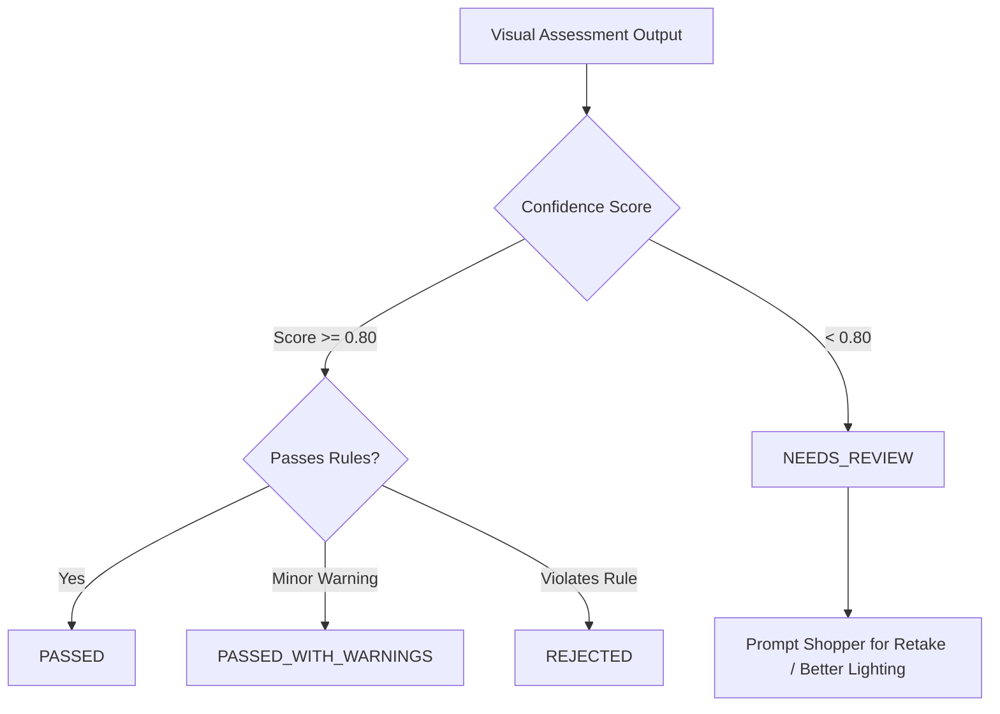

# Phase 07.3.8 — Visual Assessment Model Evaluation Framework

## 1. Objective
Establish an empirical evaluation framework for the visual assessment subsystem that verifies detection accuracy for person silhouettes, body regions, poses, and garment visibility without relying on unvalidated assumptions.

---

## 2. Evaluation Architecture

The visual assessment engine operates under a protocol-based abstraction (`VisualAssessmentProvider` in `backend/fashx/tryon/validation/visual_assessment.py`):
1. **Stage 1 (Baseline)**: `HeuristicVisualAssessmentProvider` evaluating basic aspect ratios, dimension rules, and category constraints.
2. **Stage 2 (Production)**: Lightweight on-premise CV model (e.g. YOLO-Pose / MediaPipe Pose / Human Parsing) evaluating multi-keypoint body topology and segmentation.

---

## 3. Evaluation Benchmark Dataset

A fixed 400-image labeled benchmark dataset is curated across real-world variation:

| Dataset Slice | Image Count | Criteria / Characteristics |
| :--- | :--- | :--- |
| **Standard Upright** | 100 | Clear front/angled poses, good lighting, standard backgrounds. |
| **Partial Occlusion** | 75 | Hands on hips, holding phone, cross-body bags, draped scarf. |
| **Challenging Lighting** | 75 | Backlit, low light (EV < 4), harsh shadows, uneven illumination. |
| **Multi-Person Edge Cases** | 50 | Shopper with background bystanders, child in frame, group photos. |
| **Extreme Poses** | 50 | Lying down, sitting, extreme crouching, high-angle selfie. |
| **Garment Boundaries** | 50 | High clutter backgrounds, textured fabrics, swatches, flat lays. |

---

## 4. Key Performance Indicators & Thresholds

| Metric | Target | Rationale |
| :--- | :--- | :--- |
| **False Acceptance Rate (FAR)** | `< 1.0%` | Unsuitable or non-human inputs reaching provider must be virtually zero to eliminate wasted inference cost and provider errors. |
| **False Rejection Rate (FRR)** | `< 5.0%` | Valid shopper photos must not be rejected needlessly, minimizing shopper friction. |
| **Person Detection Precision** | `> 99.0%` | Never classify an empty room or pet as a shopper. |
| **Pose Classification Accuracy** | `> 95.0%` | Correctly distinguish upright vs lying down or extreme angles. |
| **Region Coverage Recall** | `> 98.0%` | Accurately detect missing body regions (e.g. cropped legs on a dress). |
| **Inference Latency** | `< 250 ms` | Must not introduce perceptible lag during mobile client upload. |

---

## 5. Confidence Thresholds & Review Routing

- **Confidence `>= 0.80`**: High certainty; automated rule engine verdict applies directly.
- **Confidence `< 0.80`**: Uncertain; flagged as `NEEDS_REVIEW` with issue code `VISUAL_ASSESSMENT_UNCERTAIN`. Under the fail-closed mandate, uncertain evaluations are blocked from provider submission and prompt the user to retake the photo with better lighting or clearer framing.
