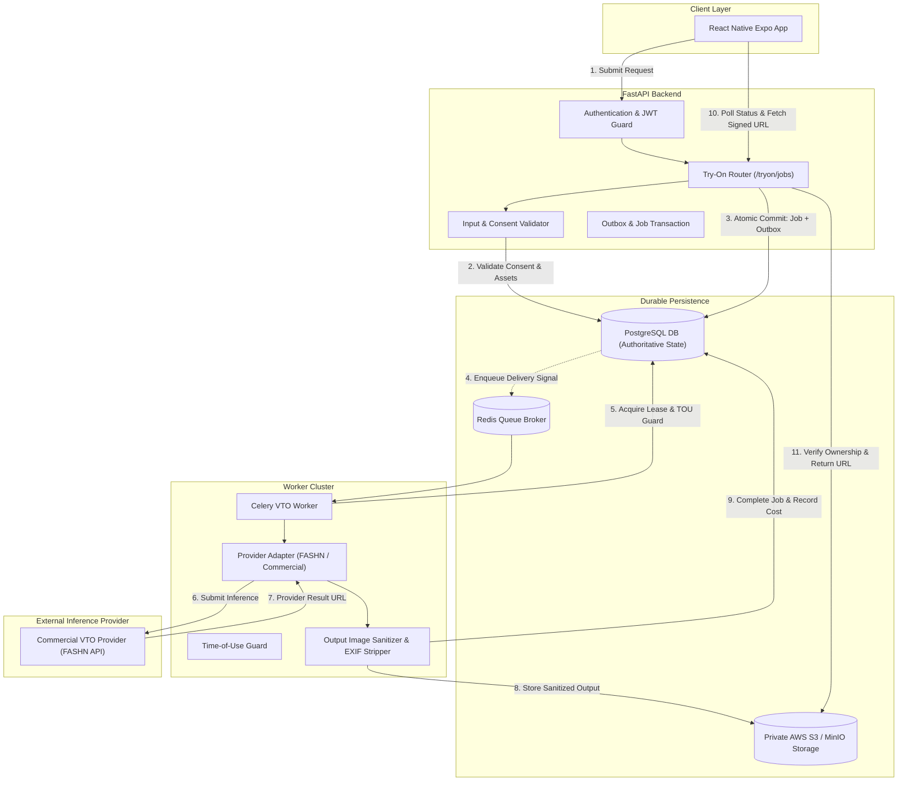

# Phase 07 Architecture & End-to-End Workflow Verification

## 1. Subsystem Architecture Overview

The FashXStudio Virtual Try-On (VTO) subsystem is designed around a provider-neutral, asynchronous, durable orchestration pattern.



---

## 2. Component Responsibilities & Boundaries

### 2.1 API and Ingress Layer
- **Responsibility**: Authenticate shoppers, enforce rate limits, validate preflight inputs, calculate request fingerprints, and persist job records and outbox events in a single atomic database transaction.
- **Boundary Rule**: The API never initiates direct network requests to third-party inference providers. It acts solely as an orchestrator and validation gate.

### 2.2 Input Validation Engine
- **Responsibility**: Verify shopper image ownership, ensure current third-party VTO consent is recorded, detect faces/bodies, verify resolution and aspect ratio, verify garment image licensing (`IMAGE_AI_PROCESS`, `VTO_PROCESS`), and ensure garment category is supported.
- **Fail-Closed Rule**: If any validation rule fails or consent is missing, job creation is rejected immediately (HTTP 400/422).

### 2.3 Durable Job & Outbox Layer
- **Responsibility**: PostgreSQL is the immutable source of truth. Every job is created in state `CREATED`, with request hash, snapshot of input asset URIs, merchant offer ID, and idempotency key.
- **Reliability Invariant**: A repeated request with the same idempotency key and identical inputs returns the existing job. A repeated key with differing inputs returns HTTP 409 Conflict.

### 2.4 Worker & Time-of-Use Verification
- **Responsibility**: Workers dequeue job references from Redis, acquire a database row lease, and immediately execute the Time-of-Use (TOU) guard.
- **TOCTOU Protection**: If the merchant revoked image rights, the product was delisted, or the shopper revoked consent between job submission and worker execution, the job transitions directly to `FAILED` with non-retryable error code `CONSENT_REVOKED` or `LICENSE_REVOKED`. No paid inference is submitted.

### 2.5 Provider Adapter Isolation
- **Responsibility**: `TryOnProviderPort` decouples the core domain from external provider implementations.
- **Isolation Invariant**: Only the adapter knows provider-specific JSON schemas, HTTP headers, authentication formats, and poll endpoints. Provider API keys are injected via environment settings and are never exposed across the boundary.

### 2.6 Output Download, Validation, and Storage
- **Responsibility**: Download provider result from verified origin only, reject SSRF attempts, cap download sizes (< 25MB), verify magic bytes (JPEG/PNG/WebP), strip EXIF and location metadata, calculate SHA-256 checksum, and store the output under an owner-scoped private S3 key prefix: `vto-results/{user_id}/{job_id}.webp`.

### 2.7 Owner-Authorized Result Retrieval
- **Responsibility**: `GET /tryon/jobs/{job_id}` verifies that the requesting JWT subject matches the job owner. Unauthorized users receive HTTP 404 (preventing existence enumeration). Authorized users receive a time-limited presigned URL (15-minute TTL).
- **Mandatory Disclosure**: The response payload includes:
  ```json
  {
    "result_type": "VISUAL_TRY_ON",
    "is_ai_generated": true,
    "fit_verified": false,
    "disclaimer_code": "VISUAL_TRYON_NOT_FIT_VERIFICATION",
    "presentation": {
      "copy": {
        "title": "AI-generated visual try-on",
        "disclaimer": "Visual try-on does not verify physical fit",
        "action": "View merchant size chart"
      }
    }
  }
  ```

---

## 3. Strict Separation of VTO from Physical Fit Prediction

The architecture strictly isolates visual try-on from fit recommendation:
1. **Fit Recommendations Engine (`fashx.fit`)**:
   - Operates independently from VTO image generation.
   - Requires verified merchant size charts (`MeasurementBasis.BODY` or `MeasurementBasis.GARMENT`) and consented shopper body measurements.
   - Raises `FitEvidenceSecurityError` if any AI-generated try-on image or synthetic image evidence is provided.
2. **Platform Content Policy (`fashx.presentation.claims`)**:
   - Strictly prohibits phrases such as "guaranteed fit", "perfect fit", "verified physical fit", "exact body fit", or "true-to-size confirmation".
   - Automatically sanitizes merchant embedded widget configurations.
