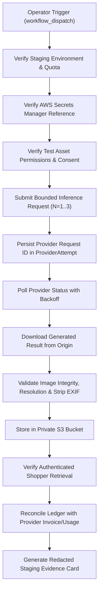

# Phase 07 Live Provider Test Plan

## 1. Objective & Security Policy

This test plan defines the explicit operational procedure for verifying connectivity, authentication, payload compatibility, and response handling with the live hosted inference provider (FASHN API).

### Non-Negotiable Policy
- **No Paid Inference in Standard CI**: Pull request CI pipelines must NEVER call live paid inference endpoints. Standard CI runs exclusively against `MockTryOnAdapter`.
- **Secret Isolation**: Live API keys (`FASHN_API_KEY`) and webhook secrets are stored exclusively in AWS Secrets Manager or secure deployment environment variables. They are NEVER committed to version control or printed in logs.
- **Strictly Bounded Invocations**: Live test runs must be triggered manually via a dedicated `workflow_dispatch` action and capped at a maximum of 5 bounded requests using approved test fixtures.
- **Redaction of Output**: All artifacts, request IDs, and provider response dumps must redact API credentials, signed URL signatures, and private shopper identifiers before inclusion in documentation.

---

## 2. Live Provider Verification Workflow



---

## 3. Pre-Flight Verification Checklist

Before initiating a live provider run:
1. [ ] Target environment is verified as `staging`.
2. [ ] Provider credentials exist in AWS Secrets Manager: `arn:aws:secretsmanager:ap-south-1:*:secret:fashx/staging/fashn-api-key`.
3. [ ] Provider balance / credit limit is confirmed positive on external dashboard.
4. [ ] Test garment asset belongs to a supported category (`category="casual_shirts"`, `IMAGE_AI_PROCESS` and `VTO_PROCESS` active).
5. [ ] Test model asset has documented model release consent for AI evaluation.
6. [ ] Global spending kill switch is active and functional (`VTO_GLOBAL_KILL_SWITCH = false`).

---

## 4. Test Execution Steps

### Step 1: Dispatch Controlled Staging Workflow
Execute through GitHub Actions `workflow_dispatch` or via authenticated CLI with restricted operator role:
```bash
python scripts/ops/run_bounded_live_tryon_test.py \
  --environment staging \
  --provider fashn \
  --shopper-photo-id test-model-01 \
  --garment-id test-garment-shirt-01 \
  --max-requests 1
```

### Step 2: Validate Request ID and Provider Attempt
Inspect database record in `tryon_provider_attempts`:
- `provider`: `"fashn"`
- `model_version`: `"v1.5"`
- `provider_request_id`: Non-empty string (e.g. `fashn_req_9f81a7b...`)
- `status_code`: `200` (Accepted)
- `latency_ms`: Recorded positive integer

### Step 3: Validate Output Processing
- Verify worker successfully downloads the image bytes.
- Verify MIME type is verified as image (`image/jpeg` or `image/webp`).
- Verify EXIF metadata is removed.
- Verify output is stored privately at `s3://fashx-staging-results/vto-results/{shopper_id}/{job_id}.webp`.

### Step 4: Verify Owner Retrieval & Disclosure
- Request `GET /tryon/jobs/{job_id}` with valid shopper auth token.
- Verify `result_type: "VISUAL_TRY_ON"`.
- Verify `fit_verified: false`.
- Verify presigned URL resolves and displays expected try-on image.

### Step 5: Verify Negative Authentication Failure
- Invalidate the API key in a test container environment (`FASHN_API_KEY=invalid_dummy_key`).
- Submit request and verify:
  - Adapter raises `ProviderAuthenticationError`.
  - Job transitions to `FAILED` with code `PROVIDER_AUTH_ERROR`.
  - High-priority alert `tryon_provider_auth_failure` fires.
  - No infinite retries occur (401/403 is classified as non-retryable).

---

## 5. Live Acceptance Record Template

The live staging test report is recorded in `staging-test-report.md` upon completion by the human founder:
```markdown
- Test Run Date: [YYYY-MM-DD]
- Environment: staging
- Operator: [Founder Handle]
- Provider: FASHN API (v1.5)
- Internal Job ID: [UUID]
- Provider Request ID: [fashn_req_...]
- Stored Asset Checksum: [SHA-256]
- Latency: [XX.X] seconds
- Estimated Cost: $0.05
- Reconciled Cost: $0.05
- Retrieval Result: Verified 200 OK (Owner Authenticated)
- Non-Owner Retrieval: Verified 404 Not Found
```
