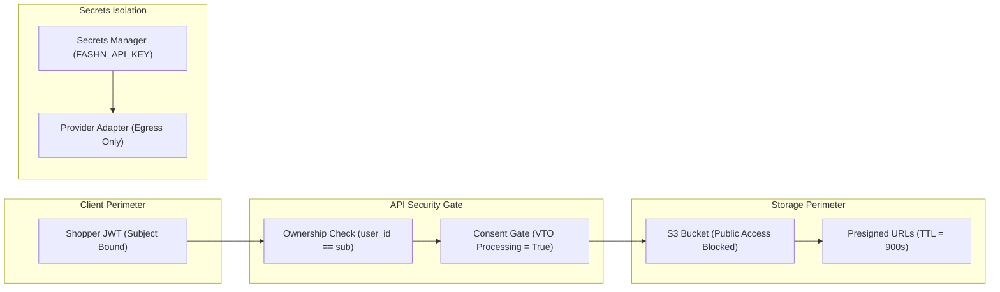

# Phase 07 Security & Privacy Verification

## 1. Security Architecture & Threat Model

Virtual try-on processes personal biometric and visual data (shopper portraits) alongside commercial catalog assets. Strict security controls govern every stage of the lifecycle.

---

## 2. Key Security Controls & Verification

### 2.1 Provider Secret Isolation
- **Invariant**: External inference provider API keys (`FASHN_API_KEY`), secret webhooks, and AWS storage access keys are strictly isolated to backend workers and the provider adapter.
- **Verification**:
  - `test_exit_001_secret_isolation_in_status_response` validates that API response models (`TryOnJobStatusResponse`, `PresentationPolicyResponse`) contain zero secret fields.
  - Code search confirms that no API keys or credentials are imported into client-facing mobile code or templates.

### 2.2 Shopper Consent & Ownership Enforcement
- **Invariant**: A shopper can only create try-on jobs using photos they own and for which valid third-party AI processing consent is durably recorded in PostgreSQL.
- **Verification**:
  - `test_shopper_validator.py` confirms that unconsented photos fail validation immediately (`CONSENT_REQUIRED`).
  - `test_time_of_use_guard.py` verifies that if consent is withdrawn after enqueueing, the background worker halts execution immediately (`CONSENT_REVOKED`) before paid inference occurs.

### 2.3 Object Storage Access & Signed URLs
- **Invariant**: S3 buckets hosting try-on results have AWS S3 Public Access Block fully enabled. No public read access is permitted.
- **Verification**:
  - Result URLs returned to mobile clients are short-lived pre-signed HTTPS URLs with a maximum 15-minute Time-To-Live (`TTL = 900s`).
  - Response headers set `Cache-Control: private, no-store, max-age=0`.
  - Object keys are partitioned by tenant: `vto-results/{user_id}/{job_id}.webp`.

### 2.4 Broken Object Level Authorization (BOLA/IDOR) Defense
- **Invariant**: A user cannot inspect, retrieve, or cancel another user's try-on job or feedback.
- **Verification**:
  - In `backend/fashx/tryon/router.py`, status retrieval endpoints verify `job.user_id == current_user.id`.
  - If a mismatch occurs, the endpoint returns HTTP 404 Not Found (rather than HTTP 403 Forbidden) to prevent resource existence enumeration.
  - Feedback submission checks in `TryOnFeedbackService` raise `FeedbackSecurityError` when an unauthorized user attempts to report on another user's job.

### 2.5 Input Sanitization & SSRF Defense
- **Invariant**: The backend only downloads provider result assets from approved provider host domains.
- **Verification**:
  - `backend/fashx/tryon/output_validation.py` validates the provider-returned image URL against an approved host policy.
  - Redirects to private IPv4 ranges (10.0.0.0/8, 172.16.0.0/12, 192.168.0.0/16, 127.0.0.1) and metadata endpoints (169.254.169.254) are rejected immediately.
  - Download payloads are capped at 25MB to prevent memory exhaustion / decompression bombs.

### 2.6 Privacy & Metadata Hygiene
- **Invariant**: Generated try-on results must not retain location tags, camera metadata, or device fingerprints.
- **Verification**:
  - All downloaded provider results are processed with Pillow to strip EXIF, GPS, and IPTC metadata prior to private persistence in S3.
