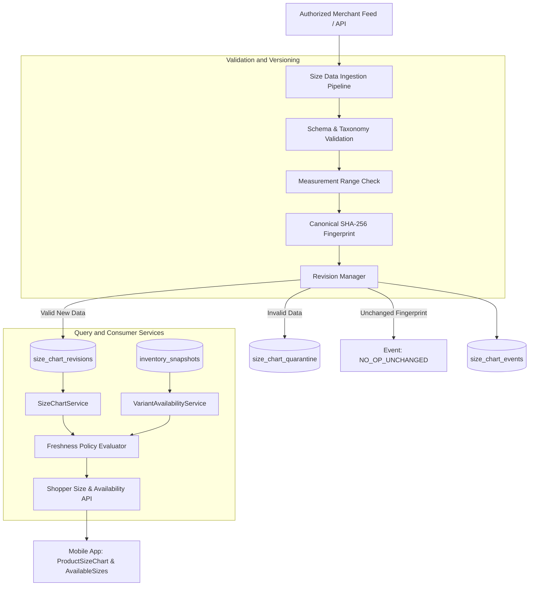

# 01 — Size Data Architecture

## 1. Architectural Overview

The FashXStudio Size Data Architecture establishes a robust data layer governing merchant-provided size information, linear garment measurements, sizing systems, and variant availability.

## 2. Core Entities & Lifecycle

### 2.1 Product Size Chart Container (`product_size_charts`)
- Represents the enduring container for a product's size chart.
- Links 1:1 with `merchant_products`.
- Points to the `current_revision_id`.
- Status transitions: `AVAILABLE`, `UNAVAILABLE`, `STALE`, `QUARANTINED`.

### 2.2 Immutable Size Chart Revisions (`size_chart_revisions`)
- Every ingestion that modifies dimension values, size labels, or units generates a monotonically increasing version number (`version=1, 2, ...`).
- Each revision contains an authoritative `content_fingerprint` computed across normalized dimensions and size labels.
- Historical revisions are never updated or deleted; they preserve an exact audit trail of what was shown to shoppers at any historical point.

### 2.3 Granular Measurement Records (`size_chart_rows` & `size_chart_measurements`)
- Normalized down to individual linear measurement attributes:
  - `field_code` (e.g. `CHEST`, `WAIST`, `HIP`, `INSEAM`).
  - `original_value` and `original_unit`.
  - `normalized_value` in `normalized_unit` (`CM`).

### 2.4 Inventory Availability Snapshots (`inventory_snapshots`)
- Captures point-in-time stock availability observations for product variants.
- Completely decoupled from the size chart container. A size label present in a size chart does not imply current purchasable stock.
