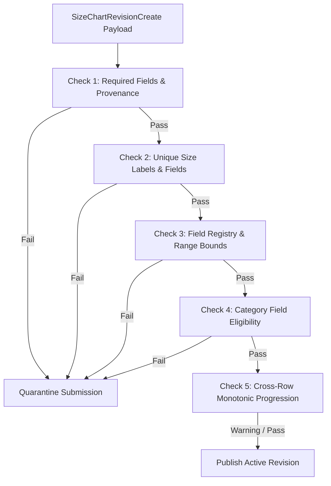

# 05 — Validation Rules and Quarantine

## 1. Validation Pipeline

Every incoming size chart submission passes through the validation engine before reaching the database.

## 2. Validation Severity Levels

- **ERROR (Terminal)**: Blocks ingestion immediately, moves payload to quarantine table, and responds with HTTP 422.
  - Empty or non-positive measurements ($\le 0$).
  - Missing source provenance (missing `source_id`).
  - Duplicate size labels in the same chart (e.g., two "M" rows).
  - Duplicate measurement fields in the same row (e.g., two "CHEST" fields).
  - Unknown measurement field codes not in `FIELD_DEFINITIONS`.
  - Values outside physical plausible limits (e.g. Chest < 40 cm or > 200 cm).
  - Category incompatibility (e.g. Inseam provided on a Dress or Top).
- **WARNING (Non-blocking)**: Logged as an ingestion warning without blocking publishing.
  - Inverted dimension progression across ascending sizes (e.g., Size L chest is smaller than Size M chest). While unusual, bespoke or relaxed fits may feature varying dimensions.

## 3. Quarantine Workflow (`size_chart_quarantine`)

When a submission is quarantined:
1. The exact raw payload is saved in `size_chart_quarantine.raw_payload_json`.
2. A list of all failed error codes is preserved in `error_codes_json`.
3. `review_status` defaults to `PENDING`.
4. The product size chart container remains in its previous valid state or `UNAVAILABLE`.
5. Merchant ops can inspect quarantined charts via internal tooling and request merchant re-export.
