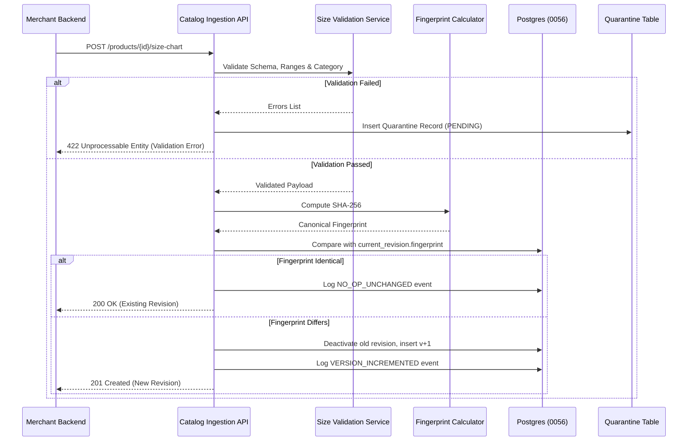

# 08 — Merchant Ingestion Pipeline

## 1. Ingestion Channels

Size data enters FashXStudio through three primary authorized channels:
1. **Direct Merchant REST API**: Authenticated merchant backend pushes via `POST /api/v1/products/{product_id}/size-chart`.
2. **Scheduled Feed Ingestion**: Periodic CSV/JSON catalog feeds processed via background workers.
3. **Partner Platform Adapters**: Webhook sync from Shopify, BigCommerce, or custom enterprise catalog exporters.

## 2. Ingestion Flow

## 3. Idempotency Guarantees
Every submission is idempotent. Re-submitting the exact same chart data multiple times is guaranteed to create exactly one active revision.
