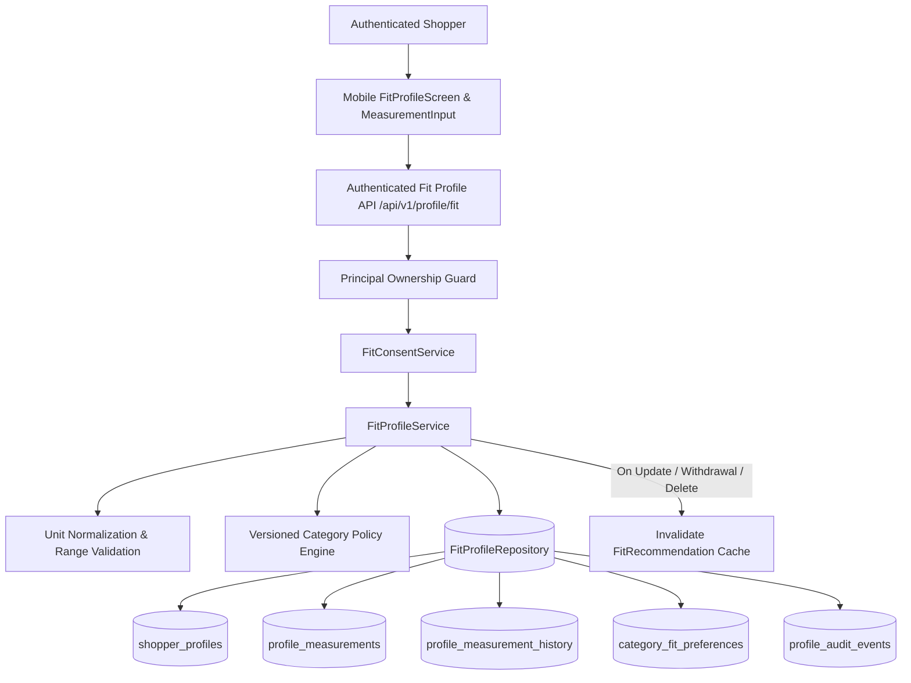

# 01 — Fit Profile Architecture

## 1. End-to-End Architecture

## 2. Service Boundaries

- **Shopper Fit Profile (`fashx.profile`)**: Stores shopper body measurements (`BODY`), measurement history, subjective fit preferences, and purpose-specific consent. Never calculates garment recommendations directly.
- **Merchant Size Data (`fashx.catalog.size_charts`)**: Stores merchant garment size charts (`GARMENT` or merchant `BODY` tables). Kept strictly isolated from shopper records.
- **Virtual Try-On (`fashx.tryon`)**: Generates visual try-on images only. VTO outputs are explicitly rejected as measurement evidence by `FitProfileService.reject_vto_as_measurement_evidence`.
