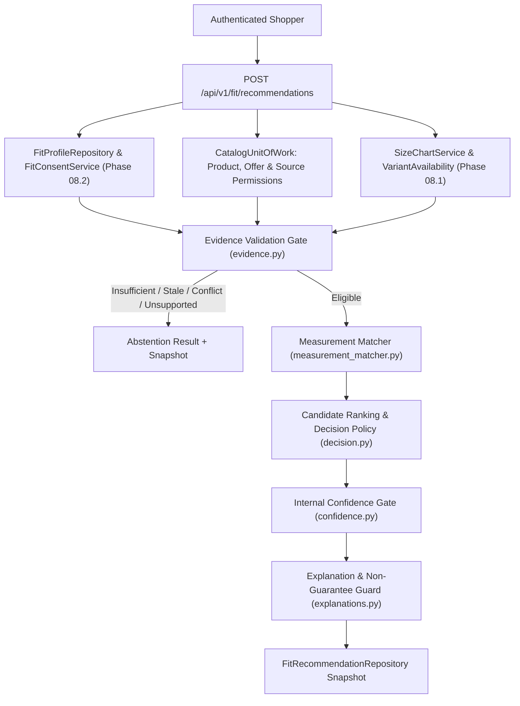

# 01 — Architecture & Service Boundaries

## System Flow

## Module Boundaries (`backend/fashx/fit/`)

| Module | Responsibility |
|---|---|
| `enums.py` | Controlled enums (`RecommendationStatus`, `MeasurementBasis`, `FitReasonCode`, `MissingDataCode`, `FitFeedbackReason`, `EvaluationLabel`) |
| `contracts.py` | Strict Pydantic v2 contracts (`extra="forbid"`), timezone-aware timestamps, Phase 07.8 compatibility |
| `category_policy.py` | Versioned per-category required/optional measurement fields and launch gate (`enabled`) |
| `ease_policy.py` | Evidence-backed `EaseRule` definitions (`E = G - B`); empty by default |
| `measurement_matcher.py` | Exact `Decimal` range comparison with strict definition & basis compatibility |
| `evidence.py` | Pre-recommendation gate for consent, merchant isolation, chart freshness, conflicts, and VTO rejection |
| `confidence.py` | Weighted internal evidence completeness score + hard gate precedence |
| `decision.py` | Deterministic candidate selection, `POSSIBLE_ALTERNATIVES`, and `NO_AVAILABLE_SIZE` rules |
| `explanations.py` | Approved wording table and regex guard rejecting guarantee phrasing |
| `service.py` | Orchestration (`evaluate_recommendation`, `get_stored_recommendation`, legacy `recommend`) |
| `repository.py` | Persistence for `fit_recommendations`, evidence, candidates, feedback, and invalidation triggers |
| `feedback.py` | Snapshot-bound shopper feedback submission, deduplication, triage, and soft deletion |
| `evaluation/` | Leakage-checked dataset loader, selective accuracy/calibration metrics, and gate reporter |
| `router.py` | Authenticated FastAPI endpoints resolving profile/catalog server-side |

## Server-Side Authority Rule

Clients pass only `product_id`, optional `merchant_offer_id`, `variant_id`, and `category`. Measurements, chart rows, stock, merchant identifiers, permissions, and confidence scores are resolved strictly server-side (`FitRecommendationRequest` sets `extra="forbid"`).
