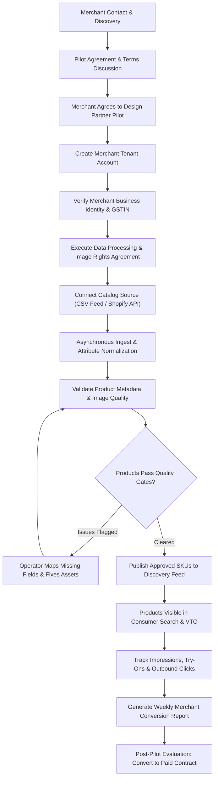

# FashXStudio — Complete Merchant Journey & Activation Specification

**Document ID:** `FASHX-JNY-008`  
**Version:** `1.0 — Approved Baseline`  
**Date:** `10 November 2026`  
**Status:** `Approved by Product Owner`  
**Scope:** `Phase 01 — B2B Partner Journey & Catalog Activation`  

---

## 1. End-to-End Merchant Flowchart

---

## 2. Stage Expectations & Operational Responsibilities

| Stage | Merchant Expectation | FashXStudio Responsibility |
| :--- | :--- | :--- |
| **Introduction** | Understand how VTO increases shopper engagement and reduces returns. | Provide clear pilot presentation with live upper-body demos. |
| **Agreement** | Transparent understanding of intellectual property rights and liability. | Provide reviewed, modular pilot agreement pack (`docs/legal/merchant-pilot/`). |
| **Tenant Setup** | Fast account setup without extensive corporate bureaucracy. | White-glove tenant provisioning with role-based access control. |
| **Catalog Connect**| Provide existing Shopify feed, CSV export, or JSON feed without custom dev work.| Flexible ingestion adapter normalizing brand schemas to canonical format. |
| **Validation** | Clear feedback on which products are ready vs missing size charts. | Automated validation report highlighting unmapped attributes and image defects. |
| **Publication** | Full control over which products are exposed to shoppers. | Explicit publication toggle; immediate delisting/takedown on command. |
| **Analytics** | Accurate visibility into try-on demand and outbound traffic. | Weekly aggregated report summarizing impressions, try-ons, and handoffs. |
| **Evaluation** | Understand commercial ROI and shopper conversion lift. | Synthesize pilot findings and present structured commercial expansion proposals. |

---

## 3. Strict Merchant Activation Definition

A merchant is classified as **`ACTIVE_PUBLISHED`** only when all seven conditions are verified:
1. **Business Identity Confirmed:** Valid GSTIN, legal corporate entity, and authorized signatory verified.
2. **Legal Agreements Executed:** Signed Master Pilot Agreement, Data Processing Agreement, and Image License on file.
3. **Decoupled Permissions Active:** `METADATA_INGEST`, `METADATA_DISPLAY`, and `IMAGE_VTO_PROCESS` recorded in database.
4. **Catalog Feed Ingested:** At least 50 eligible upper-body garments successfully parsed and normalized.
5. **Quality Gates Cleared:** Minimum resolution ($800 \times 1000$ px), neutral background, and valid size charts validated.
6. **Publication Approved:** Products promoted to `Published` status and discoverable in the consumer mobile app.
7. **Handoff Verified:** Test click on "Buy at Merchant" successfully routes to the merchant's live product page with valid tracking parameters.

*Governance Rule:* Signing a pilot contract or creating an account does **not** constitute merchant activation until live products are published and verified.
