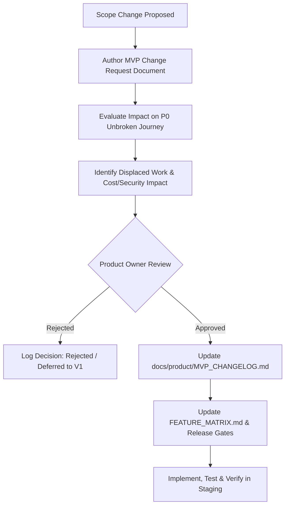

# FashXStudio — MVP Scope Governance & Change Log

**Document ID:** `FASHX-LOG-001`  
**Version:** `1.0 — Initial Frozen Baseline`  
**Date:** `10 November 2026`  
**Status:** `Active Governance Control`  
**Scope:** `Phase 01.3 — Scope Change Request Protocol`  

---

## 1. Scope Governance Principles

Once approved in Phase 1.3, the MVP feature boundary is **formally frozen**. New features or scope expansions must not enter the release simply because they are technically feasible, aesthetically appealing, or already exist in the repository.

### Mandatory Rules for Scope Changes
1. **Product Owner Approval:** Only the human founder / Product Owner can authorize a modification to the P0 feature list.
2. **Demonstrated Pilot Necessity:** A P0 addition must resolve an unavoidable blocker to pilot execution (e.g., regulatory compliance, vendor security mandate, fatal user failure).
3. **Capacity Displacement Rule:** Every proposed P0 addition must identify an existing P0 feature of equivalent engineering effort to be deprioritized to P1 or P2, preventing schedule inflation.
4. **No Security Compromise:** Security, privacy, tenant isolation, and DPDP compliance requirements can **never** be downgraded or deferred to satisfy a deadline.
5. **Traceability:** Every approved change must update this document, relevant GitHub issues, automated tests, and release gate metrics.

---

## 2. Scope Change Request Workflow



---

## 3. Standard Change Request Template

```markdown
# MVP Change Request
- **Change ID:** CR-YYYYMMDD-XX
- **Date:** YYYY-MM-DD
- **Requested By:** [Name / Role]
- **Feature Name:** [Feature Title]
- **Target Subsystem:** [e.g. Try-On, Catalog, Mobile, Auth]
- **Current Priority:** [P1 / P2 / Excluded]
- **Proposed Priority:** [P0 / P1]

## 1. Problem Statement & User Impact
What user problem, technical blocker, or merchant requirement makes this change necessary for the pilot?

## 2. Supporting Evidence
What customer interview, prototype finding, or vendor documentation justifies this scope change? (No unverified assumptions permitted).

## 3. Displaced P0 Work (Capacity Trade-off)
What existing P0 work is being deprioritized or descoped to accommodate this request?

## 4. Architectural & Dependency Assessment
- External Vendors Affected:
- Security & DPDP Compliance Impact:
- Database Migrations Required:
- Estimated Engineering Effort (Days):

## 5. Decision & Sign-Off
- [ ] Approved
- [ ] Rejected
- [ ] Deferred to Post-Pilot V1
- **Approver Signature:** [Founder / PO Name]
- **Approval Date:** YYYY-MM-DD
```

---

## 4. Change History Log

### Baseline Entry: MVP v1.0 — Initial Proposed Scope Freeze
- **Date:** 2026-11-10
- **Status:** **Proposed Baseline Frozen** (Phase 1.3 Execution)
- **Scope Summary:**
  - **Included P0:** Authentication & session lifecycle; DPDP consent & lightweight profile; 1 authorized D2C catalog feed (100–500 SKUs); automated product validation & publication; multi-brand discovery & search; real FASHN-backed async virtual try-on; digital wardrobe save/retrieve; server-controlled outbound merchant handoff; core funnel analytics; tenant isolation & private S3 storage.
  - **Simplified P1:** Manual merchant onboarding support by operator; basic merchant reporting export; simple style quiz.
  - **Explicitly Excluded P2:** Frozen commerce operations (cart, checkout, payment gateway, inventory, orders, fulfillment, returns); self-hosted diffusion model; 3D body mesh reconstruction; complex draped silhouettes (sarees, lehengas).
- **Pending Strategic Milestones:**
  1. Securing live FASHN API commercial account credentials and executing DPA.
  2. Recruiting initial D2C apparel brand design partner.
  3. Provisioning cloud staging environment (PostgreSQL 16 + Redis + S3/R2).
