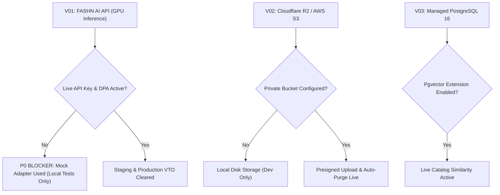

# FashXStudio — MVP Scope & Release Boundary Specification

**Document ID:** `FASHX-MVP-001`  
**Version:** `1.0 — Frozen Baseline`  
**Date:** `10 November 2026`  
**Status:** `Approved MVP Scope Boundary`  
**Scope:** `Phase 01.3 — MVP Boundary Freeze & Post-MVP Governance`  
**Core Reference:** [ADR-0001: MVP Scope and Repo Structure](file:///c:/Users/ASUS/Documents/FashXStudio/docs/adr/0001-mvp-scope-and-repo-structure.md) & [ADR-0004: Try-On Provider](file:///c:/Users/ASUS/Documents/FashXStudio/docs/adr/0004-tryon-provider.md)

---

## 1. Executive Summary & Central Hypothesis

The primary objective of Phase 1.3 is to prevent scope creep and focus engineering resources strictly on proving the foundational value proposition:

> **Central Product Hypothesis:**  
> *Can an online fashion shopper discover a real, authorized apparel product, visualize it through a genuine virtual try-on using their own photo, and gain sufficient appearance confidence to click through to the merchant's store?*

The MVP is not an incomplete version of twenty disparate e-commerce modules. It is **one complete, verified, unbroken commerce discovery and virtual try-on journey** linking at least one authorized merchant with real shoppers.

---

## 2. Release Definition: FashXStudio Pilot MVP v1.0

### Included in Pilot MVP v1.0 (P0)
- **Design Partner Integration:** Exactly 1 authorized Indian D2C apparel brand.
- **Controlled Apparel Categories:** 1 or 2 validated upper-body categories (Men's T-shirts and shirts; women's tops and structured kurtas subject to provider benchmarking).
- **Authorized Product Data:** 100–500 live SKUs ingested via structured CSV/feed with explicit commercial image rights.
- **Shopper Identity & DPDP Consent:** Registration, secure JWT session management, and purpose-specific consent logging.
- **Discovery Engine:** Multi-brand catalog feed, keyword search, size/price filters, and product detail screens.
- **Provider-Backed VTO:** Real diffusion model inference (FASHN hosted API) via asynchronous job queues, with client idempotency and safe error recovery.
- **Digital Wardrobe:** Persisting, retrieving, and deleting generated try-on looks.
- **Commerce Handoff:** Server-controlled outbound redirection to the merchant's product detail page with signed click tracking.
- **Telemetry & Funnel Analytics:** Universal event logging capturing the shopper conversion funnel.
- **Security & Privacy:** Tenant isolation, private asset storage, automated data expiration, and cryptographic erasure verification.

### Explicitly Excluded from Pilot MVP v1.0
- ❌ Direct in-app shopping cart, checkout, payments, or order processing.
- ❌ Warehouse inventory reservation or logistics/3PL integrations.
- ❌ Customer returns, refunds, or reverse logistics.
- ❌ Broad scraping of unauthorized fashion marketplaces.
- ❌ Custom self-hosted foundation model training or local GPU clusters.
- ❌ Complex ethnic silhouettes (sarees, lehengas, multi-layered dupattas).
- ❌ Automatic 3D body mesh reconstruction or guaranteed physical fit predictions.

---

## 3. Evidence Required to Prove the Hypotheses

| Product Hypothesis | Required Empirical Evidence | Status |
| :--- | :--- | :--- |
| **H1: Merchant Willingness** | 1 real D2C brand executes the pilot agreement and supplies an authorized catalog feed. | **Unverified** (Zero partners onboarded) |
| **H2: Shopper Adoption** | Real shoppers complete DPDP consent and initiate personal-image try-ons on mobile devices. | **Unverified** (No live user runs) |
| **H3: Visual Engagement** | Shoppers spend $\ge 15$ seconds inspecting results or save looks to their personal wardrobe. | **Unverified** (Telemetry pending) |
| **H4: Purchase Intent** | Shoppers click the outbound merchant handoff button following a completed try-on. | **Unverified** (Handoff clicks pending) |
| **H5: Operational Viability** | Asynchronous VTO queue processes jobs with $\le 25$s p95 latency and $< 3\%$ failure rate. | **Unverified** (Live vendor keys pending) |

*Governance Mandate:* The pilot must not claim that FashXStudio reduces return rates or lifts sales until authoritative conversion postbacks are received from merchant partners.

---

## 4. Priority Definitions & Tiers

| Priority Tier | Standard Definition | Release Governance |
| :--- | :--- | :--- |
| **P0 (Must Work)** | Core functionality required for the single unbroken journey. Cannot be simulated or omitted. | Required before onboarding any pilot merchant or shopper. |
| **P1 (Should Work)**| Valuable capability that can be operated manually by the team or deferred with an explicit workaround. | Target for release, but omission does not block the pilot. |
| **P2 (Later / Post-MVP)**| Non-essential features, enhancements, or frozen operations. | Fenced, disabled, or removed from active routing. |

---

## 5. Frozen Subsystems & Non-Destructive Code Fencing

In accordance with [ADR-0001](file:///c:/Users/ASUS/Documents/FashXStudio/docs/adr/0001-mvp-scope-and-repo-structure.md) and [docs/architecture/FROZEN.md](file:///c:/Users/ASUS/Documents/FashXStudio/docs/architecture/FROZEN.md), post-MVP commerce modules are **strictly frozen**:

```
Frozen Post-MVP Subsystems
├── C05: Cart & Checkout
├── C06: Payment Processing & Gateway
├── C07: Order Lifecycle Management
├── C08: Fulfillment & 3PL Logistics
├── C09: Inventory Reservation & Locking
├── C10: Returns & Reverse Logistics
└── F11–F13: Advanced Marketplace Promotions & Settlement
```

### Technical Fencing Rules
1. **No Destructive Deletion:** Existing database tables and schema migrations for frozen modules are preserved to maintain migration chain integrity.
2. **Unmounting Production Routers:** Frozen API routers are disabled in `backend/fashx/main.py` via configuration flag `ENABLE_FROZEN_COMMERCE_ENDPOINTS=False`.
3. **OpenAPI Surface Cleanliness:** Frozen endpoints are excluded from the production OpenAPI documentation schema.
4. **Test Fencing:** Tests touching frozen commerce logic are marked `@pytest.mark.frozen` and excluded from standard CI gates.

---

## 6. External Vendor Dependency Register

The following vendor integrations represent critical blockers for the live pilot:



### Vendor Risk & Mitigation Audit

| Dependency ID | Vendor / Platform | Scope & Usage | Current Status | Blocker Remediation |
| :--- | :--- | :--- | :--- | :--- |
| **V-01** | FASHN.ai | Hosted GPU diffusion inference | **Gap:** Adapter exists, but uses mock client by default. | Founder must obtain commercial API credentials & execute DPA. |
| **V-02** | Supabase / Local JWT | Shopper and merchant authentication | **Active:** Local JWT tokens verified in CI. | Local auth sufficient for pilot; Supabase migration optional. |
| **V-03** | Cloudflare R2 / S3 | Private asset storage & signed URLs | **Gap:** Local filesystem storage in development. | Provision staging S3 bucket with lifecycle deletion rules. |
| **V-04** | Managed Postgres | Relational data & pgvector embeddings | **Gap:** Tested in CI; cloud instance pending. | Provision managed Postgres 16 instance with pgvector. |
| **V-05** | Redis / Celery | Asynchronous job state & retry queue | **Active:** Celery worker architecture complete. | Provision managed Redis instance on staging. |

---

## 7. Category Boundary & Rollout Strategy

```
Apparel Categories
├── P0 Candidate: Men's T-Shirts (Crewneck, Polo) -> Passed initial provider benchmarks
├── P0 Candidate: Men's Shirts (Button-down, Casual) -> Passed initial provider benchmarks
├── P0 Candidate: Men's & Women's Kurtas -> High differentiator; requires fabric/drape test
├── P1: Women's Tops & Blouses -> Requires separate quality/fairness validation
└── P2: Sarees, Lehengas, Outerwear -> Excluded due to complex multi-layer pleating & drapes
```

---

## 8. Strategic Reconciliation: ADR-0001 vs. B2B2C Commercial Model

- **The Apparent Conflict:** ADR-0001 defines FashXStudio as consumer styling + affiliate redirect; Phase 1.1 defines FashXStudio as a B2B2C merchant SaaS platform.
- **The Reconciliation:** 
  1. For Pilot MVP v1.0, the first merchant is onboarded as a **Design Partner** (waived or nominal SaaS fee).
  2. The merchant's catalog is ingested and published to the FashXStudio consumer app.
  3. Checkout remains on the merchant's site via outbound redirect (`/outbound-clicks`).
  4. Once try-on engagement and outbound purchase intent are empirically proven, FashXStudio introduces tiered SaaS subscriptions and embeddable PDP widgets in Phase 10.
  5. Affiliate commissions serve as an optional secondary monetization channel where networks exist.

---

## 9. Pilot Execution Work Packages (MVP-01 – MVP-16)

```mermaid
flowchart LR
    MVP01["MVP-01: Freeze Inventory"] --> MVP02["MVP-02: Auth & Storage"]
    MVP02 --> MVP04["MVP-04: Merchant Perms"]
    MVP04 --> MVP05["MVP-05: Catalog Ingest"]
    MVP05 --> MVP06["MVP-06: Product Publish"]
    MVP06 --> MVP07["MVP-07: Discovery PDP"]
    MVP02 --> MVP08["MVP-08: Activate VTO"]
    MVP08 --> MVP09["MVP-09: VTO Reliability"]
    MVP07 --> MVP10["MVP-10: Save Look"]
    MVP09 --> MVP10
    MVP07 --> MVP11["MVP-11: Handoff Click"]
    MVP10 --> MVP12["MVP-12: Analytics Log"]
    MVP11 --> MVP12
    MVP12 --> MVP14["MVP-14: Staging Deploy"]
    MVP14 --> MVP15["MVP-15: Pilot Testing"]
    MVP15 --> MVP16["MVP-16: Release Gate"]
```



| Package ID | Scope & Objective | Priority | Pre-requisite | Exit Deliverable |
| :--- | :--- | :--- | :--- | :--- |
| **MVP-01** | Audit and freeze feature inventory | **P0** | Phase 1.3 Approval | Signed Feature Matrix & Changelog |
| **MVP-02** | Production identity and storage setup | **P0** | MVP-01 | Verified staging auth & private S3 bucket |
| **MVP-03** | Shopper profile and DPDP consent | **P0** | MVP-02 | Tested consent revocation & profile APIs |
| **MVP-04** | Merchant agreement and permission pack | **P0** | MVP-01 | Signed legal templates & DB permission records |
| **MVP-05** | Connect first authorized catalog feed | **P0** | MVP-04 | 100+ SKUs ingested into staging DB |
| **MVP-06** | Catalog validation and publication gate | **P0** | MVP-05 | 50+ approved, VTO-eligible live products |
| **MVP-07** | Discovery feed, search, and PDP screens | **P0** | MVP-06 | Working mobile browsing experience |
| **MVP-08** | Real VTO provider activation (FASHN) | **P0** | Vendor Account | Live inference executed on real image |
| **MVP-09** | Async VTO job queue & error recovery | **P0** | MVP-08 | Automated retry and timeout handling verified |
| **MVP-10** | Digital wardrobe and saved looks | **P0** | MVP-09 | Relational look storage & retrieval verified |
| **MVP-11** | Server-controlled merchant handoff | **P0** | MVP-07 | Signed redirect logging purchase intent |
| **MVP-12** | Universal event collection & telemetry | **P0** | MVP-07–11 | Verified event log pipeline in database |
| **MVP-13** | Basic merchant reporting dashboard | **P1** | MVP-12 | Exportable merchant conversion summary |
| **MVP-14** | Production staging deployment | **P0** | MVP-02–12 | Operational health endpoint on public staging |
| **MVP-15** | Human usability and quality testing | **P0** | MVP-14 | Human ratings on 30+ try-on results |
| **MVP-16** | Release readiness review & sign-off | **P0** | All P0 packages | Completed release checklist & founder sign-off |
