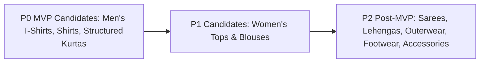

# FashXStudio — MVP Scope & Feature Priority Matrix

**Document ID:** `FASHX-SCOP-001`  
**Version:** `1.0 — Approved Baseline`  
**Date:** `10 November 2026`  
**Status:** `Approved by Product Owner`  
**Scope:** `Phase 01 — Feature Boundary & Prioritization Baseline`  

---

## 1. Priority Classification Framework

- **P0 — Must Work:** Essential capabilities required for the unbroken pilot journey. Must be fully functional, unsimulated, and covered by automated tests.
- **P1 — Should Work:** High-value capabilities that can be operated manually, simplified, or deferred with an explicit operational workaround.
- **P2 — Later (Post-MVP):** Capabilities explicitly excluded or frozen from the initial pilot release.

---

## 2. Subsystem Priority Matrix

| Subsystem | P0 — Must Work (Pilot Blocker) | P1 — Should Work (Simplified/Manual) | P2 — Later (Post-MVP / Frozen) |
| :--- | :--- | :--- | :--- |
| **Authentication** | Registration, email/phone login, logout, session expiry, token refresh. | Social login (Google/Apple), SMS OTP. | Enterprise SSO, SAML federation. |
| **Shopper Profile**| Minimum viable profile (style preferences, usual size), DPDP consent capture. | Brand size preferences, extended style quiz. | 3D body shape scanning, biometric extraction. |
| **Catalog Ingest** | 1 authorized source (CSV/feed/API), normalization, attribute tagging. | Second source connector, scheduled sync. | Uncontrolled web crawling, scraping bots. |
| **Catalog Quality**| Permission check, image rights check, deduplication, publication gate. | Merchant self-service catalog editor. | Automated image trademark scanning. |
| **Discovery** | Multi-brand feed, category browse, keyword search, size/price filters, PDP. | Personalized vector ranking, trending drops. | Multi-store visual search, price comparison. |
| **Virtual Try-On** | Real FASHN provider inference, async queue, idempotency, result viewer, error recovery. | In-app pose guidelines, blur retry. | Custom foundation model, local GPU cluster. |
| **Wardrobe** | Save, retrieve, inspect, and delete try-on looks; price snapshots. | Custom collections, tags, favorites. | AI outfit planner, wardrobe packing lists. |
| **Merchant B2B** | 1 design partner, permission grants, product-page handoff link. | Merchant portal dashboard, embed widget. | Multi-tenant enterprise marketplace portal. |
| **Analytics** | Universal event logging, deduplication, core funnel reporting. | Merchant CSV report export, daily rollups. | Real-time predictive churn models. |
| **Feedback** | 1–5 star realism rating, defect reporting modal. | Structured fit feedback ("runs tight/loose").| Automated model fine-tuning loop. |
| **Privacy/Security**| Tenant isolation, private S3 storage, presigned URLs, erasure logging. | In-app self-service privacy center. | Automated external regulatory audit tools. |
| **Operations** | Dockerized deployment, Redis, Postgres 16, logs, error alerts, cost tracking. | Staging deployment pipeline, uptime alerts. | Multi-region active-active cluster. |
| **Commerce** | Safe merchant redirect (`/outbound-clicks`) with signed tracking IDs. | Affiliate network postback webhooks. | ❄️ **FROZEN:** Cart, checkout, payments, logistics, returns. |

---

## 3. Explicit Exclusions & Non-Destructive Fencing

As codified in [ADR-0001](file:///c:/Users/ASUS/Documents/FashXStudio/docs/adr/0001-mvp-scope-and-repo-structure.md) and [docs/architecture/FROZEN.md](file:///c:/Users/ASUS/Documents/FashXStudio/docs/architecture/FROZEN.md):
- ❄️ **Commerce Operations:** In-app cart, multi-merchant checkout, payment processing, inventory reservation, order routing, 3PL logistics, and returns management are **strictly frozen**.
- **Routing Isolation:** Frozen routers are unmounted in production configuration via `ENABLE_FROZEN_COMMERCE_ENDPOINTS=False`.
- **Database Schema Protection:** Existing migrations and tables for frozen subsystems are preserved to maintain migration chain integrity.

---

## 4. Category Scope Roadmap

| Garment Category | Status | Strategic & Technical Justification |
| :--- | :--- | :--- |
| **Men's T-Shirts** | **Candidate P0** | High volume, clean geometric structure, proven diffusion model compatibility. |
| **Men's Shirts** | **Candidate P0** | Standard collar and button lines; highly suitable for initial provider validation. |
| **Structured Kurtas** | **Candidate P0** | High Indian market differentiator; straight-cut silhouettes behave reliably in diffusion try-on. |
| **Women's Tops** | **Candidate P1** | Varied necklines and fabrics; scheduled for activation after quality/fairness benchmarks. |
| **Sarees & Lehengas** | **P2 (Post-MVP)** | Complex multi-layer pleating, floating dupattas, and intricate embroidery require advanced segmentation. |
| **Footwear & Accessories**| **P2 (Post-MVP)** | Completely different 3D pose and occlusion workflows. |
