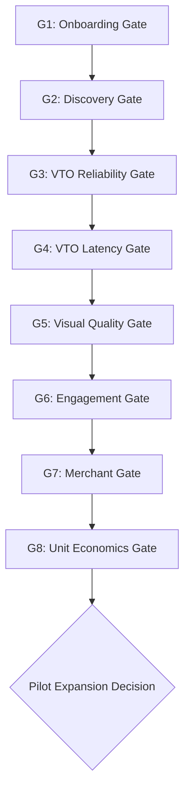

# FashXStudio — Pilot KPI Target Register & Decision Gates

**Document ID:** `FASHX-KPI-002`  
**Version:** `1.0 — Execution Baseline`  
**Date:** `10 November 2026`  
**Status:** `Proposed Target Register — Pending Real-World Execution`  
**Scope:** `Phase 01.4 — Pilot Success Benchmarks & Decision Rules`  

---

## 1. Master Pilot KPI Target Register

The targets below represent planning hypotheses for the initial controlled pilot. In accordance with [AGENTS.md](file:///c:/Users/ASUS/Documents/FashXStudio/AGENTS.md), none of these values represent measured production performance.

| Metric ID | Performance Metric | Proposed Pilot Target | Priority | Automation Level | Empirical Status |
| :--- | :--- | :--- | :--- | :--- | :--- |
| **1.4.1** | Registration Completion Rate | $\ge 70\%$ | **P0** | Fully Automated | **Unverified (No live pilot)** |
| **1.4.2** | Profile Completion Rate | $\ge 65\%$ | **P0** | Fully Automated | **Unverified (No live pilot)** |
| **1.4.3** | Discovery Success Rate | $\ge 30\%$ | **P0** | Fully Automated | **Unverified (No live pilot)** |
| **1.4.4** | VTO Job Success Rate | $\ge 90\%$ | **P0** | Fully Automated | **Unverified (Mock default in dev)** |
| **1.4.5** | VTO Latency (P95) | $< 45$ seconds | **P0** | Fully Automated | **Unverified (No GPU benchmark)** |
| **1.4.6** | Visual Realism Score | $\ge 3.8 / 5.0$ | **P0** | Dual Human Review | **Unverified (No rated outputs)** |
| **1.4.7** | Garment Preservation Score | $\ge 3.8 / 5.0$ | **P0** | Structured Checklist | **Unverified (No rated outputs)** |
| **1.4.8** | Pipeline Image Failure Rate| $\le 5\%$ | **P0** | Fully Automated | **Unverified (No live runs)** |
| **1.4.9** | Product Card CTR | $\ge 10\%$ | **P0** | Fully Automated | **Unverified (No active feed)** |
| **1.4.10**| Look Save Rate | $\ge 20\%$ | **P0** | Fully Automated | **Unverified (No saved looks)** |
| **1.4.11**| D7 Shopper Retention | $15\% - 25\%$ (Hypothesis) | **P1** | Cohort Telemetry | **Unverified (Observational)** |
| **1.4.12**| Merchant Activation | 1 Real Partner Live | **P0** | Milestone Verification| **Unverified (Zero onboarded)** |
| **1.4.13**| Merchant Dashboard Usage | 1 Session / Week | **P1** | Dashboard Logging | **Unverified (P1 Observational)** |
| **1.4.14**| Cost Per Successful VTO | $\le ₹12.00$ Direct Cost | **P0** | Cost Accounting | **Unverified (Pending live rates)** |

---

## 2. Pilot Release Decision Gates (G1 – G8)

Every decision gate defines unambiguous pass criteria, remediation actions for missed targets, and a four-state classification:
- **`PASS`**: Target achieved with statistically valid sample size.
- **`CONDITIONAL`**: Target narrowly missed, but an approved operational workaround makes a controlled pilot acceptable.
- **`FAIL`**: Critical technical, privacy, or quality threshold breached; pilot expansion blocked.
- **`INSUFFICIENT_DATA`**: Sample size too small to evaluate.

### Decision Gate Specifications

| Gate ID | Gate Name | Pass Condition | Conditional Allowance | Action on Failure (`FAIL`) |
| :--- | :--- | :--- | :--- | :--- |
| **G1** | Onboarding Gate | Reg $\ge 70\%$, Profile $\ge 65\%$ | Reg $\ge 60\%$; manual onboarding assistance enabled. | Simplify form; audit SMS/OTP delivery latency; remove optional profile fields. |
| **G2** | Discovery Gate | Discovery Success $\ge 30\%$ | Success $\ge 20\%$ with high CTR on top categories. | Revise search indexing; feature curated kurtas and tops; audit image resolutions. |
| **G3** | VTO Reliability | Job Success $\ge 90\%$ | Job Success $\ge 85\%$ after automated single retry. | Halt traffic; audit Celery queue failures; inspect FASHN provider error logs. |
| **G4** | VTO Latency | P95 Latency $< 45$s | P95 $< 60$s during peak traffic windows. | Compress input image bytes; pre-warm workers; optimize presigned S3 uploads. |
| **G5** | Visual Quality | Realism $\ge 3.8$, Preservation $\ge 3.8$ | Scores $\ge 3.5$ on Western tops; kurtas held back. | Restrict active categories to validated silhouettes; adjust prompt/mask weights. |
| **G6** | Engagement Gate | Save Rate $\ge 20\%$, Handoff $> 0$ | Save Rate $\ge 15\%$ with positive shopper qualitative feedback. | Redesign result comparison slider; make "Buy at Merchant" CTA more prominent. |
| **G7** | Merchant Gate | 1 partner verified with $\ge 50$ SKUs | Catalog imported; publication pending minor mapping fixes. | Provide white-glove manual CSV normalization for the partner. |
| **G8** | Economics Gate | Direct Cost $\le ₹12.00$ / try-on | Cost $\le ₹15.00$ with clear volume discount pathway. | Enforce per-user daily quotas (5/day); negotiate tier pricing with FASHN. |

---

## 3. Non-Waivable Hard Governance Gates

Under no circumstances may the following requirements be compromised or waived to pass a gate:
1. **Zero Unconsented Photo Processing:** Every try-on job must trace to an active `SHOP_PHOTO_VTO` consent record.
2. **Strict Merchant Image Authorization:** Every garment image must reference an active, unrevoked `MERCH_IMAGE_VTO` grant.
3. **Data Deletion Compliance:** 100% of user deletion requests must permanently purge S3 assets and log cryptographic tombstones.
4. **Tenant Isolation:** Zero cross-tenant data leakage between merchant catalogs or shopper profiles.
