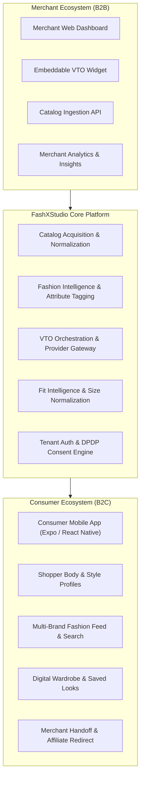

# FashXStudio — Product Strategy & Business Model

**Document ID:** `FASHX-PROD-001`  
**Version:** `1.0 — Draft for Approval`  
**Date:** `10 November 2026`  
**Status:** `Proposed Strategy`  
**Scope:** `Phase 01.1 — Product Direction and Business Model`  
**Repository Baseline:** `SahilKhutey/FashXStudio`  

---

## 1. Product Definition

FashXStudio is an AI-powered fashion intelligence, personalization and virtual shopping platform that connects fashion retailers, D2C brands, e-commerce product catalogs and consumers through a unified shopping ecosystem. It enables merchants to make their fashion products more interactive and discoverable through intelligent catalog integration, automated fashion content enrichment, personalized product recommendations, fit guidance and AI-powered virtual try-on.

For consumers, FashXStudio provides a personalized fashion shopping experience where users can create their own body and style profiles, discover products from authorized fashion retailers, visualize selected garments on their own images, save personalized looks and continue purchasing through merchant platforms. Unlike conventional fashion discovery and product aggregation platforms, FashXStudio focuses on connecting the actual shopper with the actual product through personal visual experiences and progressively more intelligent fit and style recommendations.

Its long-term vision is to become an integrated fashion intelligence and virtual shopping infrastructure for the Indian fashion commerce ecosystem, with the capability to expand into international markets.

### Product Identity Matrix

| Dimension | Definition |
| :--- | :--- |
| **Product Category** | Fashion Technology / AI Commerce |
| **Primary Technology** | Generative AI, Computer Vision, VTO Orchestration, Vector Search |
| **Business Model** | B2B2C |
| **Commercial Entry Strategy** | B2B-first (Merchant-funded commercial platform) |
| **Consumer Platform** | Mobile-first (Expo / React Native for Android & iOS) |
| **Merchant Platform** | Web dashboard + Ingestion API + Embeddable VTO Widget |
| **Initial Geographic Market** | India |
| **Core Differentiator** | Personalized visual shopping using the shopper's own photo without false fit claims |
| **Long-Term Direction** | Universal fashion intelligence & virtual shopping infrastructure |

---

## 2. Product Positioning & Philosophy

- **Category:** Fashion Technology / AI Commerce Infrastructure
- **Positioning Statement:** Personal AI-powered fashion shopping and virtual try-on infrastructure connecting D2C apparel brands with high-intent shoppers.
- **Core Promise:** *Know your body, not just your browsing history.*
- **Product Philosophy:** Try before you buy, using your own image rather than relying on generic product photographs, stock mannequins, or idealized studio models.

---

## 3. Primary Customer Segmentation

We strictly separate the **paying customer** (fashion businesses) from the **end user** (consumers).

### Customer Segment Priorities

| Customer Segment | Priority | Strategic Rationale |
| :--- | :--- | :--- |
| **Indian D2C Fashion Brands** | **P1 (Primary)** | Direct catalog ownership, accessible technical decision-makers, high motivation to decrease product returns and lift on-site engagement. |
| **Independent Online Retailers** | **P1 (Secondary)** | Agile storefronts (e.g. Shopify, WooCommerce), fast integration cycles, ideal pilot partners. |
| **Mid-Sized Fashion Retailers** | **P2** | Larger SKU catalogs (1,000–5,000 SKUs), high regional brand recognition, require structured onboarding. |
| **Marketplace Sellers** | **P2** | Scaled distribution, but constrained by marketplace-level API barriers and image licensing restrictions. |
| **Large Fashion Marketplaces** | **P3** | High volume, but extensive sales cycles (6–12 months), enterprise security reviews, and custom procurement requirements. |
| **Individual Shoppers** | **End User** | Drive daily active usage, profile density, and viral try-on loops; not the initial direct paying customer. |

### Selected Initial Merchant Profile
- **Target Category:** Indian D2C apparel brands with owned online storefronts.
- **Storefront Architecture:** Shopify, custom headless, or WooCommerce with structured feeds.
- **Catalog Scale:** 100–500 eligible upper-body SKUs for initial pilot integration.
- **Asset Readiness:** Clean, high-resolution product photography on neutral or studio backgrounds with explicit usage rights.
- **Data Readiness:** Structured size charts with bust/chest, waist, and length measurements.
- **Decision-Maker Profile:** Founder, Head of E-commerce, or Chief Digital Officer with authority to deploy an embeddable widget or run a closed pilot.

---

## 4. Primary Shopper Persona & Target Demographic

### Target Demographic Profile

| Attribute | Target Definition |
| :--- | :--- |
| **Age Range** | 18–35 years |
| **Geography** | Urban (Tier 1 metros) and Semi-Urban (Tier 2/3 cities) India |
| **Primary Platform** | Android-first (~75% target share), iOS fully supported |
| **Shopping Frequency** | Purchases fashion items online 1–3 times per month |
| **Platform Behavior** | Actively browses 2+ shopping platforms (e.g. Myntra, Ajio, D2C brand sites, Instagram shopping) |
| **Core Frustrations** | Sizing inconsistency across brands, appearance mismatch vs studio photos, high return friction |
| **Technical Literacy** | Highly comfortable with smartphone cameras, social photo sharing, and mobile-first apps |
| **Core Motivation** | Visualizing how a specific garment drapes and fits on their own skin tone and body proportions before buying |

### Shopper Behavioral Segments
1. **Visual-First Shoppers:** Demand realistic visual preview over flat studio images before committing capital.
2. **Fit-Conscious Shoppers:** Frustrated by size-chart ambiguities; require explainable sizing cross-referenced with personal measurements.
3. **Style-Conscious Curators:** Seek cohesive outfit combinations across brands tailored to specific occasions (workwear, casual outings, festivities).
4. **Value-Conscious Shoppers:** Track pricing and availability across retailers; motivated by smart discovery.
5. **Experimental Trend Shoppers:** Early adopters eager to try contemporary streetwear or modern ethnic cuts.

### Progressive Onboarding Philosophy
The mobile onboarding flow **must not** gate users behind an exhaustive 20-field measurement form. Shoppers onboard through a progressive 3-step setup:
1. Basic preference capture (Style archetype + size range).
2. Instant feed browsing.
3. On-demand photo upload with explicit consent capture at the first Virtual Try-On action.

---

## 5. Commercial Strategy & Business Architecture

### Commercial Model Evaluation

| Factor | B2B (Merchant-Only) | B2B2C (Selected Baseline) | B2C (Consumer-First) |
| :--- | :--- | :--- | :--- |
| **Primary Customer** | Merchant | Merchant + Shopper | Shopper |
| **Primary Revenue** | Merchant SaaS / License | Merchant SaaS + Usage Fees | Consumer Subscription / Affiliate |
| **Shopper Acquisition** | Merchant-driven only | Merchant embed + Direct app discovery | High direct paid marketing (CAC) |
| **Catalog Access** | Directly authorized | Directly authorized & syndicated | Fragile scraping / licensing hurdles |
| **Asset Rights** | Guaranteed by partner | Guaranteed by partner | Legal risk regarding commercial VTO |
| **Monetization Speed** | High (contract-based) | Balanced & scalable | Slow / low consumer willingness to pay |
| **Long-Term Defensibility**| Low (replaceable widget) | High (ecosystem of profiles + merchants)| High CAC vulnerability |

### Platform Architecture



---

## 6. Initial Merchant Segment & Pilot Target

### Pilot Parameters
- **Target Partners:** 1 to 3 independent Indian D2C apparel brands.
- **Pilot Catalog:** 100–500 active upper-body SKUs per merchant.
- **Integration Mechanism:** Standardized CSV/JSON product feed or Shopify App integration + lightweight JavaScript web widget snippet.
- **Pilot Duration:** 4 weeks of controlled live traffic.

### Merchant Research Hypotheses
- *Hypothesis M-H1:* Customers abandon product detail pages due to inability to visualize garment appearance on their specific body type.
- *Hypothesis M-H2:* D2C brands are willing to install an external try-on widget if it delivers measurable click-to-try and try-to-buy conversion uplifts without increasing page latency.
- *Hypothesis M-H3:* Brands have structured size charts and licensed image assets that can be normalized into canonical schemas within 48 hours.

---

## 7. Initial Garment Category Roadmap

To ensure reliable AI generation quality and manage compute budgets, FashXStudio enforces a phased garment category rollout.

```mermaid
flowchart LR
    subgraph Phase_1_MVP["Phase 1: Initial MVP"]
        T1["Men's T-Shirts"]
        T2["Men's Shirts"]
        T3["Women's Tops"]
        T4["Men's & Women's Kurtas"]
    end

    subgraph Phase_2_Expansion["Phase 2: Structured Expansion"]
        E1["Dresses"]
        E2["Jackets & Outerwear"]
        E3["Casual Blazers"]
    end

    subgraph Phase_3_Advanced["Phase 3: Complex Silhouettes"]
        A1["Sarees & Drapes"]
        A2["Lehengas & Sherwanis"]
        A3["Trousers & Bottomwear"]
    end

    Phase_1_MVP --> Phase_2_Expansion
    Phase_2_Expansion --> Phase_3_Advanced
```



### Category Quality Gate Criteria
A garment category may only be enabled in production when:
1. Provider inference preserves brand logos, patterns, collar structures, and color accuracy above agreed visual thresholds.
2. The subject's body geometry, posture, and skin tone are preserved without unnatural warping or blur.
3. Inference latency is under 25 seconds for 95% of requests.
4. Per-generation variable cost stays within the unit economic ceiling.

---

## 8. Western Wear vs. Indian Ethnic Wear Strategy

FashXStudio will support **both Western and Indian Ethnic wear from Day 1**, but with disciplined category filtering:

- **Western Wear (MVP):** Crewneck/polo T-shirts, casual and formal button-down shirts, standard women's blouses and knit tops. These silhouettes present minimal drape complexity and align closely with existing diffusion model priors.
- **Indian Ethnic Wear (MVP):** Straight-cut and A-line **Kurtas** (men's and women's). Kurtas provide an immediate differentiator for the Indian market while maintaining well-defined geometric borders.
- **Deferred Complex Ethnic (Post-MVP):** Sarees (multi-layer pleated draping across the shoulder), Lehengas (high-flare skirts with dupattas), and heavily embellished sherwanis are deferred until multi-garment segmentation models are integrated in Phase 06/07.

---

## 9. Geographic Market Scope

1. **Initial Validation (Phase 01–12):** India exclusively.
   - Tailored to Indian sizing charts (handling brand-specific variations between UK, US, and metric measurements).
   - Tailored to diverse Indian skin undertones (warm, cool, neutral, deep golden) to ensure try-on fidelity.
2. **Subsequent Expansion:** Cross-border Indian diaspora fashion commerce (US, UK, UAE, Australia), followed by general international fashion retail.

---

## 10. Monetization Hypotheses & Unit Economics

FashXStudio operates on a merchant-funded model rather than charging individual shoppers for basic try-on access.

### Pricing Architecture

| Plan Tier | Target Merchant | Pricing Structure | Included Capabilities |
| :--- | :--- | :--- | :--- |
| **Starter (Pilot)** | Early D2C Brands (1–3) | Customized Pilot Fee | Up to 300 active SKUs, 1,000 VTO generations/month, basic widget, email support. |
| **Growth (SaaS)** | Established D2C Brands | ₹15,000–₹35,000 / month + ₹3.50 per additional VTO | Up to 1,500 SKUs, full widget customization, catalog auto-sync, fit analytics dashboard. |
| **Enterprise** | Multi-brand Retailers | Custom Annual Contract | Unlimited SKUs, multi-tenant sub-accounts, SLA guarantee, custom webhook integration. |

### Unit Economics Cost Formula

The cost to serve a single virtual try-on generation (\(C_{\text{VTO}}\)) is governed by:

$$C_{\text{VTO}} = C_{\text{provider}} + C_{\text{storage}} + C_{\text{compute}} + C_{\text{infrastructure}}$$

Where:
- $C_{\text{provider}}$: Third-party GPU inference cost (e.g., FASHN.ai API token or dedicated modal container time).
- $C_{\text{storage}}$: Object storage (S3/R2 signed upload, thumbnail generation, cold archival).
- $C_{\text{compute}}$: Backend job queue management, image validation, and pre/post-processing workers.
- $C_{\text{infrastructure}}$: API ingress, Redis state management, database query overhead.

$$\text{Gross Margin} = \frac{\text{Merchant Revenue} - C_{\text{VTO}}}{\text{Merchant Revenue}} \times 100$$

*Target Gross Margin:* $\ge 65\%$ on all usage-based tiers.

---

## 11. Feature Access & Architectural Security Boundary

Feature gating is enforced at the API and domain service layer through authenticated tenant and user claims, **never** solely via UI visibility.

```
API Request
  │
  ▼
[Authentication: JWT Signature & Session Expiry]
  │
  ▼
[Tenant Isolation & Role Authorization (Shopper vs Merchant Admin)]
  │
  ▼
[Subscription Entitlement & Rate Limit Engine]
  │
  ▼
[Service Domain Execution (VTO, Catalog, Profile)]
  │
  ▼
[Audit Logging & Usage Billing Event Emission]
```

### Access Matrix

| Feature | Consumer App | Merchant Platform | Internal Admin |
| :--- | :--- | :--- | :--- |
| User Registration & Profile | Free | N/A | View / Audit |
| Catalog Browsing & Search | Free | Merchant Own SKUs | Full System Audit |
| Virtual Try-On Generations | Free Tier (5/day) | Merchant Usage Quota | Test / Benchmark |
| Lookbook & Wardrobe Save | Free | N/A | Support View |
| Merchant Purchase Redirect | Free (Affiliate) | Conversion Telemetry | Commission Audit |
| Embeddable Web Widget | N/A | Licensed Domain Bound | Master Config |
| Catalog Ingestion Pipeline | N/A | Self-Serve / Assisted | Pipeline Admin |
| Provider Cost & Latency Dashboard| N/A | Basic Usage Report | Real-Time Ops Telemetry |

---

## 12. Assumptions Register (Version 1.0)

In strict accordance with repo governance, all fifteen initial product assumptions start with status **`Untested`**. None may be marked validated without concrete interview transcripts, telemetry, or contract evidence.

| ID | Category | Assumption Statement | Validation Method | Current Status |
| :--- | :--- | :--- | :--- | :--- |
| **A01** | Consumer | Shoppers want to visualize clothes on their own photos before buying. | 15 shopper prototype discovery interviews | **Untested** |
| **A02** | Consumer | Personalized VTO increases purchase confidence and reduces hesitation. | Before/after user confidence testing | **Untested** |
| **A03** | Consumer | Shoppers are willing to upload full-body photos when privacy is explicit. | Onboarding photo capture completion rate | **Untested** |
| **A04** | Consumer | Explaining *why* a size fits reduces return intent. | Shopper feedback on size recommendations | **Untested** |
| **A05** | Consumer | Cross-brand discovery in a single feed is preferred over separate brand apps.| Multi-brand click-through analysis | **Untested** |
| **A06** | Merchant | D2C brands experience high return rates (25%+) driven by sizing and appearance. | 8–12 merchant discovery interviews | **Untested** |
| **A07** | Merchant | Brands are willing to install an external JavaScript VTO widget on PDPs. | Merchant technical review sessions | **Untested** |
| **A08** | Merchant | Brands possess authorized, high-resolution product photography on models/ghosts. | Ingestion catalog quality audit | **Untested** |
| **A09** | Merchant | Brands will pay a monthly SaaS subscription (₹15k+) plus usage fees for VTO. | Pilot pricing and commercial negotiations | **Untested** |
| **A10** | Merchant | Brands can provide standardized size charts with measurable dimensions. | Merchant size-chart audit | **Untested** |
| **A11** | Technical | Commercial VTO providers (e.g. FASHN) produce acceptable quality on kurtas. | Category visual benchmark suite | **Untested** |
| **A12** | Technical | VTO end-to-end turnaround latency can remain consistently under 25 seconds. | Asynchronous queue load testing | **Untested** |
| **A13** | Technical | Variable inference cost per try-on allows sustainable $\ge 65\%$ gross margins. | Unit economics cost accounting | **Untested** |
| **A14** | Legal | Explicit DPDP 2023 consent capture protects against user photo liability. | Legal counsel policy review | **Untested** |
| **A15** | Commercial | Participating pilot merchants will renew into paid annual contracts. | Post-pilot conversion review | **Untested** |

---

## 13. Value Propositions & Competitive Differentiation

### Merchant Value Proposition
*"Turn static product detail pages into high-converting virtual dressing rooms. FashXStudio gives your shoppers the confidence to visualize garments on their own bodies, reducing costly return rates and boosting checkout conversion with zero infrastructure burden."*

### Shopper Value Proposition
*"Shop fashion that actually looks good on you. Build your private style profile once, discover garments across top brands, and see how outfits look on your own photo before spending a rupee."*

### Unfair Differentiation vs. Aggregators
1. **Self-Image Visual Try-On:** Moving beyond generic 3D mannequin rendering to hyper-realistic diffusion try-on on the shopper's uploaded photo.
2. **Cross-Brand Size Normalization:** Translating disparate merchant size charts into unified personal recommendations.
3. **Privacy-Preserving Architecture:** Strict DPDP Act compliance, on-demand biometric photo erasure, and zero sharing of raw user photos with third-party advertisers.

---

## 14. MVP Boundary & Frozen Post-MVP Scope

As codified in [docs/adr/0001-mvp-scope-and-repo-structure.md](file:///c:/Users/ASUS/Documents/FashXStudio/docs/adr/0001-mvp-scope-and-repo-structure.md) and [docs/architecture/FROZEN.md](file:///c:/Users/ASUS/Documents/FashXStudio/docs/architecture/FROZEN.md):

### In-Scope for Commercial MVP
- Multi-merchant catalog ingestion and normalization (Shopify / CSV feed).
- Verified user registration, local JWT auth, and DPDP consent logging.
- Progressive onboarding (style quiz, optional photo upload).
- Product search, filtering, and explainable recommendations.
- Async VTO orchestration via real provider gateway with fail-closed quality checks.
- Digital closet (saved looks with price-snapshot tracking).
- Outbound affiliate merchant handoff (`/redirect` endpoint).
- Embeddable merchant PDP widget.
- Merchant analytics tracking impressions, try-on runs, and outbound handoffs.

### Strictly Frozen Post-MVP Operations
- ❄️ Direct shopping cart and multi-merchant checkout.
- ❄️ Payment gateway integration and merchant disbursements.
- ❄️ Warehouse inventory reservation and stock locking.
- ❄️ Shipping label generation, 3PL courier integrations, and logistics tracking.
- ❄️ Returns management, reverse logistics, and customer refunds.

---

## 15. Strategic Decision Register & Sign-Off

| Decision Item | Selected Option | Status |
| :--- | :--- | :--- |
| **Commercial Model** | B2B2C architecture with B2B-first commercialization | **Approved (Draft Baseline)** |
| **First Paying Customer**| Indian D2C apparel brands with owned online storefronts | **Approved (Draft Baseline)** |
| **Primary Shopper** | Urban and semi-urban Indian online fashion shoppers aged 18–35 | **Approved (Draft Baseline)** |
| **Initial Garments** | T-shirts, shirts, women's tops, and kurtas (upper-body focus) | **Approved (Draft Baseline)** |
| **Initial Geography** | India (Domestic market first) | **Approved (Draft Baseline)** |
| **Monetization Engine** | Merchant monthly SaaS + usage fee per completed try-on | **Approved (Draft Baseline)** |
| **Consumer Pricing** | Free tier with daily try-on quota (no consumer subscription at launch)| **Approved (Draft Baseline)** |

**Next Review Milestone:** Following execution of the merchant and shopper discovery interviews outlined in `docs/product/MARKET_VALIDATION_REGISTER.md`.
