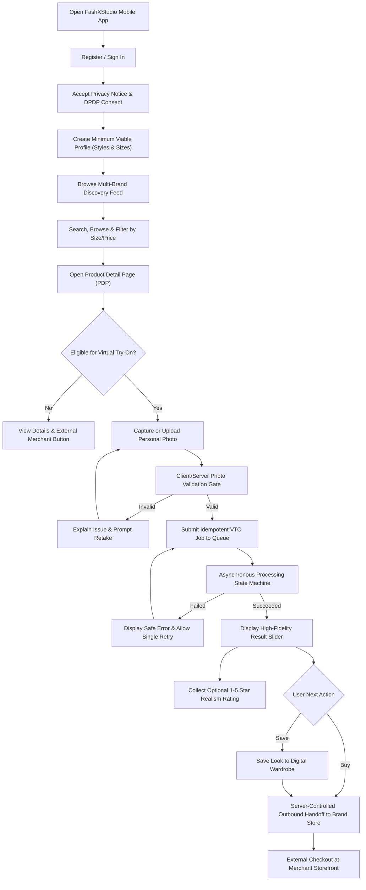

# FashXStudio — Complete Shopper Journey Specification

**Document ID:** `FASHX-JNY-007`  
**Version:** `1.0 — Approved Baseline`  
**Date:** `10 November 2026`  
**Status:** `Approved by Product Owner`  
**Scope:** `Phase 01 — Consumer Journey & Experience Specification`  

---

## 1. End-to-End Shopper Flowchart

---

## 2. Stage Expectations & System Responsibilities

| Stage | Shopper User Experience | FashXStudio System Responsibility |
| :--- | :--- | :--- |
| **Registration** | Frictionless signup via email, phone, or social login. | Secure JWT issuance; rate-limited OTP challenges. |
| **Consent** | Plain-language transparency on how photos are handled. | Purpose-specific, versioned consent records; non-bundled opt-ins. |
| **Profile** | Fast 30-second setup of style archetypes and size range. | Storing preferences without blocking browsing if incomplete. |
| **Discovery** | Fluid, image-first feed of curated D2C apparel. | Sub-800ms search latency; accurate brand and price metadata. |
| **Product Detail**| Clear garment imagery, size chart modal, and VTO indicator.| Dynamic eligibility check verifying active merchant image rights. |
| **Image Upload** | Step-by-step visual framing and lighting guidance. | Presigned private S3 uploads; 9-stage validation screening. |
| **VTO Processing**| Observable status milestones (`queued` ➔ `processing`). | Background Celery orchestration; client idempotency deduplication. |
| **Result View** | Interactive before/after split slider and pinch-to-zoom. | Secure, time-limited presigned S3 result delivery. |
| **Feedback** | 1-tap star rating and optional issue tag selection. | Relational feedback logging for model quality benchmarks. |
| **Wardrobe** | Organized collection of styled looks with price tracking. | Cascaded relational persistence; one-tap look deletion. |
| **Merchant Handoff**| Seamless redirect to the official brand product page. | Allowlist domain verification; cryptographically signed click tracking. |

---

## 3. Critical Failure & Recovery Scenarios

Every implementation must be verified against these 12 critical journey edge cases:
1. **Partial Registration:** Account created but profile setup abandoned ➔ App resumes at discovery feed with neutral defaults.
2. **Consent Revocation:** User revokes photo consent in settings ➔ Active VTO jobs are purged from Redis; VTO CTA is disabled with explanatory tooltip.
3. **Mid-Flight License Revocation:** Merchant revokes garment image rights while job is queued ➔ Job terminates safely; displays *"Brand has temporarily paused try-on for this item."*
4. **Invalid Photo Upload:** User uploads photo with multiple people or severe occlusion ➔ Rejection displays actionable guidance and prompts retake.
5. **Garment Stock Depletion:** Garment goes out of stock during session ➔ PDP reflects updated availability; VTO disabled.
6. **AI Provider Timeout:** FASHN API exceeds 30-second processing window ➔ Job transitions to `failed`; user offered single-tap retry.
7. **Storage Upload Failure:** Output synthesis succeeded but S3 upload failed ➔ Job flagged `failed` with internal alert; user given clear retry path.
8. **Result Display Error:** Mobile network drops while fetching result asset ➔ App retains `job_id`; retries download using refreshed presigned URL.
9. **Rapid Double-Tap on Submit:** Shopper taps "Try it on" twice in quick succession ➔ Backend validates client `Idempotency-Key` and processes exactly one job.
10. **Wardrobe Item Deletion:** Shopper deletes saved look ➔ Database row deleted; associated temporary S3 assets scheduled for auto-purge.
11. **Broken Merchant URL:** Merchant changed product slug on external store ➔ Handoff engine catches 404 and redirects safely to merchant domain root.
12. **Client Offline Mid-Generation:** Device loses connectivity while job is processing ➔ Backend runs job to completion in background; result appears in app upon reconnection.
