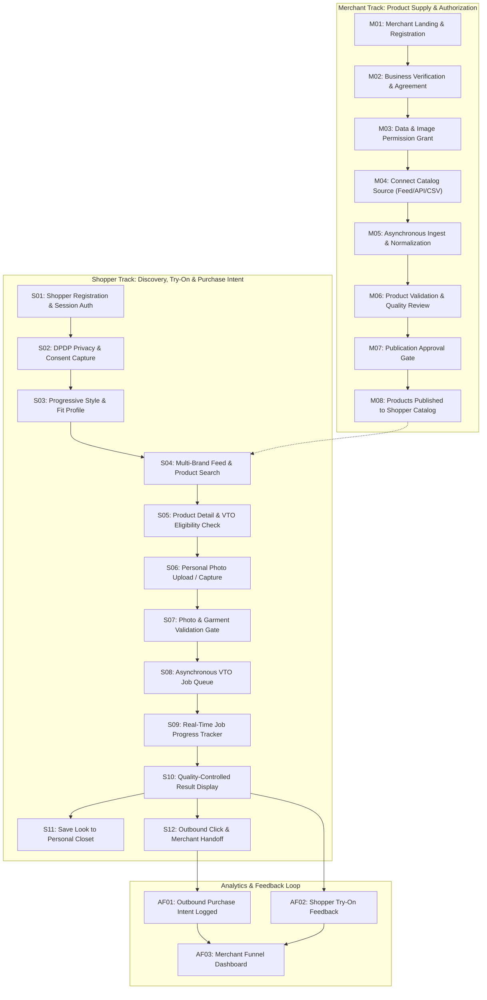

# FashXStudio — Master End-to-End User Journey Specification

**Document ID:** `FASHX-JNY-001`  
**Version:** `1.0 — Execution Baseline`  
**Date:** `10 November 2026`  
**Status:** `Approved Journey Baseline`  
**Scope:** `Phase 01.2 — End-to-End Product Contract & UX Specification`  

---

## 1. Executive Summary & Design Principles

This document defines the single, complete, testable product contract connecting:
```
Merchant Onboarding ➔ Authorized Product Ingestion ➔ Catalog Publication ➔
Shopper Onboarding ➔ Personalized Product Discovery ➔ Virtual Try-On ➔
Saved Look ➔ Merchant Product-Page Handoff ➔ Purchase Intent Analytics
```

### Core Product Principles
1. **Separation of Concerns:** FashXStudio powers personal visual discovery and virtual try-on; the merchant's storefront handles authoritative inventory, checkout, payment processing, and order fulfillment.
2. **Visual Try-On Boundary:** A generated VTO image is a visual simulation of style, color, and drape on the user's uploaded photo—it is **not proof that a garment will physically fit**. Size and fit guidance are treated as separate capabilities with distinct confidence scores.
3. **Explicit, Granular Permissions:** Merchant product metadata permissions, merchant image processing rights, shopper identity, and shopper photo-processing consents are stored as separate, versioned, revocable records.
4. **Asynchronous & Idempotent:** Virtual try-on and catalog ingestion run as asynchronous background jobs with client-generated idempotency keys. The client never polls a hanging HTTP request.
5. **No Fake Progress or Simulated Results:** UI loaders display real server states (`created`, `queued`, `preprocessing`, `processing`, `postprocessing`). If an operation fails, the system returns a safe, user-actionable error.

---

## 2. Actors & System Responsibilities

| Actor / System | Primary Responsibilities |
| :--- | :--- |
| **Merchant Owner / Admin** | Registers business, submits verification evidence, executes merchant agreement, configures data & image permissions. |
| **Merchant Catalog Operator** | Connects product feeds/APIs, reviews validation errors, maps size charts, submits approved products for publication. |
| **Shopper (Consumer)** | Registers account, reviews DPDP privacy notices, sets style/fit preferences, uploads/captures photo, executes VTO, saves looks, redirects to merchant. |
| **Consumer Mobile App (Expo)** | Renders fluid UI, validates local inputs, communicates with backend via `/api/v1`, caches feed data, manages offline fallback. |
| **Merchant Web Portal** | Responsive dashboard for catalog management, source health monitoring, permission audits, and engagement funnel analytics. |
| **API Gateway / Backend (FastAPI)** | Authenticates sessions, authorizes tenant access, validates schemas, enforces consent gates, manages state machines, records telemetry. |
| **Catalog Ingestion Workers** | Asynchronously import product feeds, normalize attributes, run deduplication algorithms, and generate pgvector embeddings. |
| **VTO Orchestrator & Workers** | Validates user & garment imagery, submits jobs to GPU provider (e.g. FASHN), evaluates visual quality, stores results in private object storage. |
| **Merchant Storefront** | Destination for shopper handoff; hosts authoritative product availability, pricing, cart, and checkout. |

---

## 3. End-to-End System Journey Flow



---

## 4. Dual Journey Stage Specifications

### A. Merchant Journey Stages (M01–M15)
- **M01–M03 (Account & Identity):** Merchant registers work email, completes OTP verification challenge, and enters corporate entity details.
- **M04–M06 (Agreements & Verification):** Submits GST/business registration evidence; signs Master Service Agreement and Data Processing Terms.
- **M07–M08 (Granular Permissions):** Explicitly grants product metadata ingestion rights and separate product image transformation/VTO rights.
- **M09–M11 (Catalog Connect & Ingest):** Connects Shopify store, product feed URL, or uploads structured CSV template; triggers ingest worker.
- **M12–M14 (Validation & Publication Review):** Ingestion worker maps attributes and flags missing sizes, low-res images, or unmapped categories. Operator fixes mappings and hits "Publish Approved Products".
- **M15 (Live Catalog Management):** Merchant dashboard monitors active SKUs, sync health, and VTO eligibility.

### B. Shopper Journey Stages (S01–S20)
- **S01–S03 (Onboarding & Auth):** Shopper launches Expo mobile app, signs in via email/OAuth, and completes session verification.
- **S04 (Consent Engine):** User reviews plain-language privacy notice. Explicitly consents to body/style personalization and photo processing for VTO.
- **S05–S08 (Progressive Profile):** Captures height, usual size, fit preference (slim/regular/oversized), preferred colors, and style archetypes.
- **S09–S11 (Discovery & Product Selection):** Shopper browses multi-merchant feed, filters by category/size, and opens an eligible product detail page.
- **S12–S14 (Try-On Preparation):** Taps "Try it on", views framing guidelines, captures or uploads a photo. System validates single person, resolution, and pose.
- **S15–S17 (VTO Execution):** Client submits idempotent job. App tracks state (`queued` ➔ `processing` ➔ `completed`). Renders high-fidelity try-on result.
- **S18 (Closet Save):** Persists look to digital wardrobe with price-snapshot tracking.
- **S19–S20 (Merchant Handoff & Feedback):** Taps "Buy at Merchant"; server logs outbound intent and redirects to approved merchant product page.

---

## 5. Non-Negotiable UX & Engineering Rules

1. **Timeout Handling:** If a client request times out while submitting a job or handoff, the UI **must not** assume the server failed. It queries the resource by its idempotency key to prevent duplicate jobs or double billing.
2. **Fail-Closed Permission Check:** If a merchant revokes image-use rights while a product is live, all try-on requests for that SKU fail immediately with a safe `MERCHANT_PERMISSIONS_REVOKED` user message.
3. **No Hidden Buttons as Security:** All permissions, quotas, and tenant isolation checks are enforced at the backend service layer via JWT claims.
4. **Biometric Privacy:** Temporary user photos uploaded for VTO are stored in private object buckets with presigned URLs and scheduled for automatic deletion.

---

## 6. End-to-End Acceptance Scenario

To declare Phase 01.2 acceptance, the following unbroken flow must be demonstrated:
1. Merchant `M_D2C_01` registers, verifies organization, and signs version 1.0 terms.
2. `M_D2C_01` grants metadata rights and image VTO rights, connecting a 50-SKU kurta feed.
3. Ingestion worker normalizes the feed, validates attributes, and operator approves 45 eligible products.
4. Products are indexed into the catalog with `catalog_status=published` and `vto_eligibility_status=eligible`.
5. Shopper `U_SHOP_01` registers, completes DPDP consent, and sets "Casual & Ethnic" preferences.
6. `U_SHOP_01` searches for "cotton kurta", selects SKU `KURTA_NAVY_01`, and uploads a photo.
7. VTO job is submitted with idempotency key `idemp_001`. Job queue processes inference via FASHN adapter.
8. Generated try-on result is validated for quality, rendered on the mobile app, and saved to `U_SHOP_01`'s wardrobe.
9. Shopper taps "Buy at Merchant", triggering event `merchant_handoff_clicked` and cleanly redirecting to the merchant's checkout page.
10. Merchant dashboard reflects 1 impression, 1 completed VTO, 1 saved look, and 1 outbound click.
