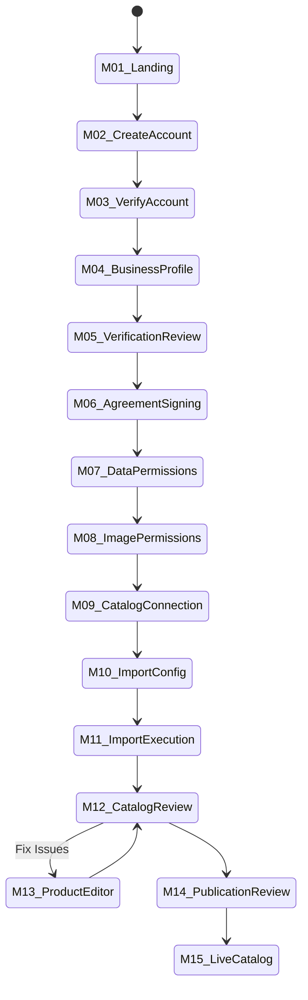

# FashXStudio — Merchant Onboarding & Catalog Publication Journey

**Document ID:** `FASHX-JNY-002`  
**Version:** `1.0 — Execution Baseline`  
**Date:** `10 November 2026`  
**Scope:** `Phase 01.2 — Merchant Track Specification`  

---

## 1. Merchant Journey Flow (M01–M15)

The merchant journey transitions an Indian D2C apparel brand from initial discovery to an active, authorized product supplier with live products in the consumer discovery feed.



### Detailed Screen & Action Matrix

| Step ID | Screen Title | User Action & Input | System Operation & API | Expected Output |
| :--- | :--- | :--- | :--- | :--- |
| **M01** | Merchant Landing | Clicks "Partner With Us" / "For Brands" | Serves landing content | Entry into merchant onboarding flow |
| **M02** | Create Account | Enters work email, phone, name, password | `POST /api/v1/merchants` | User entity created; OTP challenge dispatched |
| **M03** | Verify Account | Enters 6-digit OTP code | `POST /api/v1/auth/verify` | Authenticated session with `ROLE_MERCHANT_ADMIN` |
| **M04** | Business Profile | Enters Brand Name, GSTIN, Web URL, Office Address | `POST /api/v1/merchants/{id}/profile` | Merchant organization record set to `pending_verification` |
| **M05** | Verification | Uploads GST Certificate / Trademark proof | `POST /api/v1/merchants/{id}/verification`| Verification packet queued for founder/admin review |
| **M06** | Agreements | Reviews & digitally accepts Master Pilot Terms | `POST /api/v1/merchants/{id}/agreements` | Agreement record created with timestamp, IP, and version |
| **M07** | Data Permissions | Selects metadata fields allowed for syndication | `POST /api/v1/merchants/{id}/permissions`| Permission `METADATA_INGEST` logged |
| **M08** | Image Permissions| Explicitly authorizes garment images for AI VTO | `POST /api/v1/merchants/{id}/permissions`| Permission `IMAGE_VTO_PROCESS` logged |
| **M09** | Catalog Source | Selects connection type (Shopify / Feed / CSV) | `POST /api/v1/merchants/{id}/catalog-sources`| Catalog source entity created with credentials |
| **M10** | Import Config | Maps category fields, sets sync frequency | `PUT /api/v1/catalog-sources/{id}/configuration`| Field mapping rules saved to DB |
| **M11** | Import Status | Clicks "Start Initial Import" | `POST /api/v1/catalog-sources/{id}/imports`| Background worker starts; returns `job_id` |
| **M12** | Catalog Review | Reviews imported SKUs, flagged errors, dupes | `GET /api/v1/merchants/{id}/products` | Validation report displaying valid vs flagged items |
| **M13** | Product Editor | Corrects missing sizes, maps categories | `PATCH /api/v1/merchants/{id}/products/{p_id}`| Product record updated to `ready_for_approval` |
| **M14** | Publish Review | Selects validated products and confirms | `POST /api/v1/products/{id}/publish` | Products promoted to `published` in discovery index |
| **M15** | Live Dashboard | Views active catalog health & sync status | `GET /api/v1/merchants/{id}/dashboard` | Real-time overview of published SKUs & VTO metrics |

---

## 2. Granular Data & Image Permission Model

In compliance with copyright and data sovereignty regulations, permissions are **never bundled into a single checkbox**. Each capability is a distinct, versioned database record:

```
Merchant Permission Record
├── permission_id (UUID)
├── merchant_id (UUID)
├── scope: [METADATA_INGEST | METADATA_DISPLAY | IMAGE_STORE | IMAGE_TRANSFORM | IMAGE_VTO_PROCESS | CATALOG_ANALYTICS | PRODUCT_HANDOFF]
├── allowed_categories: ["mens_tshirt", "womens_top", "kurta"]
├── policy_version: "2026.1"
├── granted_by_user_id (UUID)
├── granted_at (ISO 8601)
├── status: [ACTIVE | REVOKED | EXPIRED]
└── revocation_reason (Nullable String)
```

### Permission Capabilities Matrix

| Permission Type | Authorized Scope | Fallback / Revocation Behavior |
| :--- | :--- | :--- |
| `METADATA_INGEST` | Import product title, SKU, price, description, sizes | Ingestion jobs rejected if revoked. |
| `METADATA_DISPLAY` | Render product cards and details on consumer feed | Products immediately hidden from shopper feed. |
| `IMAGE_STORAGE` | Store and cache high-resolution garment imagery | Images purged from CDN/storage on revocation. |
| `IMAGE_TRANSFORM` | Generate square thumbnails, crops, and background removals | Raw images used without processing. |
| `IMAGE_VTO_PROCESS`| Submit garment image to diffusion model for virtual try-on | VTO action disabled; button displays "Try-on paused". |
| `CATALOG_ANALYTICS`| Aggregate impression, try-on, and handoff events | Merchant dashboard reporting disabled. |
| `PRODUCT_HANDOFF` | Direct shoppers to merchant's product page | Redirects blocked; displays "Item temporarily unavailable". |

---

## 3. Minimum Product Data Contract

Any imported product record must adhere to this canonical schema before entering validation:

```json
{
  "merchant_id": "merch_d2c_001",
  "source_product_id": "sku_fab_1082",
  "sku": "FAB-KURTA-NVY-M",
  "title": "Indigo Block-Print Cotton Kurta",
  "brand": "FabIndie",
  "category": "ethnic_wear",
  "subcategory": "kurta",
  "gender": "women",
  "description": "Pure cotton straight kurta with hand-block print and mandarin collar.",
  "product_url": "https://brand.com/products/indigo-block-print-kurta",
  "images": [
    {
      "url": "https://cdn.brand.com/images/k1082_front.jpg",
      "role": "front",
      "permission_ref": "perm_img_vto_01"
    }
  ],
  "price": 1499.00,
  "currency": "INR",
  "in_stock": true,
  "sizes": ["S", "M", "L", "XL"],
  "size_chart": {
    "unit": "cm",
    "measurements": {
      "M": {"bust": 96, "waist": 86, "length": 110}
    }
  },
  "material": "100% Cotton",
  "color": "Navy Blue",
  "source_updated_at": "2026-11-10T04:00:00Z"
}
```

---

## 4. Product Lifecycle States & Publication Gates

A product progresses through strict lifecycle states:

```
[Discovered] ➔ [Imported] ➔ [Normalized] ➔ [Validating]
                                             │
                       ┌─────────────────────┴─────────────────────┐
                       ▼                                           ▼
                 [Needs Review]                                [Approved]
                       │                                           │
                       ▼                                           ▼
                  (Fixed in UI)                               [Published]
                                                                   │
                                                ┌──────────────────┴──────────────────┐
                                                ▼                                     ▼
                                             [Paused]                             [Archived]
```

### Publication Gate Checklist
A product is promoted to `Published` **if and only if**:
- [x] Merchant organization status is `ACTIVE` and verified.
- [x] Required permissions (`METADATA_DISPLAY`, `PRODUCT_HANDOFF`) are active.
- [x] Product title, valid brand, valid product URL, and at least 1 front image are present.
- [x] Front image meets minimum resolution ($800 \times 1000$ px) and valid aspect ratio.
- [x] Primary category is supported by the current release.
- [x] Deduplication algorithm confirms no duplicate SKU or canonical URL conflict.
- [x] Product is confirmed `in_stock`.

### Independent VTO Eligibility Flag
A product can be `Published` (searchable/buyable) even if `vto_eligibility_status` is `INELIGIBLE`. A product is only marked `VTO_ELIGIBLE` when:
1. `IMAGE_VTO_PROCESS` permission is explicitly active.
2. Front image is on a neutral background or ghost mannequin without severe occlusion.
3. Garment category is an approved MVP category (T-shirt, shirt, top, kurta).
