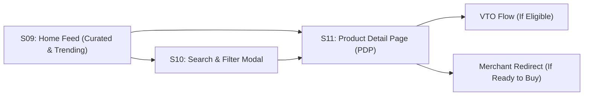

# FashXStudio — Product Discovery & Product Detail Journey

**Document ID:** `FASHX-JNY-004`  
**Version:** `1.0 — Execution Baseline`  
**Date:** `10 November 2026`  
**Scope:** `Phase 01.2 — Discovery & Navigation Specification`  

---

## 1. Discovery Architecture Overview (S09–S11)

The discovery subsystem connects the shopper with authorized fashion products across onboarded D2C brands. It blends preference-driven feed curation, keyword/filter search, and high-fidelity product detail pages with explicit VTO availability status.

---

## 2. Screen Specifications

### S09: Multi-Brand Discovery Feed
- **Header:** Brand logo, search icon, profile avatar, active filter chips.
- **Feed Sections:**
  - *For You:* Personalized recommendations scored by style archetypes and preferred colors.
  - *New Drops:* Freshly synchronized products from connected D2C brands.
  - *Ethnic Focus:* Men's & women's kurtas from curated regional designers.
- **Product Card Elements:**
  - High-res front garment image.
  - Merchant brand pill (e.g., "FabIndie", "The Souled Store").
  - Clean title (truncated to 2 lines).
  - Price & Currency (`₹1,499`).
  - **Try-On Availability Badge:**
    - 🟢 *Try On Ready* (Garment passes all VTO criteria).
    - ⚪ *Browse Only* (VTO not supported for this item).

### S10: Search & Multi-Facet Filtering
- **Keyword Search:** Elastic/trigram match across product title, brand, category, and fabric.
- **Filter Facets:**
  - Category: `T-Shirts`, `Shirts`, `Tops`, `Kurtas`.
  - Brand: Multi-select across active authorized merchants.
  - Size in Stock: `XS`, `S`, `M`, `L`, `XL`, `XXL`.
  - Price Range: Dual-slider with min/max bounds.
  - VTO Only Toggle: Filter exclusively for garments eligible for virtual try-on.
- **Sort Options:** `Recommended`, `Price: Low to High`, `Price: High to Low`, `Newest First`.

### S11: Product Detail Page (PDP)
- **Image Carousel:** Authorized merchant product gallery (Front, Back, Detail, Lifestyle).
- **Garment Metadata:** Title, brand link, current price, SKU, fabric/material details, care instructions.
- **Variant Selectors:** Color swatches and available size pills with stock availability indicators.
- **Size Chart Modal:** Interactive brand size chart mapping chest/bust, waist, and length measurements with metric/imperial toggle.
- **Call-to-Action Buttons:**
  - **Primary CTA ("Try it on"):** Enabled only when `vto_eligibility_status == "ELIGIBLE"`. If ineligible, displays *"Try-on not supported for this item"* with an explanatory modal.
  - **Secondary CTA ("Buy at Merchant"):** Prominently styled button that launches the outbound handoff flow to the merchant's official storefront.
  - **Fit Disclaimer:** Persistent footer notice: *"Virtual Try-On is a visual preview of style and drape. Please consult the brand's size chart for physical sizing guidance."*
