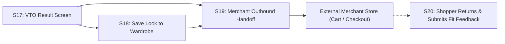
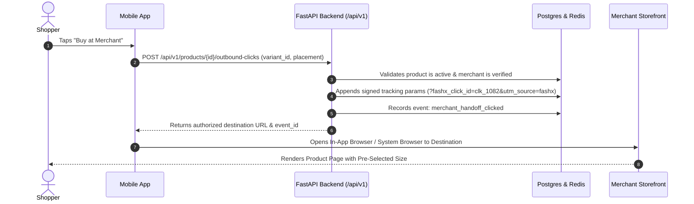

# FashXStudio — Saved Looks, Digital Wardrobe & Commerce Handoff Journey

**Document ID:** `FASHX-JNY-006`  
**Version:** `1.0 — Execution Baseline`  
**Date:** `10 November 2026`  
**Scope:** `Phase 01.2 — Wardrobe & Commerce Redirection Specification`  

---

## 1. Wardrobe & Commerce Workflow (S18–S20)

Once a virtual try-on is successfully generated, the shopper can either persist the styled look into their personal digital wardrobe or seamlessly transition to the merchant's e-commerce store to purchase.



---

## 2. Save Look & Digital Wardrobe (S18)

### Save-Look Data Entity
To minimize storage overhead and protect privacy, a `SavedLook` record does **not** duplicate the raw uploaded user image. It maintains normalized relational references:

```
SavedLook Entity
├── look_id (UUID)
├── user_id (UUID)
├── product_id (UUID)
├── variant_id (UUID)
├── vto_job_id (UUID)
├── result_asset_url (Time-limited Signed S3 URL)
├── price_at_save (Numeric e.g. 1499.00 INR)
├── saved_at (ISO 8601)
├── user_tags: ["Summer Outfits", "Diwali 2026"]
└── is_active (Boolean)
```

### Digital Wardrobe Screen Capabilities
- **Collection Views:** Group looks by season, occasion, or garment category (e.g., "Workwear Kurtas", "Weekend Casuals").
- **Price-Drop Tracking:** Compares `price_at_save` against the current synchronized merchant price and highlights price drops with a green badge.
- **Variant Switcher:** Allows the shopper to toggle between different colors tried on for the same garment.
- **One-Tap Deletion:** Instantly purges the look and cascades deletion of temporary generated assets if no longer referenced.

---

## 3. Server-Controlled Merchant Handoff (S19)

### Redirection Security & Attribution Architecture
To prevent phishing, malicious open-redirect attacks, and parameter tampering, the mobile app **never** opens an unvalidated external URL directly. All outbound navigation is routed through the backend:



### Security & Allowlist Enforcement
- The backend verifies that the destination URL matches the registered domain in `merchants.allowed_domains`.
- Open redirect attempts (e.g. `?dest=evil.com`) are rejected with `HTTP 400 INVALID_DESTINATION`.
- Affiliate tracking parameters (e.g. Sub-ID, Click ID) are cryptographically signed on the server.

---

## 4. Purchase Intent vs. Conversion Attribution

### Honest Commerce Boundary
- **Outbound Click $\neq$ Sale:** An outbound click measures **high purchase intent**, not a completed financial transaction.
- **Purchase Conversion Validation:** A purchase is logged as a verified conversion **only** when:
  1. The partner merchant integrates the FashXStudio Conversion Webhook (`POST /api/v1/integrations/webhooks/orders`).
  2. Or an authorized affiliate tracking network returns an authenticated server-to-server postback referencing `fashx_click_id`.
- Untracked direct sales are never fabricated or estimated as confirmed revenue.

---

## 5. Shopper Return & Post-Try-On Feedback (S20)

When the shopper returns to the app from the merchant storefront, a non-intrusive bottom sheet prompts for feedback:
- *"Did you find what you were looking for?"* (`Yes, ordered` / `Bookmarked for later` / `Item out of stock` / `Size unavailable`).
- Try-On Realism Score: 1 to 5 stars.
- Optional comment field for quality reporting (e.g., fabric drape, color accuracy).
