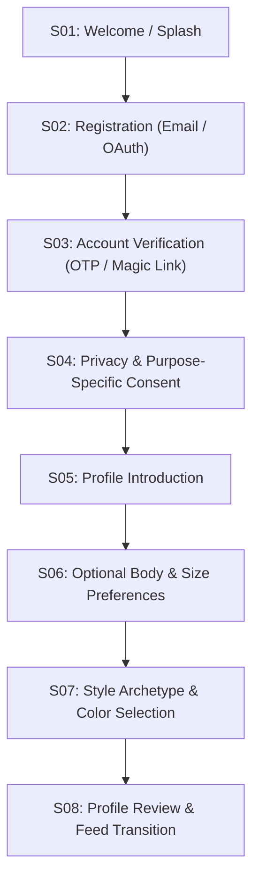

# FashXStudio — Shopper Onboarding, Consent & Profile Journey

**Document ID:** `FASHX-JNY-003`  
**Version:** `1.0 — Execution Baseline`  
**Date:** `10 November 2026`  
**Scope:** `Phase 01.2 — Shopper Track Specification`  

---

## 1. Shopper Journey Overview (S01–S08)

The shopper onboarding journey introduces users to FashXStudio, secures explicit DPDP Act 2023 consent, and captures a lightweight, progressive style profile before directing them to the discovery feed.



---

## 2. Progressive Onboarding Philosophy

1. **Zero Cold-Gate:** Shoppers are **never** blocked by a mandatory 20-field body measurement questionnaire.
2. **Browse First:** Users may skip body profile setup and immediately explore products.
3. **Just-In-Time Photo Capture:** Full-body photo capture is requested only when the user taps "Try it on" for a specific garment, never during initial account creation.

---

## 3. Privacy & Purpose-Specific Consent (S04)

In compliance with the Indian Digital Personal Data Protection Act (DPDP Act 2023) and global privacy standards, consent is explicitly decoupled into independent categories:

```
Shopper Consent Schema
├── user_id (UUID)
├── notice_version: "2026.1-DPDP"
├── consent_timestamp (ISO 8601)
├── client_ip & user_agent
└── purposes:
    ├── account_essential: TRUE (Mandatory for service operation)
    ├── profile_personalization: [TRUE | FALSE] (Body & style recommendation)
    ├── vto_photo_processing: [TRUE | FALSE] (AI inference on uploaded photo)
    ├── photo_storage_cache: [TRUE | FALSE] (Retain photo for 30 days vs discard post-job)
    └── telemetry_analytics: [TRUE | FALSE] (Aggregated usage metrics)
```

### Consent Screen UI Rules
- Plain-language explanation: *"We use your style quiz to recommend clothes that fit your taste. If you choose to try on clothes, your photo is sent securely to our AI model and deleted according to your settings."*
- No pre-ticked checkboxes for optional purposes.
- Shopper may revoke consent at any time in `Settings ➔ Privacy & Data`.
- If `vto_photo_processing` is declined, product browsing and size charts remain 100% accessible; only the "Try it on" button is disabled with an explanatory tooltip.

---

## 4. Body & Style Profile Specifications (S06–S07)

### Profile Fields & Behavior

| Profile Category | Attribute | Input Type | Validation Rules | MVP Behavior |
| :--- | :--- | :--- | :--- | :--- |
| **Basic** | Display Name | Text | 2–50 chars, sanitized | Shown on greeting |
| **Basic** | Gender Preference | Single Select | `Men`, `Women`, `All` | Filters initial feed |
| **Body** | Height | Number (cm/ft) | 120–230 cm | Optional |
| **Body** | Weight | Number (kg) | 30–200 kg | Optional |
| **Usual Sizes** | Tops / Shirts | Multi-select | `XS`, `S`, `M`, `L`, `XL`, `XXL` | Feeds size filter |
| **Fit Preference**| Cut Style | Single Select | `Slim`, `Regular`, `Relaxed`, `Oversized` | Adjusts recommendation weight |
| **Style** | Archetypes | Multi-select (Max 3) | `Casual`, `Streetwear`, `Ethnic`, `Minimal`, `Formal` | Curates initial feed tabs |
| **Color** | Preferred Colors | Multi-select | Palette swatches (Navy, Beige, Olive, Black, etc.) | Boosts match scores |
| **Color** | Avoided Colors | Multi-select | Palette swatches | Penalizes match scores |

### Strict Privacy Guarantee
- The system **never** silently extracts body measurements or sensitive attributes (e.g., estimated weight, waist circumference, or biometric markers) from an uploaded try-on photo.
- All body attributes must be explicitly entered and confirmed by the shopper.
