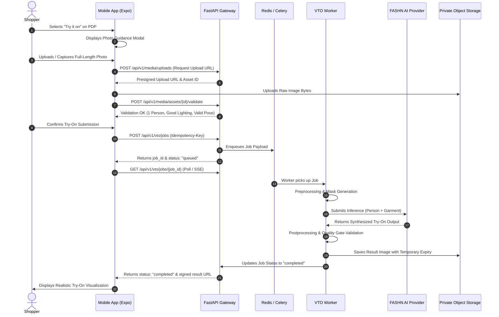
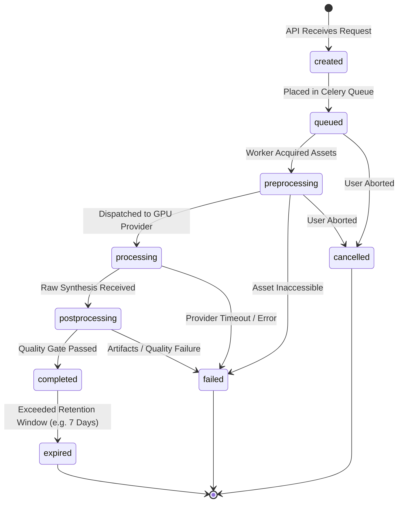

# FashXStudio — Virtual Try-On Shopper Journey & Orchestration

**Document ID:** `FASHX-JNY-005`  
**Version:** `1.0 — Execution Baseline`  
**Date:** `10 November 2026`  
**Scope:** `Phase 01.2 — Virtual Try-On Pipeline & UX Specification`  

---

## 1. VTO Workflow Overview (S12–S17)

The virtual try-on workflow connects the shopper's uploaded photograph with an authorized garment asset through an asynchronous, quality-controlled AI generation pipeline.

---

## 2. Photo Guidance & Validation Protocol

### User Photo Guidance Screen (S12)
Before requesting camera or gallery access, the app presents explicit visual guidelines:
- **Framing:** Full-body or upper-torso framing depending on garment type.
- **Lighting:** Evenly lit environment without harsh backlight or heavy shadows.
- **Pose:** Standing straight, arms relaxed at sides, looking forward.
- **Composition:** Exactly one person in frame; avoid crowded backgrounds.
- **Consent Notice:** *"Only upload your own photo. Photos of minors or non-consenting individuals are strictly prohibited."*

### Nine-Stage Image Validation Pipeline
1. **MIME & Magic Bytes:** Confirms valid image file (`image/jpeg`, `image/png`, `image/webp`).
2. **File Size Bounds:** Enforces limits (Minimum: 100 KB, Maximum: 15 MB).
3. **Resolution & Aspect Ratio:** Minimum $768 \times 1024$ px; aspect ratio between $3:4$ and $9:16$.
4. **Decodability Check:** Ensures image is uncorrupted and readable via Pillow/OpenCV.
5. **Person Detection:** Confirms presence of a human subject with confidence $\ge 0.85$.
6. **Single-Subject Verification:** Rejects images containing multiple detected bodies.
7. **Pose & Occlusion Guard:** Flags severe limb crossings, hands blocking torso, or extreme seated/twisted angles.
8. **Garment Compatibility:** Verifies merchant garment image is eligible and properly segmented.
9. **Active Consent Verification:** Validates that shopper's `vto_photo_processing` consent is active.

---

## 3. Asynchronous Job State Machine

Jobs transition through strict, observable lifecycle states without synthetic progress bars:

### Honest Status Messaging Matrix

| System State | User-Facing Message | Available User Action |
| :--- | :--- | :--- |
| `created` | Preparing your try-on session... | Cancel |
| `queued` | Waiting for available AI processor... | Cancel |
| `preprocessing` | Preparing your photo and garment details... | Cancel |
| `processing` | Generating your personalized try-on... | Wait (Spinner / Animation) |
| `postprocessing` | Reviewing visual quality and fine details... | Wait |
| `completed` | Your virtual try-on is ready! | View, Save Look, Compare, Outbound Buy |
| `failed` | We couldn't complete this try-on. | View safe error message & retry options |
| `cancelled` | Try-on session cancelled. | Select another item / restart |
| `expired` | This generated preview has expired. | Generate a fresh try-on |

---

## 4. Recoverable Error Handling & Retry Policies

When a job enters `failed`, the API returns a structured, safe error envelope with explicit recovery actions:

| Error Code | User-Facing Explanation | Remediation / Recovery Action |
| :--- | :--- | :--- |
| `IMAGE_POOR_LIGHTING` | Photo is too dark to clearly see garment fit. | Prompt to retake photo with better lighting. |
| `IMAGE_OCCLUSION_DETECTED`| Your torso or arms are partially hidden. | Retake photo standing straight with hands at sides. |
| `MULTIPLE_PEOPLE_DETECTED`| Multiple people detected in the image. | Upload a photo containing only yourself. |
| `PROVIDER_TIMEOUT` | AI processor took too long to respond. | Single-tap retry with same idempotency key. |
| `QUALITY_CHECK_FAILED` | Generation contained visual imperfections. | Automatic single retry with alternative diffusion seed. |
| `MERCHANT_PERM_REVOKED` | Brand has temporarily paused try-on for this item. | Direct user to standard product detail & merchant link. |
| `DAILY_QUOTA_EXCEEDED` | Daily free try-on limit reached (5/5). | Message informing quota resets at midnight IST. |

---

## 5. Result Display & Comparison Screen (S17)

- **Interactive Split Slider:** Before/After interactive slider comparing the user's original photo against the synthesized try-on result.
- **Detail Zoom:** Pinch-to-zoom enabling inspection of collar lines, fabric texture, and sleeve draping.
- **Action Toolbar:**
  - *Save to Wardrobe:* Persists look to digital closet.
  - *Try Another Size/Color:* Quick variant switcher.
  - *Buy at Merchant:* Triggers direct handoff to brand store.
  - *Report Result:* Feedback modal allowing shopper to flag artifacts, skin tone warping, or misalignments.
