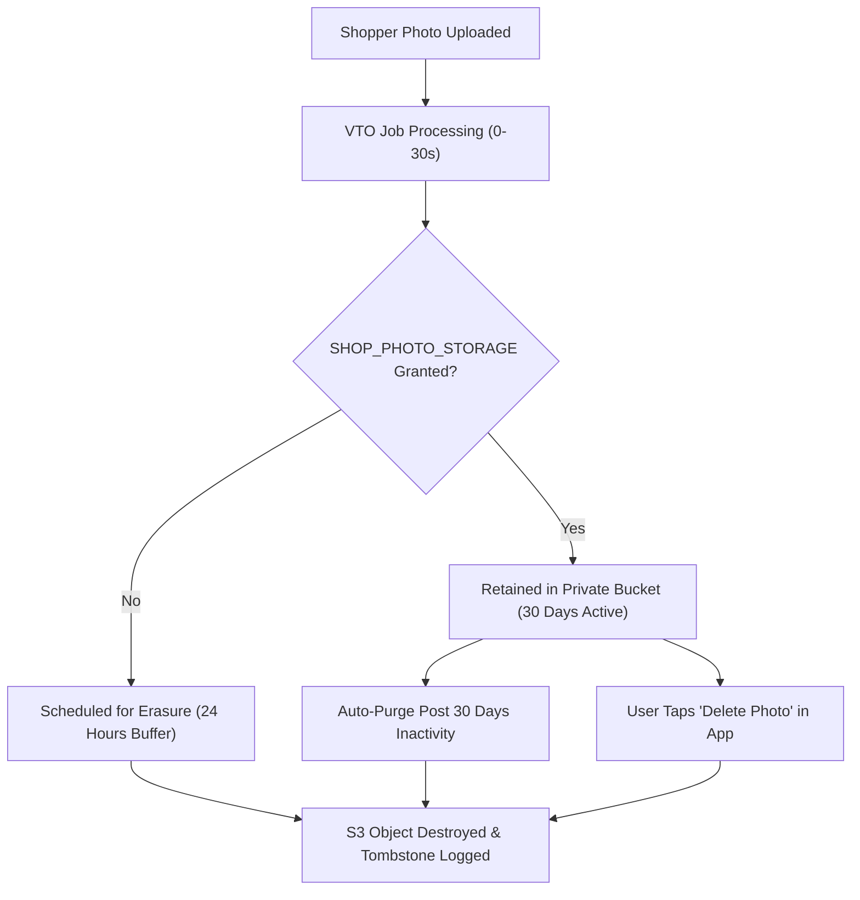

# FashXStudio — Consent & Permission Governance Matrix

**Document ID:** `FASHX-PRIV-001`  
**Version:** `1.0 — Execution Baseline`  
**Date:** `10 November 2026`  
**Scope:** `Phase 01.2 — Legal & Privacy Governance Specification`  

---

## 1. Regulatory Context & Architectural Mandate

In strict adherence to the **Digital Personal Data Protection Act (DPDP Act 2023)** of India and international privacy best practices:
1. **Explicit Purpose Separation:** Consent is collected independently for each declared data processing purpose. Bundled or coerced consent is strictly prohibited.
2. **Right to Revoke & Erase:** Both shoppers and merchants can revoke specific permissions or request comprehensive erasure at any time.
3. **No Secondary Use Without Consent:** User photos uploaded for virtual try-on are **never** utilized for foundation model training or commercial marketing without explicit, separate opt-in consent.
4. **Server-Enforced Access Control:** Permission validation occurs at the backend gateway on every request.

---

## 2. Merchant Permission Governance Matrix

Merchant permissions grant FashXStudio specific rights to handle proprietary catalog metadata and copyrighted brand photography.

| Permission Code | Purpose & Scope | Legal Notice Reference | Default State | Revocation Impact |
| :--- | :--- | :--- | :--- | :--- |
| `MERCH_DATA_INGEST` | Import product titles, descriptions, SKUs, and prices via feed/API. | Section 3.1, Merchant Terms | Disabled (Opt-In) | Ingestion workers immediately block sync for this merchant. |
| `MERCH_DATA_DISPLAY` | Display normalized product metadata on the consumer mobile app. | Section 3.2, Merchant Terms | Disabled (Opt-In) | Products instantly hidden from consumer discovery feed. |
| `MERCH_IMAGE_STORE` | Store and cache garment photography in private cloud object storage. | Section 4.1, Merchant Terms | Disabled (Opt-In) | Garment assets marked for deletion within 24 hours. |
| `MERCH_IMAGE_TRANSFORM`| Resize, compress, and remove backgrounds for catalog presentation. | Section 4.2, Merchant Terms | Disabled (Opt-In) | Asset pipelines restricted to raw source imagery. |
| `MERCH_IMAGE_VTO` | Submit garment image to diffusion model for virtual try-on synthesis.| Section 4.3, Merchant Terms | Disabled (Opt-In) | VTO action disabled for all SKUs; button displays "Try-On Paused". |
| `MERCH_ANALYTICS` | Aggregate impression, try-on, and handoff events for merchant reporting. | Section 5.1, Merchant Terms | Disabled (Opt-In) | Merchant dashboard analytics disabled. |
| `MERCH_HANDOFF` | Direct consumer traffic to merchant's product page via affiliate link. | Section 6.1, Merchant Terms | Disabled (Opt-In) | Outbound redirect blocked; displays item unavailable. |

---

## 3. Shopper Consent Governance Matrix

Shopper consents protect personal biometric photography and private style/body data.

| Purpose Code | Purpose Declaration | Legal Basis | Optional? | Retention Window | Revocation Workflow |
| :--- | :--- | :--- | :--- | :--- | :--- |
| `SHOP_AUTH_ESSENTIAL` | Account creation, session authentication, and security audit logs. | Contractual Necessity | Mandatory | Account lifetime + 90 days audit | Account deletion deletes user records. |
| `SHOP_PROFILE_STYLE` | Save height, usual size, and style preferences for personalized feed. | User Consent | Optional | Account lifetime or user reset | User resets preferences in Profile Settings. |
| `SHOP_PHOTO_VTO` | Process uploaded photo through AI model to generate virtual try-on. | User Consent | Optional | Job completion + 24 hours temp buffer | User can revoke in Privacy Settings; blocks VTO. |
| `SHOP_PHOTO_STORAGE`| Retain photo in private storage for instant future try-ons (30 days). | User Consent | Optional | 30 days from upload or explicit delete | Deletes image asset from private S3 bucket. |
| `SHOP_TELEMETRY` | Track anonymized navigation and click-through events for UX refinement. | Legitimate Interest | Optional | 90 days rolling window | Opt-out disables pseudonymous event tracking. |

---

## 4. Retention & Erasure Lifecycle

### Deletion Audit Verification
- When an erasure request is executed (either via automated TTL expiration or user-initiated deletion), the system issues an S3 `DeleteObject` command, marks the database row `tombstoned_at = now()`, and writes an immutable entry into `audit_logs` confirming permanent destruction.
