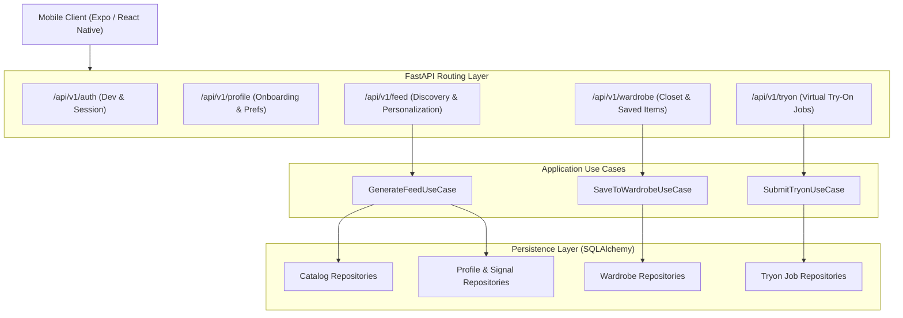

# RC-01 — Backend Recovery Architecture

## Architectural Principles
FashXStudio backend is structured using clean architecture patterns with explicit boundaries:
1. **Domain Layer**: Core business models, entities, and validation invariants.
2. **Application Layer**: Use cases orchestrating domain services, transaction units of work, and ports.
3. **Infrastructure & Adapters**: SQLAlchemy repositories, external embedding providers, object storage abstractions, and Alembic migrations.
4. **Presentation / API Layer**: FastAPI routers, Pydantic schemas, dependency injection for UOWs, and authentication dependencies.

## Subsystem Responsibilities

### 1. Discovery & Recommendation Subsystem
- **Component**: `backend/fashx/recommendation/application/generate_feed.py`
- **Responsibilities**:
  - Retrieve candidate products from `canonical_garments` joining `merchant_products`, `merchant_offers`, and `garment_enrichments`.
  - Apply deterministic user preference filters:
    - **Categories**: Must match user preferred categories if specified.
    - **Budget**: Maximum price in minor units (e.g. paisa/cents) must be `>= offer.price_cents`.
    - **Gender**: Product gender category must match target user gender or be unisex (`all`).
  - Calculate taste vector similarity when user has interaction signals (likes, saves, quiz picks).
  - Produce personalized explanation strings for feed cards.
  - Return diagnostic metadata (`total_candidates`, `filtered_by_*`, `empty_reason`).

### 2. Wardrobe & Closet Subsystem
- **Component**: `backend/fashx/wardrobe/`
- **Responsibilities**:
  - Persist saved garments with immutable snapshot details (`title`, `price_cents`, `currency`, `image_url`, `brand`, `category`).
  - Enforce user isolation: A user cannot view, modify, or delete items owned by another user.
  - Support soft or hard deletion per business requirements.

### 3. Catalog & Ingestion Subsystem
- **Component**: `backend/fashx/catalog/`
- **Responsibilities**:
  - Maintain `catalog_sources` registry. Every ingested item must belong to an authorized, cleared catalog source.
  - Ingest merchant feeds and assign canonical IDs to products.
  - Produce semantic enrichments (occasions, styles, seasons, embeddings) via `garment_enrichments`.

### 4. Profile & Identity Subsystem
- **Component**: `backend/fashx/profile/`
- **Responsibilities**:
  - Manage onboarding preferences, style quiz picks, reference photo consent, and user preferences.
  - Expose preferences consumed by `GenerateFeedUseCase`.
