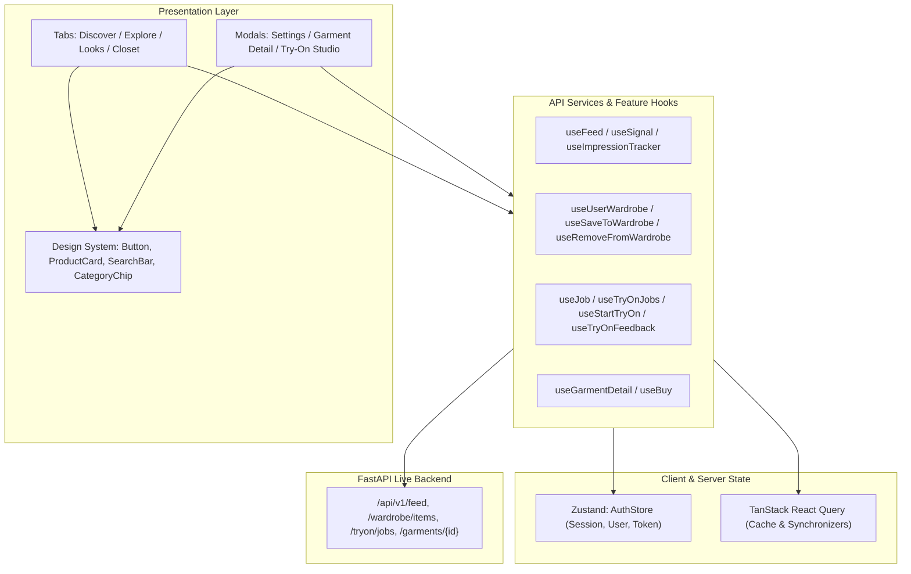

# RC-02 — Frontend Architecture & State Management

## Architecture Overview
The FashXStudio mobile application is built using React Native, TypeScript, and Expo Router. It separates client state, server state, presentation components, and domain business rules cleanly.

## State Management Responsibilities

### 1. Global Authentication & Session State (`Zustand`)
- **File**: `mobile/src/features/auth/authStore.ts`
- **Scope**: Authenticated user session, `me` object, role, onboarding completion flags.
- **Security**: Token storage handled securely via `expo-secure-store` or dev token session. On sign-out or account erasure, queries are invalidated and cached tokens are cleared.

### 2. Server State & Remote Caching (`TanStack React Query`)
- **Feed Cache**: Stored under query key `["feed"]`. Invalidated upon recording negative interaction signals (`hide`, `not_interested`) or refreshing.
- **Wardrobe Cache**: Stored under query key `["wardrobe"]`. Invalidated upon saving or removing items.
- **Try-On Jobs**: Polled with exponential/adaptive intervals until reaching terminal status (`completed`, `failed`, `cancelled`).

### 3. Navigation State (`Expo Router`)
- File-based router using typed routes in `mobile/app/`.
- Deep linking support for `/garment/[id]` and `/tryon/[jobId]`.
