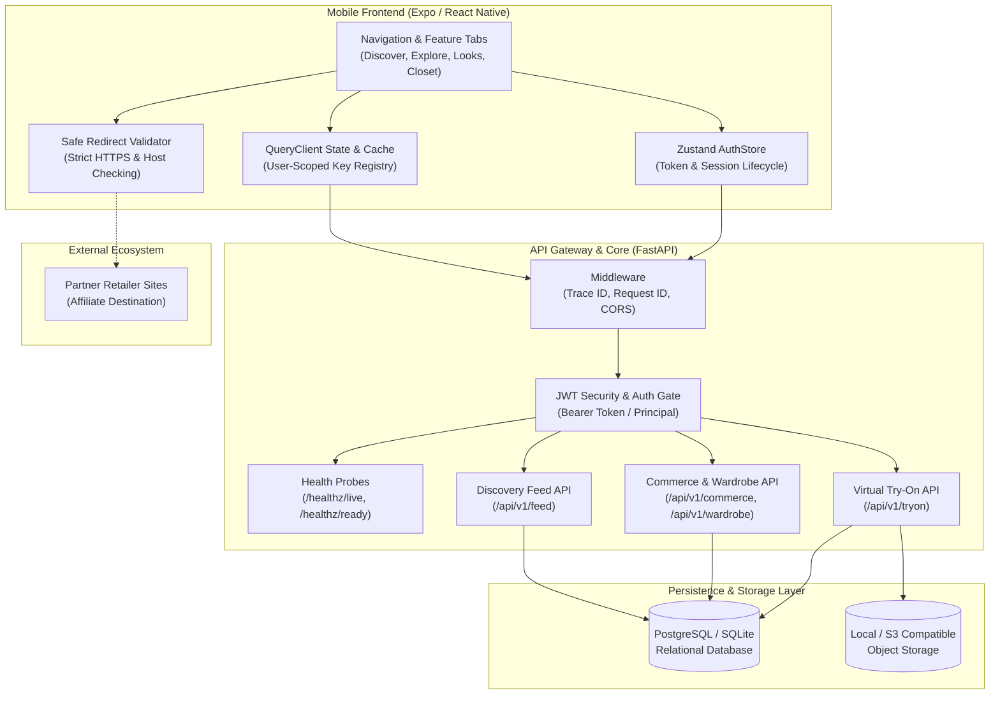

# RC-03 — System Integration Architecture

## Architectural Topology

The FashXStudio system architecture integrates the mobile client, API gateway, persistence engines, and external merchant partners:

## Data Flow Sequences

### 1. Authenticated Discovery & Feed
1. Mobile fetches `/api/v1/me` with Bearer JWT token to retrieve authenticated principal and onboarding status.
2. Mobile queries `/api/v1/feed` with user query key `["feed", userId]`.
3. Backend filters candidates through deterministic filters (budget, excluded items), scores relevance against user taste vector and body compatibility, applies MMR diversification, generates natural language stylist explanations, and returns items.

### 2. Outbound Commerce Attribution (Rule I12)
1. User taps "Shop at retailer" or "Buy".
2. Mobile posts to `/api/v1/commerce/buy-clicks` with `garment_id` and optional `offer_id`.
3. Backend verifies offer in-stock status and destination URL HTTPS requirement, generates attribution `tracking_id`, stores click record, and appends UTM parameters.
4. Mobile validates redirect URL with `isSafeRetailerRedirect` before launching `WebBrowser.openBrowserAsync`.
