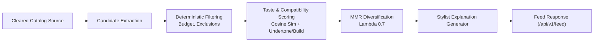

# RC-03 — Catalog Discovery & Feed Integration

## Discovery Pipeline Integration

The discovery subsystem connects the catalog database with user personalization:

## Seed Parity & Feed Verification
- Seed dataset provides 20 garments spanning `top`, `bottom`, and `one_piece` categories with valid try-on support flags and image assets.
- Seed script `scripts/catalog/seed_local.py` has been updated to generate valid HTTPS URLs on approved retailer hosts (`https://shop.example.com/products/{id}`).
- Feed retrieval was verified via `scripts/rc03_smoke.py`, successfully loading all 20 garments with computed `relevance_score`, `stylist_explanation`, and `tryon_supported: True`.
