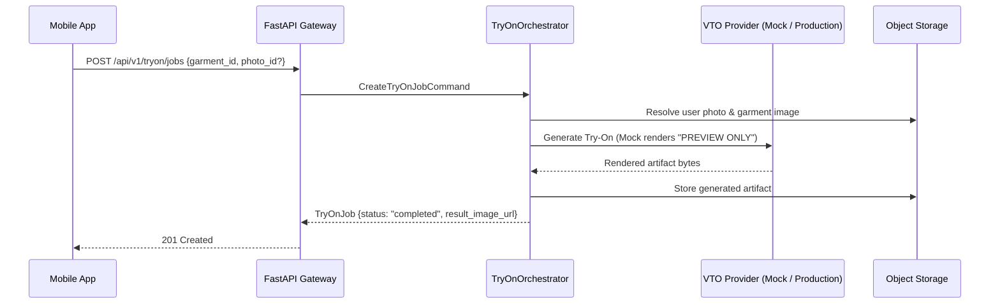

# RC-03 — Virtual Try-On Integration

## Orchestration Overview
The Virtual Try-On (VTO) subsystem provides virtual dressing room previews for try-on eligible garments.

## Integration Verification
- **API Contracts**: Mobile hook `useTryOn.ts` supports query caching via `queryKeys.tryOnJob(userId, jobId)` and `queryKeys.tryOnJobs(userId, limit)`.
- **Photo Resolution**: Backend automatically resolves the user's active accepted photo if `photo_id` is omitted in the request.
- **Watermarking**: Mock provider consistently burns the `"PREVIEW ONLY"` diagonal watermark onto all synthetic renders to prevent misleading photorealistic representations.
