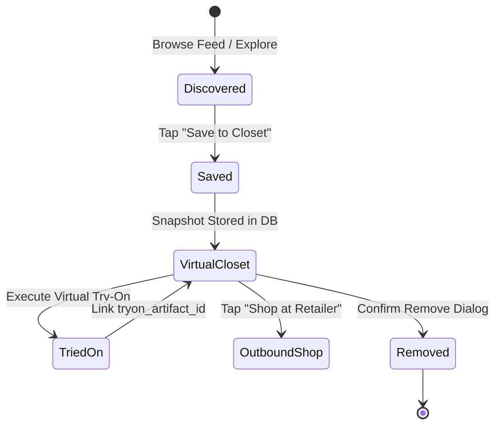

# RC-03 — Looks & Closet Integration

## Virtual Wardrobe Architecture (Rule I11)
The Closet / Wardrobe subsystem manages persistent user collections of saved garments and generated try-on looks.

## Immutable Snapshots
Per Rule I11, when a garment is saved to the user's wardrobe, the backend captures an immutable snapshot of:
- `snapshot_title`: Garment title at moment of save
- `snapshot_price_minor`: Price in cents/paise
- `snapshot_currency`: Three-letter ISO currency
- `snapshot_image_key`: Storage object key

This guarantees that future merchant updates or price changes do not corrupt the historical look or break client rendering.

## End-to-End Lifecycle Verification
The full wardrobe persistence lifecycle (save -> list -> delete) was verified against the running server in both `scripts/rc03_smoke.py` and `tests/integration/test_rc03_e2e_integration.py`.
