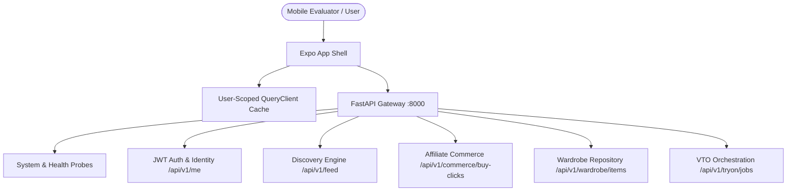

# RC-03 — End-to-End System Integration & Functional Workflow Recovery

## Overview
Recovery Cycle 03 (**RC-03**) transitions FashXStudio from a modular collection of backend services and redesigned mobile frontend screens into a unified, authenticated, end-to-end operational consumer application.

## Key Deliverables & Verified Modules
- **Identity & Cache Isolation (P0)**: Query client keys centralized in `queryKeys.ts` with explicit `userId` prefix. Automatic cache wiping (`queryClient.clear()`) and disk cache purge (`Image.clearDiskCache()`) on authentication state changes.
- **Safe Shopping Redirect Hardening (Rule I12)**: Implemented `isSafeRetailerRedirect` and `assertSafeRetailerRedirect` on mobile, preventing open redirect vulnerabilities and strictly requiring HTTPS protocol and host validation matching backend policies.
- **Consolidated Health Probes**: Live & ready probes at `/healthz/live` and `/healthz/ready` alongside `/api/v1/system/health/live` and `/api/v1/system/health/ready`.
- **E2E Smoke Verification Harness**: Python automation script at `scripts/rc03_smoke.py` verifying full end-to-end integration against running service.
- **OpenAPI 3.1 Snapshot**: Fully updated API contract specification exported to `artifacts/rc03/openapi.json`.

## Documentation Index
| Document | Description |
|---|---|
| [00_SCOPE.md](file:///docs/reengineering/RC03/00_SCOPE.md) | Cycle objective, boundaries, deliverables, and acceptance criteria |
| [01_SYSTEM_INTEGRATION_ARCHITECTURE.md](file:///docs/reengineering/RC03/01_SYSTEM_INTEGRATION_ARCHITECTURE.md) | Architecture topology and subsystem communication flows |
| [02_API_CONTRACT_MATRIX.md](file:///docs/reengineering/RC03/02_API_CONTRACT_MATRIX.md) | Mobile-to-backend endpoint specifications and data models |
| [03_IDENTITY_AND_CACHE.md](file:///docs/reengineering/RC03/03_IDENTITY_AND_CACHE.md) | Identity management, query keys, and cache invalidation policies |
| [04_CATALOG_DISCOVERY.md](file:///docs/reengineering/RC03/04_CATALOG_DISCOVERY.md) | Catalog retrieval, MMR ranker, and stylist explanation generation |
| [05_SHOPPING_INTEGRATION.md](file:///docs/reengineering/RC03/05_SHOPPING_INTEGRATION.md) | Affiliate attribution tracking and hardened external redirects |
| [06_VTO_INTEGRATION.md](file:///docs/reengineering/RC03/06_VTO_INTEGRATION.md) | Virtual try-on orchestration and job management |
| [07_LOOKS_AND_CLOSET.md](file:///docs/reengineering/RC03/07_LOOKS_AND_CLOSET.md) | Wardrobe persistence lifecycle (save, list, delete) |
| [08_FEEDBACK_PERSONALIZATION.md](file:///docs/reengineering/RC03/08_FEEDBACK_PERSONALIZATION.md) | Interaction signals, fallback embeddings, and feed adaptation |
| [09_RELIABILITY_OBSERVABILITY.md](file:///docs/reengineering/RC03/09_RELIABILITY_OBSERVABILITY.md) | Health probes, structured logging, and network resilience |
| [10_E2E_TEST_PLAN.md](file:///docs/reengineering/RC03/10_E2E_TEST_PLAN.md) | Test suites, smoke harness, and coverage metrics |
| [11_EXECUTION_LOG.md](file:///docs/reengineering/RC03/11_EXECUTION_LOG.md) | Chronological step-by-step implementation log |
| [12_RELEASE_ACCEPTANCE.md](file:///docs/reengineering/RC03/12_RELEASE_ACCEPTANCE.md) | Release acceptance scorecard and gate verification |
