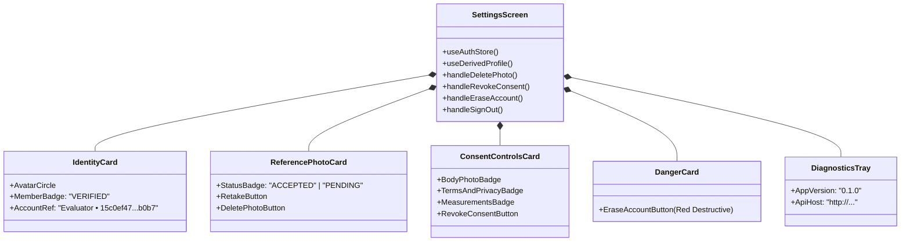

# RC-04 — Settings & Profile Screen Architecture

## Problem Definition (FX-009)
The baseline `mobile/app/settings/index.tsx` screen presented internal technical diagnostics directly to consumers, including raw 36-character UUID strings for `userId` and `photo.id`, alongside unstyled button rows.

## Architecture & Visual Hierarchy

The modernized screen implements five clean consumer cards followed by a collapsible developer diagnostics tray:

## Security & DPDP Safeguards
1. **Dual Confirmation**: Destructive actions (Photo deletion, Consent revocation, Account erasure) invoke `Alert.alert` (native) or `window.confirm` (web) with clear warning text before executing mutations.
2. **Immediate Token Eviction**: `handleEraseAccount` cascades through the backend deletion pipeline before invoking `signOut()` to wipe local tokens and caches.
3. **Query Key Invalidation**: Photo and consent updates trigger immediate React Query invalidation using `queryKeys.derivedProfile(userId)` and `queryKeys.me(userId)`.
