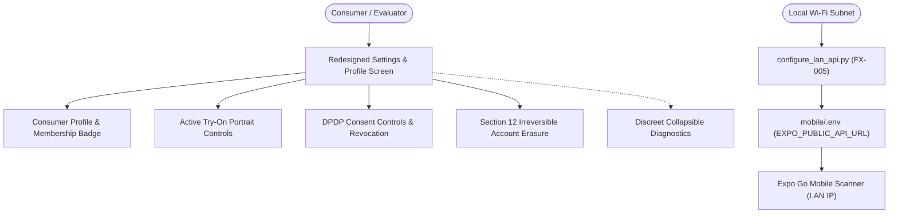

# RC-04 — Consumer Polish, Profile/Settings Experience & Release Readiness Verification

## Overview
Recovery Cycle 04 (**RC-04**) completes the consumer-facing polish of FashXStudio, resolving developer leakages (FX-009) and establishing physical hardware testing automation (FX-005).

## Key Accomplishments in RC-04
1. **Consumer Settings & Profile Redesign (FX-009)**:
   - Eliminated raw internal database UUIDs (`User ID: ...`, `Photo ID: ...`) from main consumer views.
   - Built with the unified FashX design system tokens (`colors`, `spacing`, `radius`) and reusable primitives (`Button`, `Badge`, `SectionHeader`, `AppText`).
   - Retained complete DPDP compliance with dedicated actions: portrait deletion, consent revocation, and account erasure.
   - Preserved all automated test hooks (`testID` selectors).
2. **Physical Device LAN Configuration Utility (FX-005)**:
   - Authored `scripts/mobile/configure_lan_api.py` to auto-resolve active host outbound network interfaces and test port 8000 reachability.
   - Supports `--apply` to update `mobile/.env` safely without manual IP entry.
3. **Continuous Verification**:
   - 21/21 Mobile Jest test suites passing (152 tests).
   - Mobile TypeScript `tsc --noEmit` passing with 0 errors.
   - Backend integration and smoke verification suites green.

## Documentation Index
| Document | Description |
|---|---|
| [00_SCOPE.md](file:///docs/reengineering/RC04/00_SCOPE.md) | Cycle objective, boundaries, and deliverables |
| [01_SETTINGS_PROFILE_ARCHITECTURE.md](file:///docs/reengineering/RC04/01_SETTINGS_PROFILE_ARCHITECTURE.md) | Architecture of the modernized Settings & Profile experience |
| [02_LAN_DEVICE_CONFIG.md](file:///docs/reengineering/RC04/02_LAN_DEVICE_CONFIG.md) | Physical device networking, QR code execution, and LAN automation |
| [03_TEST_VERIFICATION.md](file:///docs/reengineering/RC04/03_TEST_VERIFICATION.md) | Verification output from Jest, TypeScript, Pytest, and Smoke script |
| [04_RELEASE_SCORECARD.md](file:///docs/reengineering/RC04/04_RELEASE_SCORECARD.md) | Release acceptance scorecard and gate verification |
