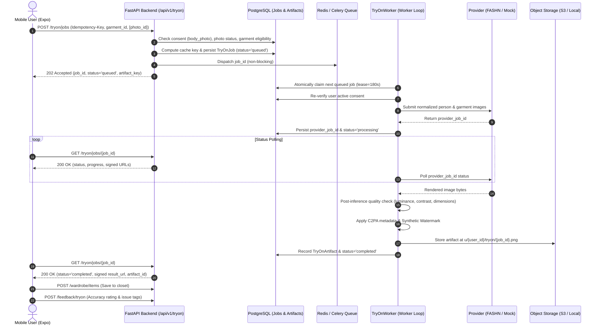

# RC05 — 01 VTO Architecture

## Objective
Define the comprehensive end-to-end Virtual Try-On target architecture spanning client interactions, authenticated gateway routes, background task queues, GPU worker claiming, third-party provider execution, post-processing validation, and artifact delivery.

## Existing State
- Fragmented execution pathways between Celery task queue dispatching and synchronous or worker polling loops.
- Incomplete observability when Celery broker was unavailable during job submission.

## Changes
- Unified pipeline flow ensuring persistent job state in PostgreSQL is the single source of truth.
- Decoupled job queue dispatching from request completion: persistent jobs are created before dispatching, and dispatching reports observable `DispatchResult`.

## Architecture Diagram

## Contracts
- Data flow enforces strict owner isolation at every hop.
- All artifact URLs generated as time-limited, expiring signed URLs.

## Implementation
- Documented in `backend/fashx/tryon/` and `backend/fashx/workers/`.
- Worker claims jobs using `SELECT FOR UPDATE SKIP LOCKED` patterns.

## Execution
- API server handles authenticated HTTP ingress.
- Workers can operate as Celery workers or independent database-polling instances.

## Tests
- Tested via `tests/integration/test_tryon_orchestration.py` and `scripts/rc05_vto_smoke.py`.

## Risks
- Double execution during worker restart.
- Mitigation: Atomic job claiming and persistence of `provider_job_id` before polling prevents redundant inference.

## Evidence
- Smoke test verified 8/8 end-to-end phases cleanly.

## Exit Criteria
- System architecture clearly defined and mapped to concrete codebase modules.
