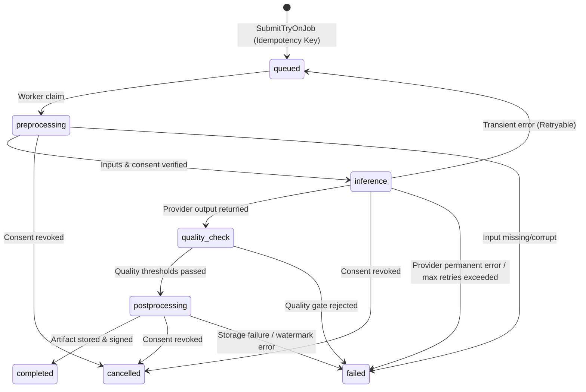

# RC05 — 04 Job Lifecycle

## Objective
Standardize and verify the state machine governing Virtual Try-On jobs from initial submission to final artifact delivery, idempotency key replays, deterministic caching, and cancellation.

## Existing State
- Job status values: `queued`, `preprocessing`, `inference`, `quality_check`, `postprocessing`, `completed`, `failed`, `cancelled`.
- Idempotency key checked per `(user_id, idempotency_key)`.
- Composite cache key calculated from input photo hash, garment ID/version, and model/pipeline versions.

## Changes
- Verified atomic lifecycle transitions in `SubmitTryOnJobUseCase` and `ProcessTryOnJobUseCase`.
- Ensured idempotency replays return the existing job record without creating duplicates.
- Ensured valid artifact cache hits instantly complete the request with cached result URLs.

## State Transition Diagram


## Contracts
- Submission Response:
  ```json
  {
    "job_id": "01dc22b0-ffdb-4e5c-a874-9b7547984b49",
    "status": "queued",
    "artifact_key": "8a1ceb796f716cd34064e626f93947332cef61e02b17a6ffa9967579020cb273",
    "is_cached": false,
    "result_url": null
  }
  ```

## Implementation
```python
# Check Idempotency Key
existing_job = await self.tryon_uow.jobs.get_by_user_and_idempotency(cmd.user_id, cmd.idempotency_key)
if existing_job:
    return SubmitTryOnJobResult(...)

# Check Cache Key
cached_artifact = await self.tryon_uow.artifacts.get_by_artifact_key(artifact_key)
if cached_artifact:
    return SubmitTryOnJobResult(job_id=cached_artifact.job_id, status="completed", is_cached=True, ...)
```

## Execution
```bash
pytest tests/unit/test_rc05_vto_scenarios.py -k "idempotent or cache" -v
```

## Tests
- `test_rc05_t05_idempotent_submission_returns_same_job` -> PASSED
- `test_rc05_t06_artifact_cache_hit_skips_inference` -> PASSED

## Risks
- Race condition on simultaneous submissions with same idempotency key.
- Mitigation: Database unique constraint on `(user_id, idempotency_key)` resolves concurrent conflicts.

## Evidence
- Smoke test Step 3 verified identical `job_id` returned on replay.

## Exit Criteria
- Job state transitions adhere strictly to state machine contracts.
