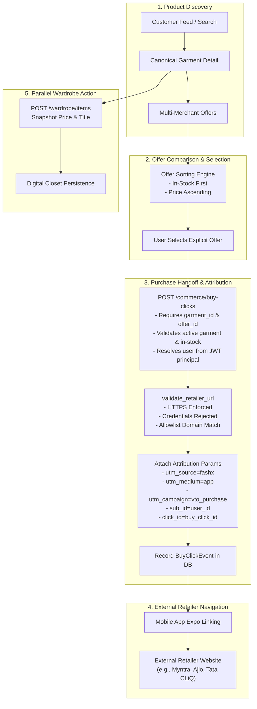

# RC-06 — Shopping & Purchase Handoff Architecture

## System Architecture

The FashXStudio shopping architecture connects catalog acquisition, product discovery, multi-merchant offer aggregation, digital wardrobe persistence, and secure outbound retailer redirection.

## Architectural Boundaries

1. **Catalog Domain (`fashx/catalog`)**:
   - Manages canonical fashion taxonomy, merchant products, and multi-merchant offers.
   - Provides customer-facing garment detail resolution with calculated best in-stock price and merchant name lookup.

2. **Commerce & Wardrobe Domain (`fashx/commerce_wardrobe`)**:
   - Manages buy-click attribution lifecycle and outbound link generation.
   - Houses user wardrobe items with immutable pricing and title snapshots at the moment of addition.

3. **Security & Identity Gateway (`fashx/security`)**:
   - Authenticates mobile client requests via JWT.
   - Extracts principal subject and guarantees caller identity cannot be spoofed across users.

4. **Mobile Client (`mobile/`)**:
   - React Native Expo application with React Query and TypeScript.
   - Provides interactive radio selection for retailer offers, displaying currency formatting and stock status.
