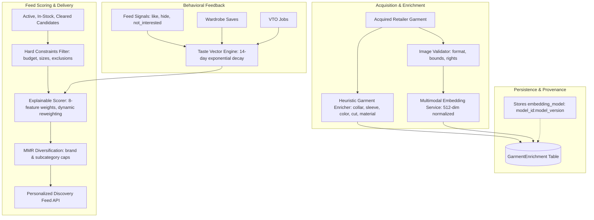

# RC07 — Real Catalog Enrichment, Visual Embeddings & Personalized Recommendations

## Executive Summary
Re-engineering Cycle 07 (RC07) establishes the catalog intelligence and personalization foundation of FashXStudio. Acquired fashion products are transformed into normalized, enriched, searchable garment records that power discovery, hard-constraint filtering, grounded explainable scoring, and taste-vector ranking without artificial filler vectors contaminating production ranking.

## Core Architecture

## Deliverables Register
| Identifier | Document | Topic |
|---|---|---|
| D07.00 | `00_SCOPE_AND_BASELINE.md` | Scope boundaries, repository commit baseline, branch topology |
| D07.01 | `01_ENRICHMENT_PIPELINE.md` | Deterministic attribute extraction, confidence summary, vector purity |
| D07.02 | `02_IMAGE_VALIDATION_SPEC.md` | Safe image validation, dimension/MIME bounds, SSRF guard, license check |
| D07.03 | `03_MULTIMODAL_EMBEDDING_PROVIDER.md` | `ImageTextEmbedder` protocol, version pinning (`2026.1`), environment restrictions |
| D07.04 | `04_EMBEDDING_SERVICE.md` | Input/output verification, batching, finite vector validation |
| D07.05 | `05_EMBEDDING_PERSISTENCE.md` | Versioned embedding persistence `<model_id>:<model_version>` |
| D07.06 | `06_TASTE_VECTOR_ENGINE.md` | `TasteSignal`, exponential decay (14-day half-life), signal weights |
| D07.07 | `07_FEEDBACK_COLLECTION_PIPELINE.md` | `/api/v1/feed/signals` endpoint, user ownership, cache invalidation |
| D07.08 | `08_SCORING_AND_RANKING_WEIGHTS.md` | 8-feature `RankingWeights`, dynamic reweighting on missing vectors |
| D07.09 | `09_HARD_CONSTRAINTS_POLICY.md` | Eligibility gates (cleared sources, display rights, active, in-stock, budget) |
| D07.10 | `10_GROUNDED_EXPLANATIONS.md` | Reason chips taxonomy, stylist explanation, no unverified fit claims |
| D07.11 | `11_MMR_DIVERSIFICATION.md` | Maximal Marginal Relevance, brand caps, subcategory caps |
| D07.12 | `12_CONTRACT_SPECIFICATIONS.md` | OpenAPI schema contract, response structures |
| D07.13 | `13_EVALUATION_METRICS_REPORT.md` | NDCG@K, Precision@K, Recall@K, constraint violation rate |
| D07.14 | `14_MOBILE_INTEGRATION_GUIDE.md` | Mobile React Query hooks, signal dispatch, optimistic updates |
| D07.15 | `15_TEST_VERIFICATION_MATRIX.md` | 36 unit, integration, contract, and evaluation test suites |
| D07.16 | `16_ACCEPTANCE_REPORT.md` | Sign-off criteria, AGENTS.md verification, environment audit |
