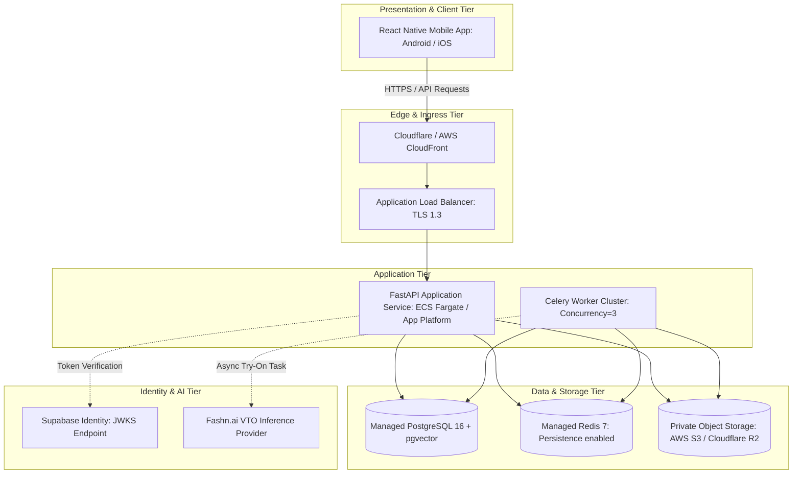

# RC08 — Deployment Architecture

## 1. Architectural Strategy: Modular Monolith with Asynchronous Workers
FashX preserves a clean, modular monolith backend architecture rather than decomposing into unneeded microservices. Heavy workloads (catalog scraping, ML enrichment, virtual try-on, and image deletion) run asynchronously via Celery worker processes backed by Redis.

## 2. 3-Tier Infrastructure Model

## 3. Network Isolation & Security Zones
- **Public Zone**: Application Load Balancer / Edge CDN terminating public TLS certificates.
- **Private App Zone**: FastAPI and Celery worker containers located in private subnets with NAT egress only.
- **Data Zone**: PostgreSQL and Redis instances bound exclusively to private VPC subnets with no public IPv4 addresses.
- **Object Storage Access**: Direct IAM role attachment or restricted S3 access credentials. All buckets enforce `BlockPublicAccess=true`.
