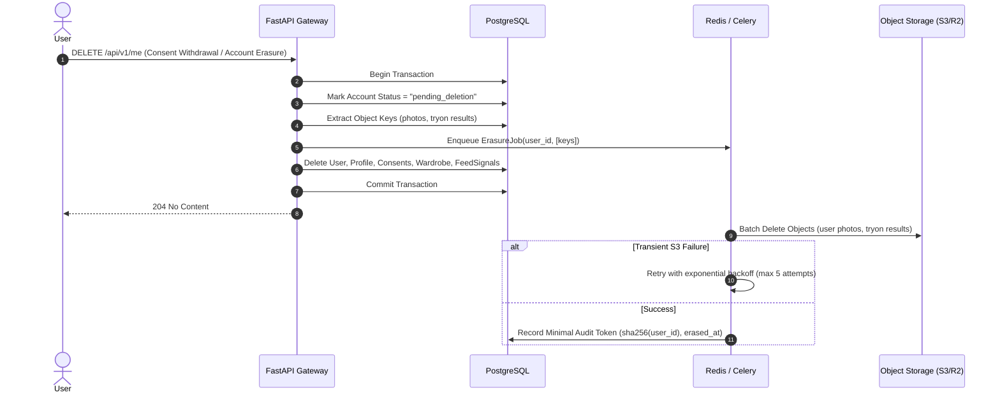

# RC08 — Object Storage, Privacy & Cascading Erasure

## 1. Storage Topology
- **Buckets**: Staging (`fashx-staging-media`) and Production (`fashx-prod-media`).
- **Access Level**: Private only (`BlockPublicAccess=true`, `SSE-S3` AES-256 server-side encryption enabled).
- **Access Pattern**: Pre-signed URLs with maximum TTL of 300 seconds (5 minutes) generated on demand for authenticated users.

## 2. Privacy Architecture: Cascading Erasure
Under the DPDP Act and GDPR, account deletion must purge all associated personal data from both database and object storage:

## 3. Strict Erasure Rules
1. **No Phantom Artifacts**: A successful database deletion must not be considered complete until all referenced S3 objects have been deleted.
2. **Retryable Ledger**: Any object-deletion failure is queued for immediate background retry. If unrecoverable after 5 attempts, an alert is triggered.
3. **Audit Token**: Only a cryptographic one-way hash (`sha256(user_id)`) with deletion timestamp is preserved for compliance proof. All personal identifiers are permanently eliminated.
